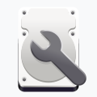
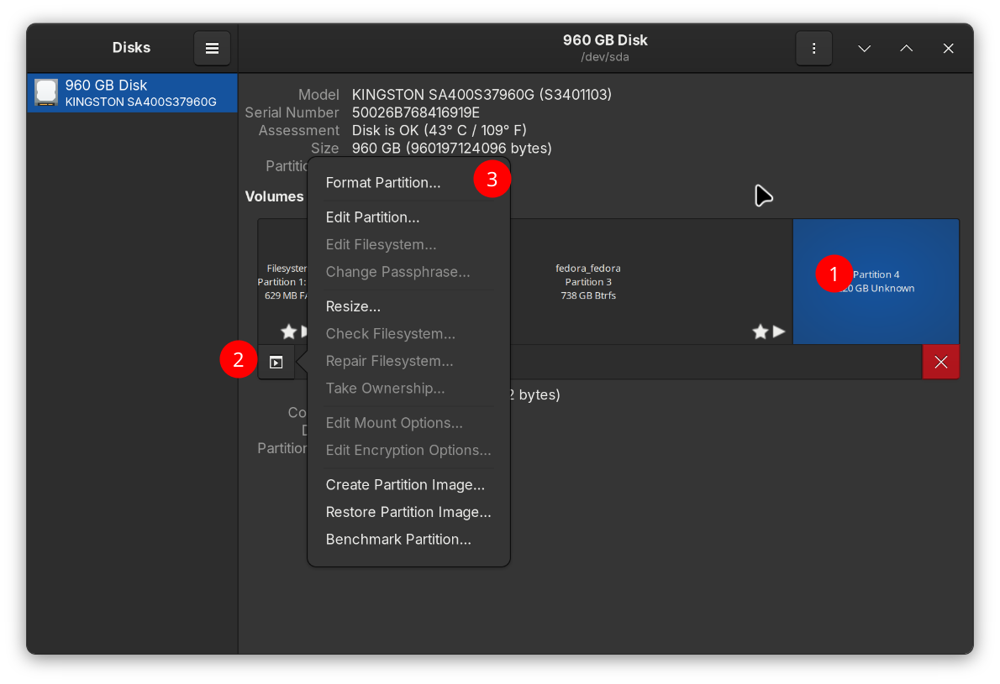
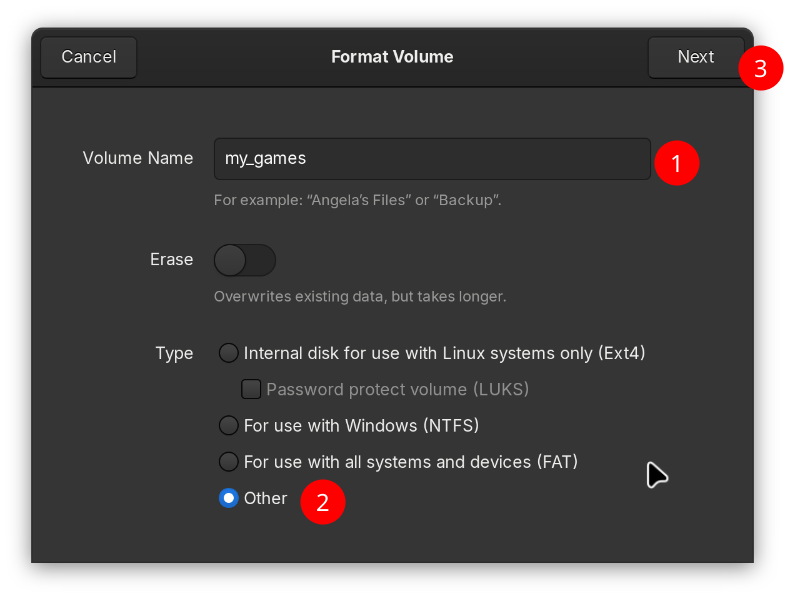
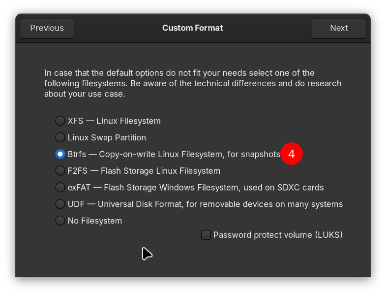
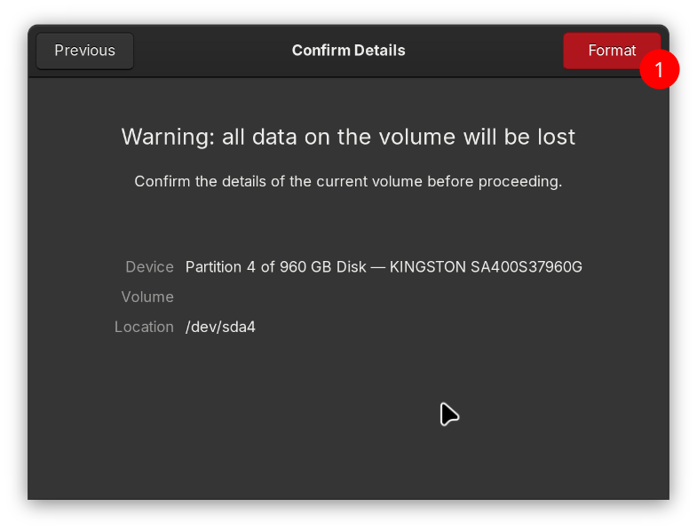
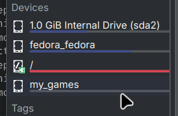
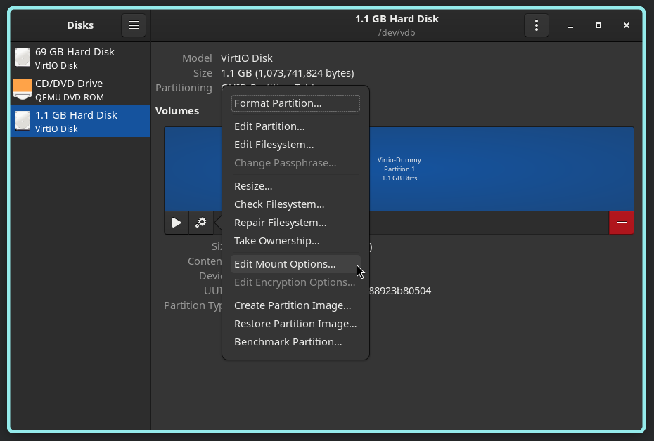
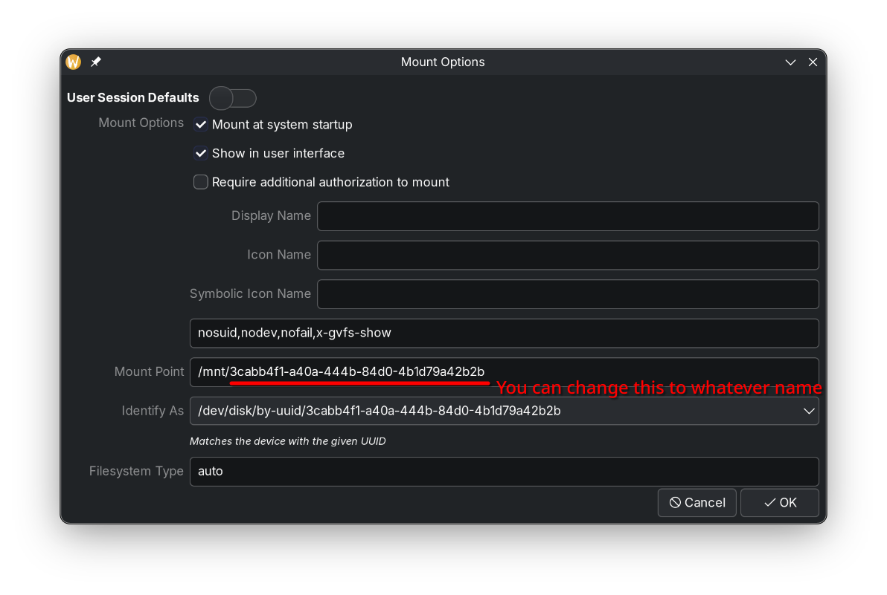
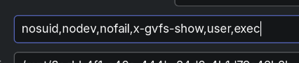

# Автоматичне монтування додаткових дисків

!!! info "Картки MicroSD монтуються автоматично, без жодних ручних дій."

## Відеопосібник { #video-guide }

https://youtu.be/fN9lvkkrExI

## Налаштування розділу з автоматичним монтуванням { #setup-an-auto-mounting-partition }

1. Відкрийте застосунок «Диски» (GNOME Disks), його піктограма має виглядати так. 

2. Очистіть розділ, який хочете використовувати, а потім на звільненому місці створіть новий.

   

3. Задайте назву диска й файлову систему.

!!! warning "Звіти про проблеми Bazzite приймає лише для файлових систем BTRFS/Ext4."

{data-gallery="step-2"}
{data-gallery="step-2"}
{data-gallery="step-2"}

Тепер перезавантажте систему, і розділ має змонтуватися автоматично. Він має з'явитися в `/run/media/system/PARTITION_NAME`.

{data-gallery="step-3"}

## Монтування вручну { #manual-mounting }

Якщо не працює як слід, додайте в кінець `,user,exec`.

## Вирішення проблем { #troubleshooting }

### Аварійний режим після монтування? { #emergency-mode-after-mounting }

У цьому відеопосібнику показано, як відновити систему після помилок із монтуванням.

https://www.youtube.com/watch?v=-2wca_0CpXY

### Диски не монтуються автоматично, хоча мають файлову систему BTRFS/ext4 (під час кожного завантаження запитується автентифікація для монтування) { #drives-will-not-auto-mount-despite-being-btrfsext4-requests-authentication-every-boot-to-mount }

1. Змонтуйте потрібні диски.

2. Відкрийте «Диски» (GNOME Disks) і перейдіть до потрібного диска.

3. Натисніть «Додаткові параметри розділу» → «Редагувати параметри монтування…» (Additional Partition Options > Edit Mount Options).

4. Переконайтеся, що «Типові параметри сеансу користувача» (User Session Defaults) ВИМКНЕНО, а «Монтувати під час запуску системи» (Mount at system startup) УВІМКНЕНО, і натисніть «Гаразд» (Ok).

5. Повторіть для інших дисків. Перевірити, що все спрацювало, можна у файлі fstab: там мають з'явитися відповідні UUID. `sudo cat /etc/fstab`.

