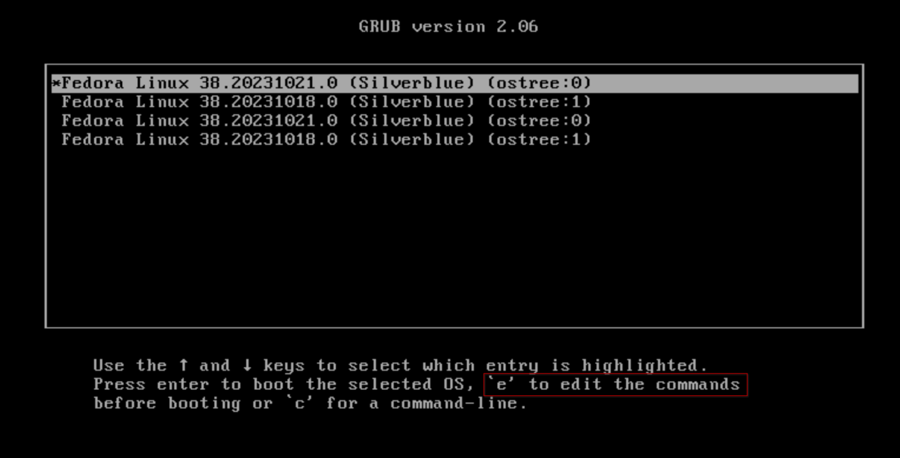
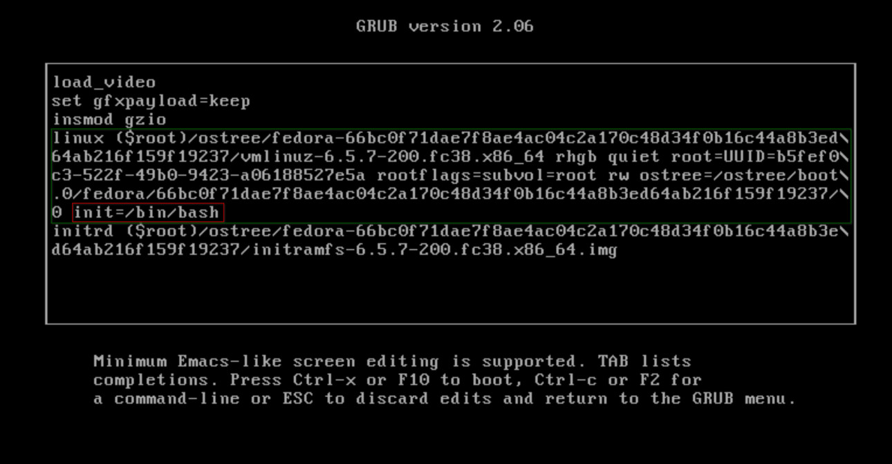
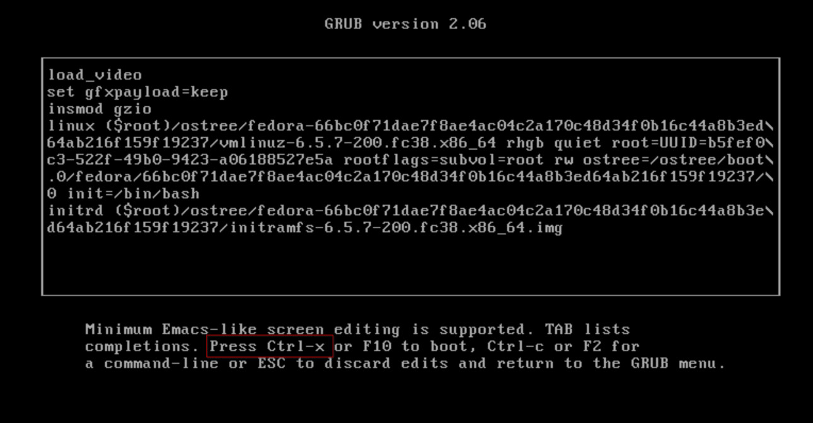
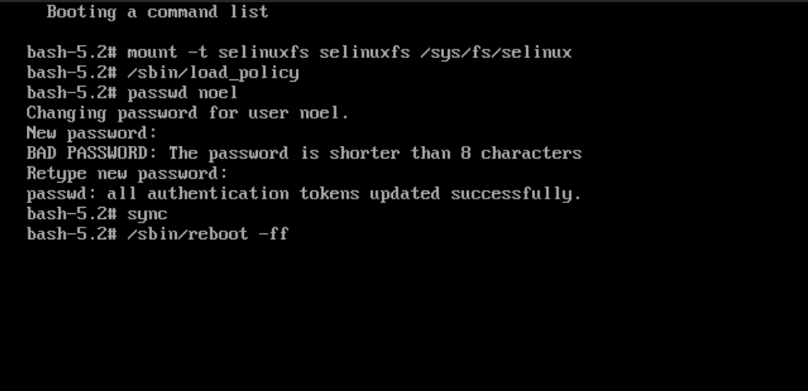
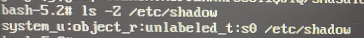

# Скидання забутого пароля користувача

!!! important

    Цей спосіб — лише для випадку, коли ви забули свій поточний пароль! Змінювати поточний пароль слід через робоче середовище.

!!! warning

    Дотримуйтеся цього посібника **на власний розсуд**, бо будь-яка з цих дій може зламати вашу систему.

1. Перезавантажте пристрій.
2. Натисніть <kbd>Esc</kbd> на клавіатурі, щоб потрапити в меню завантаження GRUB.
   a. Якщо натиснути <kbd>Esc</kbd> забагато разів, можна опинитися в командному рядку `grub>`.
   b. Щоб повернутися в меню завантаження, введіть `exit` і натисніть <kbd>Enter</kbd>
3. Відредагуйте останнє розгортання, натиснувши <kbd>E</kbd> на клавіатурі.

Відредагуйте команду GRUB і додайте `init=/bin/bash` у кінець рядка, що починається з `linux`.

Продовжте завантаження комбінацією <kbd>Ctrl</kbd>+<kbd>X</kbd>

Коли ви опинитеся в оболонці root:

1. Тимчасово змонтуйте SELinux

   `mount -t selinuxfs selinuxfs /sys/fs/selinux`

2. Завантажте політику SELinux

   `/sbin/load_policy`

3. Введіть новий пароль (наприклад, `passwd bazzite`)

   `passwd [INSERT USERNAME HERE]`

4. Синхронізуйте зміни

   `sync`

5. Перезавантажте систему

   `/sbin/reboot -ff`

Тепер ваш пароль користувача має бути скинуто.

> Дякуємо [Colin Walters](https://github.com/cgwalters) за [це рішення](https://github.com/ublue-os/main/issues/469#issuecomment-1885264886).

## Не працює? { #not-working }

Багато користувачів за старою звичкою забувають кроки, пов'язані з SELinux. Якщо ви виконали все, крім кроків із SELinux вище, файл `/etc/shadow` стане недоступним для читання будь-яким процесом.

Щоб перевірити, чи `/etc/shadow` має неправильну конфігурацію SELinux, виконайте таку команду:

`ls -Z /etc/shadow`

У себе ви теж маєте побачити _unlabeled_t_.
Тепер потрібно виправити мітку `/etc/shadow` командою нижче:

`restorecon -v /etc/shadow`

Потім знову перевірте результат командою `ls -Z /etc/shadow`. Має вийти:

`system_u:object_r:shadow_t:s0   /etc/shadow`

Тепер система готова, і можна перезавантажитися командою `/sbin/reboot -ff`.
