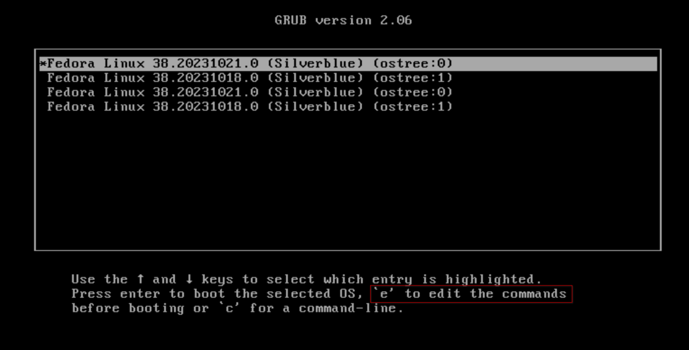
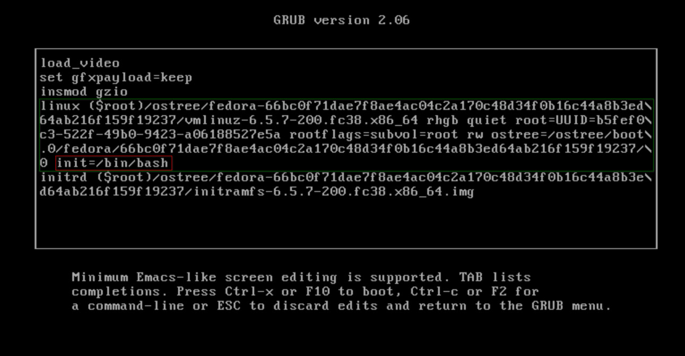
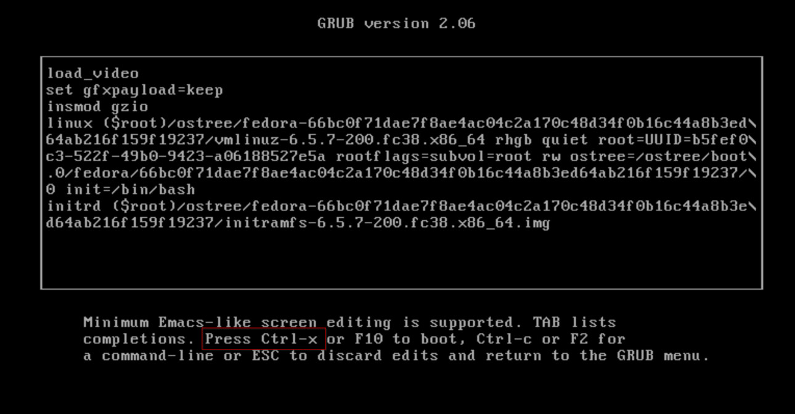

# Додавання користувача до групи

## Передмова { #foreword }

[Користувачі та групи](https://wiki.archlinux.org/title/Users_and_groups) в Linux використовуються для керування доступом, тобто щоб контролювати доступ до файлів, тек і периферійних пристроїв системи. Вони дуже важливі для роботи Linux.

!!! note "Наведені нижче інструкції мають підходити й для інших атомарних систем Fedora."

---

## Додавання користувача до групи в атомарних системах { #adding-user-to-a-group-on-atomic-systems }

[Bazzite побудовано на Fedora Atomic](../General/Fedora_Atomic_Comparison.md), а атомарні системи керують користувачами й групами трохи інакше. Тому `usermod` не можна використати напряму. Нижче описано кроки, як додати свого користувача до певної групи.

!!! warning "Дотримуйтеся цього посібника на власний розсуд, бо будь-яка з цих дій може **зламати** вашу систему."

!!! info "Якщо вам потрібно лише додати користувача до групи input для сумісності з контролерами, скористайтеся автоматичним скриптом у **Bazzite Portal → Tweak Systems → Add «input» to your user groups**."

---

#### 1. Створіть резервну копію груп користувачів { #1-backup-user-groups }

Перш ніж почати, створіть резервну копію груп користувачів у `/etc/group` такою командою:

```bash
sudo cp /etc/group /etc/group.bak
```

Ця команда скопіює поточний файл груп у файл `group.bak`. Крім того, згодом може стати в пригоді, якщо ви зараз переглянете й запишете поточний вміст `/etc/group`.

---

#### 2. Скопіюйте ідентифікатор групи з `/usr/` { #2-copy-group-id-from-usr }

Потім потрібно знайти й скопіювати ідентифікатор групи (Group ID). Для будь-якої відомої групи його можна знайти такою командою:

!!! tip "Не забудьте замінити `<your_group_name>` справжньою назвою групи."

```bash
grep "<your_group_name>" /usr/lib/group
```

!!! example

    Наприклад, запис для групи `dialout` — `dialout:x:18`:

    ```bash
    grep "dialout" /usr/lib/group
    ```
    повертає
    ```console
    dialout:x:18
    ```

!!! info "`/lib/` — це символічне посилання на `/usr/lib/`."

---

#### 3. Запишіть ідентифікатор групи у файл груп { #3-write-group-id-to-group-file }

Цей ідентифікатор групи потрібно записати в робочу копію `/etc/group`. Це можна зробити, вручну додавши запис у кінець файлу `/etc/group`, або однією командою:

!!! tip "Не забудьте замінити `<your_group_name>` справжньою назвою групи."

```bash
grep "<your_group_name>" /usr/lib/group | sudo tee -a /etc/group
```

!!! example
    
    ```bash
    grep "dialout" /usr/lib/group | sudo tee -a /etc/group
    ```

!!! warning "**НЕ** <small>_намагайтеся схитрувати й_</small> використовувати тут оператори bash `>` або `>>`. `>` перезаписує файл, а обидва працюють лише в оболонці root. Дотримуйтеся інструкцій."

---

#### 4. Скористайтеся `usermod` { #4-use-usermod }

Тепер можна додати користувача до групи такою командою:

!!! tip "Не забудьте замінити `<your_group_name>` справжньою назвою групи, а `<username>` — своїм іменем користувача."

```bash
sudo usermod -aG <your_group_name> <username>
```
!!! example
    
    ```bash
    sudo usermod -aG dialout bazzite
    ```

---

#### 5. Перевірте й перезавантажте { #5-check-and-reboot }

Переконайтеся, що ваш файл `/etc/group` містить щонайменше ці три записи:

!!! tip "Не забудьте замінити `<your_group_name>` справжньою назвою групи, `<username>` — своїм іменем користувача, а `group_ID` — справжнім ідентифікатором групи."

*   `wheel:x:10:<username>`
*   `<username>:x:1000`
*   `<your_group_name>:x:<group_ID>:<username>`

Якщо у вашому файлі `/etc/group` немає цих записів, **НЕ** перезавантажуйтеся й негайно зверніться по допомогу на [сервер Bazzite у Discord](../community.md#discord-no-discord-account) 

Інакше перезавантажте систему, щоб застосувати зміни.

---

## Систему зламано, і доступу до `sudo` немає { #i-broke-my-system-and-lost-sudo-access }

Якщо ви випадково видалили або перезаписали файл `/etc/group` чи зламали його якось інакше, ви, можливо, ще зможете потрапити в графічний сеанс (тобто на робочий стіл), але не матимете доступу до:

*   входу через менеджер входу
*   автентифікації Polkit
*   `sudo`

Записати щось у `/etc/group` не вийде, бо для доступу до `/etc/` потрібен `sudo`.

Щоб це виправити, файл потрібно відредагувати в оболонці root ще до того, як система дійде до графічного сеансу.

---

#### 1. Перезавантажтеся в редактор команд GRUB { #1-reboot-into-grub-command-editor }

Перезавантажте пристрій і натискайте <kbd>Esc</kbd> на клавіатурі, щоб потрапити в меню завантаження GRUB. Якщо ви не приховували меню GRUB, можна також натискати <kbd>↓</kbd>, доки не з'явиться меню GRUB.

!!! tip

    *   Якщо натиснути <kbd>Esc</kbd> забагато разів, можна опинитися в командному рядку `grub>`.
    *   Щоб повернутися в меню завантаження, введіть `exit` і натисніть <kbd>Enter</kbd>.



---

#### 2. Тимчасово змініть команду завантаження { #2-edit-the-boot-command-temporarily }

Відредагуйте останнє розгортання, натиснувши <kbd>E</kbd> на клавіатурі.



Додайте `init=/bin/bash` у кінець рядка, що починається з `linux`.



Продовжте завантаження комбінацією <kbd>Ctrl</kbd>+<kbd>X</kbd>.

---

#### 3. Виправте `/etc/group` { #3-fix-etcgroup }

Коли завантаження завершиться, система відкриє **оболонку root**.

Перегляньте й відредагуйте `/etc/group` у будь-якому текстовому редакторі командного рядка, наприклад `vim` або `nano`. Файл має містити таке:

!!! tip "Замініть `<username>` своїм іменем користувача. Якщо ви не задали його під час встановлення, за замовчуванням це `bazzite`."

*   `wheel:x:10:<username>`
*   `<username>:x:1000`

!!! example 
    
    ```console
    bash-5.2# cat /etc/group
    wheel:x:10:bazzite
    bazzite:x:1000
    ```
!!! note "Якщо ви раніше створили резервну копію файлу `/etc/group`, можна скопіювати її назад командою `cp /etc/group.bak /etc/group`"

---

#### 4. Додайте користувача до групи `wheel` { #4-add-user-to-wheel-group }

Після виправлення `/etc/group` потрібно тимчасово завантажити SELinux, щоб правильно додати користувача назад до групи. Виконайте такі команди:

Змонтуйте SELinux
```bash
mount -t selinuxfs selinuxfs /sys/fs/selinux
```
Завантажте політику SELinux
```bash
/sbin/load_policy
```
Додайте користувача до групи `wheel`
!!! tip "Замініть `<username>` своїм іменем користувача. Якщо ви не задали його під час встановлення, за замовчуванням це `bazzite`."
```bash
/sbin/usermod -aG wheel <username>
```
Синхронізуйте зміни
```bash
sync
```
Перезавантажте систему
```bash
/sbin/reboot -ff
```

---
