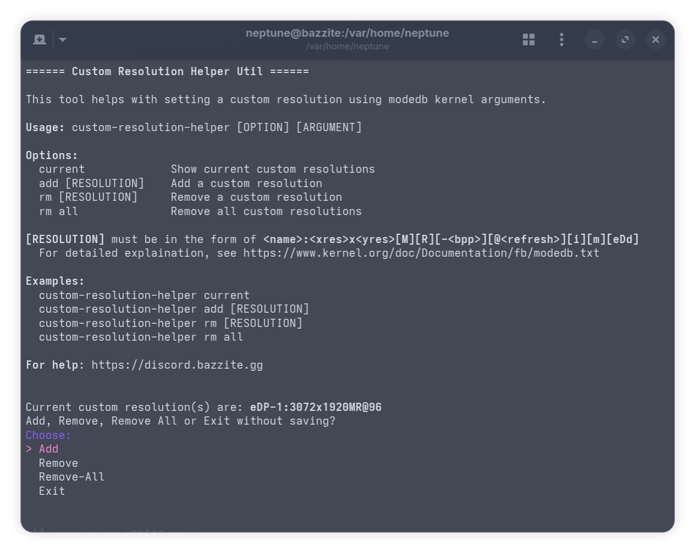
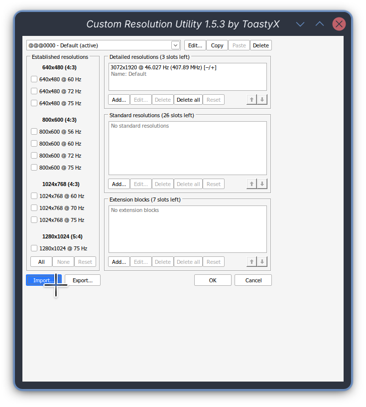

# Власні роздільності екрана

## Kscreen-Doctor (лише образи з KDE / режим робочого столу) { #kscreen-doctor-kde-imagesdesktop-mode-only }

!!! info "Починаючи з Plasma 6.6, `kscreen-doctor` дає змогу додати власний режим (modeline). Якщо у вас образ із KDE, спершу спробуйте цей спосіб!"

### Як додати власну роздільність за допомогою `kscreen-doctor` { #guide-to-add-a-custom-resolution-using-kscreen-doctor }

1. Виконайте в терміналі `kscreen-doctor -o`.
2. Знайдіть ID монітора, для якого хочете додати режим. Ви маєте побачити щось подібне:
    ```bash
    Output: 1 eDP-1 a17bb763-cbd3-4b3d-b7d3-7344112e71b7
        enabled
        connected
        priority 1
        Panel
        replication source:0
        Modes:  1:2880x1800@60.00!  2:2880x1800@120.00*  3:1600x1200@59.87...... # output omitted for brevity
    ```
    Наприклад, якщо ви хочете додати власний режим для **eDP-1**, ваш ID — **1**. Запишіть його.
3. Тепер можна скласти команду для додавання власного режиму в такому форматі:
    ```bash
    kscreen-doctor output.<ID>.addCustomMode.<Width>.<Height>.<Refresh>.<Blanking>
    ```
    Замініть кожен параметр потрібним значенням. Зверніть увагу, що частота оновлення вказується в **мГц** (мілігерцах), тож частоті **75 Гц** відповідає значення `75000` у `<refresh>`.

    `<Blanking>` — це `full` або `reduced`, залежно від того, чи хочете ви, щоб таймінги генерувалися за [CVT-RB](#interactive-mode-option-explaination)
    
    Наприклад, команда, яка додає власну роздільність 1920x1080@75 Гц для дисплея з ID 1 зі скороченим гасінням (reduced blanking), буде такою:
    ```bash
    kscreen-doctor output.1.addCustomMode.1920.1080.75000.reduced
    ```
    
## Custom-Resolution-Helper { #custom-resolution-helper }



!!! warning "Якщо виникне неочікувана проблема з дисплеєм, видаліть усі власні роздільності командою `crh rm all`. Будь-які зміни на своєму пристрої робіть обережно й **на власний ризик**."

!!! info "Власні роздільності, створені цим способом, починають діяти лише після перезавантаження."

Утиліта командного рядка, яка допомагає **створювати** власні роздільності й **керувати** ними у вашій системі Bazzite.

<hr>

### Використання `custom-resolution-helper` { #using-custom-resolution-helper }

Відкрийте термінал хост-системи й **введіть**:

```command
custom-resolution-helper
```

Також є **скорочення**, яке зручніше набирати на портативних пристроях або HTPC без клавіатури:

```command
crh
```

<hr>

### Як створити власну роздільність за допомогою `custom-resolution-helper` { #guide-for-creating-a-custom-resolution-using-custom-resolution-helper }

- Спосіб ModeDB: простіше налаштувати, але, найімовірніше, не працюватиме з HDMI.
- Спосіб EDID: налаштовувати складніше, тож використовуйте його, лише якщо ModeDB не працює.

!!! info "Починаючи з Plasma 6.6, `kscreen-doctor` дає змогу додати власний режим (modeline). Якщо у вас образ із KDE і власна роздільність потрібна лише в режимі робочого столу, спершу спробуйте [цей спосіб](#guide-to-add-a-custom-resolution-using-kscreen-doctor)!"

=== "Спосіб ModeDB"

    1. Виконайте `custom-resolution-helper` у терміналі.
    2. Переконайтеся, що у вас **немає** такої самої роздільності.
    3. Виберіть `Add`: переміщуйтеся стрілками й підтверджуйте клавішею Enter.
    4. Виберіть дисплей, для якого хочете створити власну роздільність. Він має бути в стані `connected`.
    5. Дотримуйтеся інструкцій на екрані в **інтерактивному режимі**.
    6. Коли ви виберете всі параметри, з'явиться запит на зміну конфігурації завантаження. Просто підтвердьте його своїм паролем.
    7. Коли команда завершиться, перезавантажте систему й виберіть нову роздільність у **Системних параметрах** (System Settings).

=== "Спосіб EDID"

    1. Виконайте `custom-resolution-helper` у терміналі.
    2. Виберіть `Dump-EDID` і свій дисплей.
    3. EDID буде збережено в `/tmp/crh/edid.bin`.
    4. Можна скопіювати його в домашню теку, теку «Завантаження» або на робочий стіл.
    5. Відредагувати його можна у знайомому CRU, але для цього потрібен лаунчер на основі Wine/Proton. Відкрити CRU можна через Lutris, Faugus Launcher або навіть Steam.
    6. Відкривши CRU, натисніть кнопку імпорту в лівому нижньому куті. Переконайтеся, що тип файлів встановлено на «all» і вибрано «Import complete EDID».
    
    7. Редагуйте EDID так само, як у Windows.
    8. Закінчивши, збережіть його у файл за допомогою кнопки експорту.
    9. Перемістіть відредагований файл EDID у `/tmp/crh/edited/` і виберіть його в `crh add-edid`. З'явиться запит на зміну конфігурації завантаження. Просто підтвердьте його своїм паролем.
    10. Коли команда завершиться, перезавантажте систему й виберіть нову роздільність у **Системних параметрах** (System Settings).
    

#### Пояснення параметрів інтерактивного режиму: { #interactive-mode-option-explaination }

- **VESA(TM) Coordinated Video Timings (CVT)**: виберіть, якщо потрібної частоти оновлення зараз немає в **Системних параметрах** (наприклад, ви розганяєте дисплей із 60 Гц до 75 Гц, але 75 Гц зараз немає серед доступних частот).

- **Reduced Blanking** (скорочене гасіння): потрібне, якщо ваш монітор має високу роздільність або частоту оновлення. Докладніше — у [калькуляторі таймінгів дисплея Тома Вербера](https://tomverbeure.github.io/video_timings_calculator).

- **Interlaced** (черезрядкова розгортка): встановлює черезрядковий режим. Корисно, наприклад, для плазмового телевізора або ЕПТ-дисплея.

- **Margins** (поля): корисно, коли краї зображення ховаються за межами екрана, ніби зображення збільшене. Здебільшого це краще налаштовувати в самому моніторі чи телевізорі.

<hr>

### Як створити власну роздільність для трансляції ігор через Sunshine { #guide-for-creating-a-custom-resolution-for-sunshine-game-streaming }

Припустімо, ви транслюєте з основного ПК (на Bazzite) на ноутбук:

- ваш настільний ПК має роздільність `1920x1080@144Hz`,
- а ноутбук — `2560x1600@120Hz`.

...і текст у трансляції розмитий через масштабування.

Можна додати на основний ПК (на Bazzite) віртуальний дисплей без «заглушки»!

=== "Віртуальний монітор KDE"

    !!! info "Цей спосіб працює лише з KWin, тобто на образах з KDE і в режимі робочого столу. Якщо він потрібен у GNOME або ігровому режимі, скористайтеся Custom Resolution Helper. Зверніть увагу: щоб змінити робоче середовище, треба перевстановити систему."

    1. Відкрийте [Bazzite Portal](../Installing_and_Managing_Software/Bazzite_Portal.md) → Install Applications → Sunshine → Setup Virtual Monitor → Add Virtual Monitor.
    2. Встановіть спосіб захоплення екрана (Screen Capture) на KWin ScreenCast.
    3. Перезапустіть Sunshine через вебінтерфейс.
    
    !!! notice "Якщо з'являється помилка Error -1 або Error 503, спробуйте [Bazzite Portal](../Installing_and_Managing_Software/Bazzite_Portal.md) → Install Applications → Sunshine → Setup Virtual Monitor → Fix Error 503. Докладніше про це — [тут](./sunshine.md#is-a-display-connected-and-turned-on-error-503)."
    !!! warning "Під час трансляції ваш поточний монітор буде вимкнено! Після трансляції обов'язково натисніть **Quit Session** у Moonlight."

=== "Custom Resolution Helper"

    - Просто створіть власну роздільність за інструкцією вище й виберіть параметр, щоб дисплей був **завжди ввімкнений**. Після перезавантаження можна натиснути <kbd>Super</kbd> + <kbd>P</kbd>, щоб перемкнути режим кількох моніторів у KDE. Потім переконайтеся, що в Sunshine вибрано правильний дисплей.

    - Також можна додати режим `2560x1600MR@120` до основного дисплея ПК. Через це монітор основного ПК може згаснути й показати повідомлення `unsupported mode`, і роздільність доведеться змінювати під час трансляції. Спробуйте цей спосіб, якщо не хочете мати справу з кількома моніторами.

    !!! warning "**Не** вимикайте основний дисплей, бо тоді може не залишитися жодного виходу на дисплей (а це може зламати й трансляцію). <br>Якщо чорний екран не зникає навіть після перезавантаження, можна перейти в `tty` комбінацією <kbd>ctrl</kbd> + <kbd>alt</kbd> + <kbd>F2</kbd> і відредагувати або видалити `~/.config/kwinoutputconfig.json` з командного рядка. Зверніть увагу, що так ви видалите налаштування моніторів. <br>Приклад команди: `mv ~/.config/kwinoutputconfig.json ~/.config/kwinoutputconfig.json.bak`"

<hr>

### Для досвідчених користувачів { #advanced-usage }

Цей інструмент додає **параметр ядра** `video=[RESOLUTION]`. Рядок `[RESOLUTION]` має формат `<name>:<xres>x<yres>[M][R][-<bpp>][@<refresh>][i][m][eDd]`, як описано в [документації ядра щодо modedb](https://www.kernel.org/doc/Documentation/fb/modedb.txt).

Якщо ви впевнені у своїх силах і знаєте, що робите, можна скористатися командою

```command
custom-resolution-helper add [RESOLUTION]
```

щоб додати роздільність із можливостями, яких немає в цьому скрипті, наприклад примусово ввімкнути цифровий вихід на порту DVI-I.

Також можна змінювати параметри ядра напряму командою

```command
rpm-ostree kargs --editor
```

Але пам'ятайте, що будь-які зміни на своєму пристрої завжди слід робити обережно й **на власний ризик**.
