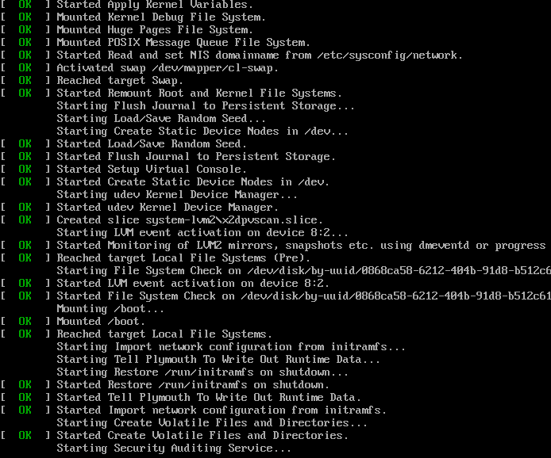

# Докладний журнал під час завантаження

## Призначення { #purpose }

Журнал ініціалізації показує, чи працюють служби, коли пристрій завантажується.



## 1 — Змініть тему initramfs, щоб увімкнути докладний журнал: { #1-change-initramfs-theme-to-enable-detailed-init-logs }

```command
sudo plymouth-set-default-theme details
```

Або створіть `/etc/plymouth/plymouthd.conf` вручну

## 2 — Згенеруйте initramfs заново й перезавантажтеся, щоб змінити тему { #2-regenerate-initramfs-reboot-to-enable-theme-change }

```command
sudo rpm-ostree initramfs --enable --reboot
```
