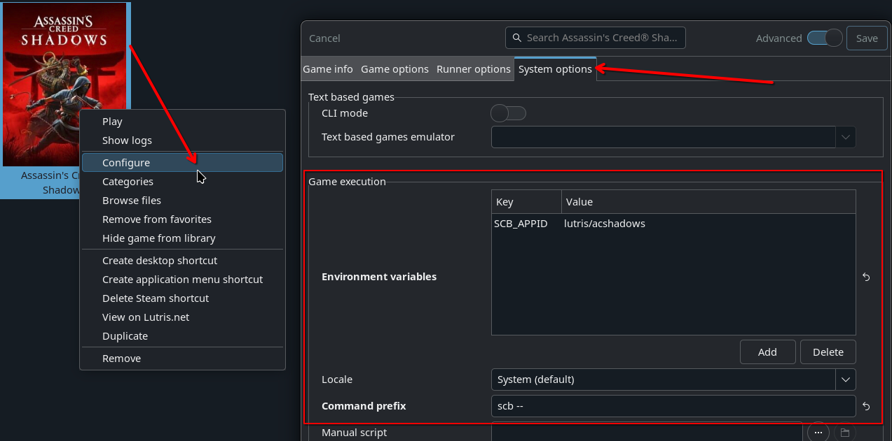

# ScopeBuddy

## Що це таке? { #what-is-it }

- Невеликий скрипт-посередник для gamescope, щоб не копіювати довгі параметри запуску для кожної гри.
- Дає змогу задавати змінні середовища та параметри запуску gamescope глобально, для окремої гри або залежно від того, у якому режимі працює ScopeBuddy чи Steam.
- Дає змогу автоматично запускати скрипти bash перед запуском гри (це побічний ефект того, як працюють файли конфігурації).
- Свої налаштування можна перенести на інший комп'ютер, просто скопіювавши `~/.config/scopebuddy` на новий пристрій.
- Також використовується як обхідне рішення, щоб оверлей Steam працював із вкладеним gamescope в режимі робочого столу.
- Виправляє введення Steam у вкладеному режимі на робочому столі.

## Як користуватися { #how-to-use-it }

**Як заміна `gamescope`, лише щоб виправити оверлей Steam**:

Якщо ви хочете лише виправити оверлей Steam (і введення Steam у деяких іграх), просто замініть `gamescope` у параметрах запуску гри на `scb` або `ScopeBuddy`.
Тобто замість

```bash
XDG_DEFAULT_LAYOUT=no gamescope -w 1920 -h 1080 -W 2560 -H 1440 -- %command% --launcher-skip
```

буде

```bash
XDG_DEFAULT_LAYOUT=no scb -w 1920 -h 1080 -W 2560 -H 1440 -- %command% --launcher-skip
```

Тепер оверлей Steam працюватиме, коли гра запускається через gamescope в режимі робочого столу! 🎉

### Використання в Lutris { #usage-in-lutris }

1. Відкрийте Lutris і клацніть правою кнопкою миші на грі, з якою хочете використовувати ScopeBuddy.
2. Натисніть `Configure`
3. Перейдіть на вкладку `System options` і прокрутіть униз до `Game execution`
4. Натисніть `Add` під `Environment variables` і вкажіть ключ `SCB_APPID` і значення `lutris/nameofgame`.
5. У поле `Command prefix` додайте `scb --`
6. Натисніть Save



!!! info "Змінна середовища `SCB_APPID` необов'язкова, але з нею можна користуватися файлами конфігурації для окремих ігор"

!!! note "Lutris не має українського перекладу, тому назви пунктів наведено англійською, як в інтерфейсі."

## Файли конфігурації { #configuration-files }

### Глобальні налаштування за замовчуванням { #setting-global-defaults }

Якщо ви хоч раз запустили гру з наведеними вище параметрами запуску, ScopeBuddy створить для вас приклад конфігурації за замовчуванням `~/.config/scopebuddy/scb.conf`

!!! info "Можливо, файлу не буде. У такому разі створіть порожній."

У цьому файлі можна задати змінні середовища й набір аргументів gamescope за замовчуванням.

```bash
export XDG_DEFAULT_LAYOUT=no
SCB_GAMESCOPE_ARGS="-f -w 2560 -h 1440 -W 2560 -H 1440 -r 180"
```

З таким `scb.conf` ScopeBuddy завжди встановлюватиме в gamescope норвезьку розкладку клавіатури й запускатиме gamescope з аргументами `-f -w 2560 -h 1440 -W 2560 -H 1440 -r 180`

Тепер параметри запуску ігор, які ми хочемо запускати в gamescope, можна скоротити до

```bash
scb -- %command% --launcher-skip
```

!!! note
    `--launcher-skip` — це лише приклад параметра запуску

### Автоматична роздільність, HDR і VRR { #auto-resolutionhdrvrr }

Якщо ви часто змінюєте роздільність або транслюєте ігри через Sunshine/Moonlight чи Steam Remote Play, параметри вашого дисплея можуть часто змінюватися.

На робочих столах KDE (рання підтримка GNOME [додана з обмеженнями](https://github.com/HikariKnight/ScopeBuddy?tab=readme-ov-file#gnome-support)) ScopeBuddy може автоматично підставляти ширину й висоту, стан HDR або стан VRR вашого основного дисплея.

Додайте такі змінні у файл конфігурації `~/.config/scopebuddy/scb.conf`:

```bash
SCB_AUTO_RES=1 # Overrides output height and width with current display
SCB_AUTO_HDR=1 # Adds --enable-hdr if the current display has HDR enabled
SCB_AUTO_VRR=1 # Adds --adaptive-sync if the current display has VRR enabled
```
Якщо у вас кілька дисплеїв (або «заглушка» для трансляції), ці значення визначатимуться за основним дисплеєм у KDE.

Якщо жорстко вказати певний дисплей у `SCB_GAMESCOPE_ARGS` за допомогою `--prefer-output {your-device-here}`, автоматичні значення визначатимуться за цим дисплеєм.

Повний приклад конфігурації зі змінними SCB_AUTO_* може виглядати так:

```bash
SCB_GAMESCOPE_ARGS="-f --mangoapp" # passes args for fullscreen + mangohud to gamescope
SCB_AUTO_RES=1
SCB_AUTO_HDR=1
SCB_AUTO_VRR=1
```

Якщо дисплей у KDE має роздільність 2560x1440 з увімкненими HDR і VRR, команда gamescope буде такою: `gamescope -f --mangoapp -W 2560 -H 1440 --hdr-enabled --adaptive-sync`.

Якщо згодом перемкнути дисплей у KDE на 1920x1080 з вимкненим HDR і ввімкненим VRR: `gamescope -f --mangoapp -W 1920 -H 1080 --adaptive-sync`.

І все це без жодної зміни в параметрах запуску Steam чи конфігурації ScopeBuddy!

### Додаткові файли конфігурації { #additional-config-files }
Якщо для якоїсь гри у вас інший набір налаштувань за замовчуванням, наприклад ви хочете масштабувати цю гру з 1080p до 1440p, можна створити окрему конфігурацію за замовчуванням і вказати ScopeBuddy використовувати її.
Для цього прикладу створіть файл `1080p.conf` у `~/.config/scopebuddy/` і додайте в нього налаштування для масштабування з 1080p.

```bash
export XDG_DEFAULT_LAYOUT=no
SCB_GAMESCOPE_ARGS="-f -w 1920 -h 1080 -W 2560 -H 1440 -r 180"
```

Щоб використати нову конфігурацію, задайте змінну середовища `SCB_CONF` у параметрах запуску гри в Steam

```bash
SCB_CONF=1080p.conf scb -- %command% --launcher-skip
```

Тепер ScopeBuddy використовуватиме `1080p.conf` замість `scb.conf` для параметрів і змінних середовища за замовчуванням.

!!! note

    Якщо передати ScopeBuddy будь-який аргумент, `SCB_GAMESCOPE_ARGS` буде повністю проігноровано!
    Тобто з параметром запуску `scb -f -- %command%` змінні середовища з `scb.conf` завантажаться, але `SCB_GAMESCOPE_ARGS` із жодного файлу конфігурації використано не буде.

### Окремі налаштування для однієї гри в Steam { #setting-specific-options-for-a-single-steam-game }

Для прикладу візьмемо Path of Exile 2. Ця гра підтримує HDR, тож ми хочемо додати до gamescope аргумент `--hdr-enabled`.

Спершу треба знайти AppID гри Path of Exile 2 у Steam. Для цього відкрийте **Властивості** гри в Steam і перейдіть у розділ **Оновлення** (Updates).
Унизу буде інформація про гру, вам потрібне значення **AppID**. Для Path of Exile 2 це `2694490`.

Тепер створіть `2694490.conf` у `~/.config/scopebuddy/AppID/` і додайте туди налаштування для Path of Exile 2.
Для прикладу встановимо `SteamDeck` у `0`: припустімо, що гра примусово вмикає налаштування, які мають сенс лише на Steam Deck, тож ми перестаємо повідомляти грі, що вона працює в клієнті Steam Deck.

```bash
export SteamDeck=0
SCB_GAMESCOPE_ARGS+=" --hdr-enabled"
```

Тепер, коли Steam запускає `scb -- %command%`, ScopeBuddy завантажить конфігурацію з `scb.conf`, а потім `AppID/2694490.conf`, щоб додати параметри поверх налаштувань за замовчуванням (або замінити попередні, якщо ті самі змінні експортуються чи змінюються повторно)

Зверніть увагу, що для `SCB_GAMESCOPE_ARGS` використано `+=`, а не `=`.

- `+=` означає «додати в кінець поточного значення змінної».
- `=` означає «замінити все значення змінної».

Так ми можемо повторно використати `SCB_GAMESCOPE_ARGS`, задану в `scb.conf`

!!! note

    AppID також можна задати вручну через `SCB_APPID="somecoolgame"`, щоб замінити автоматичне визначення AppID, яке поки підтримує лише Steam. Так можна вручну додати просту підтримку конфігурацій на зразок AppID для ігор в інших лаунчерах, як-от Lutris або Heroic. Наприклад, `SCB_APPID="heroic/somecoolgame"` використовуватиме файл конфігурації `AppID/heroic/somecoolgame.conf`.

## Поширені запитання (FAQ) { #frequently-asked-questions-faq }

### Чи є графічний застосунок для створення конфігурацій? { #is-there-a-graphical-application-for-making-configurations }

Так! Є застосунок на Flathub: [ScopeBuddy GUI](https://flathub.org/en/apps/io.github.rfrench3.scopebuddy-gui)

### Чи є простий спосіб дізнатися шлях до теки гри? { #is-there-an-easy-way-to-get-the-directory-path-to-the-game }

Так, у ScopeBuddy є вбудована функція для цього, їй потрібен awk.
Додайте це у свою конфігурацію AppID.

```bash
GAMEDIR=$(SCB_GetGameDir "$command")
```

Після цього `$GAMEDIR` міститиме шлях до теки з виконуваним файлом гри (binary/exe).

!!! note

    Ця функція створена для Steam. Можливо, вона працюватиме в Lutris і Heroic, але там її не перевіряли.

### Чи можна користуватися функціями ScopeBuddy без gamescope? { #can-i-use-scopebuddys-functions-without-using-gamescope }

Так, просто додайте змінну середовища `SCB_NOSCOPE=1` у параметри запуску так

```bash
SCB_NOSCOPE=1 scb -- %command% --launcher-skip
```

Тоді ScopeBuddy не запускатиме gamescope й ігноруватиме `SCB_GAMESCOPE_ARGS` в усіх конфігураціях.
Крім того, файлом конфігурації за замовчуванням стане `noscope.conf` замість `scb.conf`, якщо ви не додали в параметри запуску ще й змінну `SCB_CONF`.

!!! note

    `SCB_NOSCOPE=1` також можна експортувати в конфігурації AppID, якщо ви ніколи не хочете використовувати gamescope для якоїсь гри, але хочете використовувати для неї ScopeBuddy. Проте в такому разі `noscope.conf` буде проігноровано, бо він застосовується вже після завантаження `scb.conf`.

### Чи працює ScopeBuddy в ігровому режимі Steam? { #does-scopebuddy-work-inside-steam-gaming-mode }

Так!
Коли ScopeBuddy бачить, що Steam працює в ігровому режимі, він примусово встановлює `SCB_NOSCOPE=1` і `SCB_CONF=gamemode.conf`, тож можна задати власні параметри, які використовуватимуться лише в ігровому режимі Steam, зберігши налаштування для окремих ігор!

Тобто ScopeBuddy може сам використовувати вкладений gamescope в режимі робочого столу й не використовувати gamescope в ігровому режимі Steam.
Більше не треба вручну додавати й прибирати gamescope з параметрів запуску, коли перемикаєтеся між ігровим режимом і режимом робочого столу! 🎉

### Чи може ScopeBuddy керувати параметрами запуску моїх ігор? { #can-i-have-scopebuddy-handle-the-launch-options-for-my-games }

Звісно! Для цього потрібна конфігурація AppID, у яку для гри можна додати параметри запуску ось так.

```bash
command+=" --launcher-skip --some-other-parameter"
```

!!! note

    `+=` дуже важливий, бо параметри запуску ОБОВ'ЯЗКОВО треба додавати до %command%. Також обов'язково почніть із пробілу після першої лапки ", інакше гра не запуститься.

### Чи можна, щоб ScopeBuddy не застосовував свої виправлення й працював лише як менеджер gamescope? { #can-i-have-scopebuddy-not-apply-its-fixes-and-only-use-it-as-a-gamescope-manager }

Такі змінні середовища змінюють типову поведінку ScopeBuddy

- `SCB_APPENDMODE=1` у `scb.conf` дає змогу передавати аргументи ScopeBuddy, і вони додаватимуться **після** аргументів gamescope з усіх файлів конфігурації.
- `SCB_STEAMARGIGNORE=0` у `scb.conf` вимикає видалення аргументів `-e` або `--steam`, якщо їх передано gamescope. ScopeBuddy видаляє їх, бо зараз саме цей прапорець спричиняє збої gamescope.
- `SCB_NESTEDFIX=0` у `scb.conf` вимикає виправлення оверлею Steam і введення Steam, яке застосовує ScopeBuddy (і так, це одне й те саме виправлення)

!!! note

    Чому взагалі існують ці змінні середовища, пояснює [XKCD 1172](https://xkcd.com/1172/)

### Коли використовувати export для змінної середовища? { #when-should-i-use-export-for-an-environment-variable }

Це залежить від того, чи це внутрішня змінна ScopeBuddy, чи глобальна змінна для ігор.
Загальне правило: експортуйте кожну змінну середовища, крім таких випадків

- Назва починається з `SCB_`, бо всі такі змінні — внутрішні змінні ScopeBuddy
- Змінна називається `command`, бо це внутрішня змінна ScopeBuddy, яка містить усе з `%command%` у Steam (або все після `--`)

### Стривайте... Це все просто Bash!? { #wait-this-is-all-just-bash }

Кожен файл конфігурації ScopeBuddy — це повноцінний скрипт bash, який виконується перед запуском gamescope і гри. Тобто досвідчені користувачі можуть робити дуже креативні речі! Також можна встановити `SCB_DEBUG=1`, щоб фінальна команда записувалася в `~/.config/scopebuddy/scopebuddy.log`


!!! note

    Steam змінює середовище запуску: для деяких інструментів, як-от `curl`, у ньому будуть несумісні бібліотеки, а `wget` працюватиме нормально. Ретельно перевіряйте свої скрипти й під час тестування записуйте їхній вивід у журнал, додавши в кінці команди в конфігурації `2>&1 1>/tmp/myscript.log`, щоб легше було шукати помилки.

Ось кілька корисних змінних, доступних вам

- `$SCB_NOSCOPE` дорівнює 1, якщо ScopeBuddy запущено з `SCB_NOSCOPE=1`
- `$SCB_GAMEMODE` дорівнює 1, якщо ScopeBuddy запущено в ігровому режимі Steam (це також означає `SCB_NOSCOPE=1`)
- `$SCB_CONFIGDIR` дорівнює `$HOME/.config/scopebuddy`, тож у своїй конфігурації можна підключати інші конфігурації (тільки не створіть нескінченний цикл!)
- `$command` міститиме розгорнуту змінну %command% зі Steam і всі параметри запуску, які ви додали після неї.
- `GAMEDIR=$(SCB_GetGameDir "$command")` запише теку гри (з виконуваним файлом binary/exe) у `$GAMEDIR`, щоб ви могли використовувати її у своїх скриптах.

Дайте волю фантазії!
Але, будь ласка, з розумом!

### Приклад скрипту для оновлення ArcDPS у Guild Wars 2 { #script-example-for-an-arcdps-updater-for-guild-wars-2 }

Це приклад, який може надихнути вас на власні ідеї.

Створіть файл конфігурації для Guild Wars 2
AppID/1284210.conf

```bash
# Guild Wars 2
# Do not use gamescope for this title
SCB_NOSCOPE=1
# Use ArenaNet login instead of Steam
command+=" -provider Portal"

# Get the game directory from the expanded %command% variable from steam
GAMEDIR=$(SCB_GetGameDir "$command")

# Run the arcdps updater script before game starts
"$SCB_CONFIGDIR/scripts/dl-arcdps" "$GAMEDIR"
```

Потім створіть файл скрипту (не забудьте зробити його виконуваним)
scripts/dl-arcdps

```bash
#!/bin/bash
# Get the directory passed to the script
GW2_DIR=$1
# Get the latest md5sum for arcdps
NEWMD5SUM=$(wget -qO- https://www.deltaconnected.com/arcdps/x64/d3d11.dll.md5sum | awk '{print $1}')
# Get installed arcdps md5sum
MD5SUM=$(md5sum "$GW2_DIR/d3d11.dll" 2>/dev/null | awk '{print $1}')
# If they do not match, ask to update arcdps
if [ "$MD5SUM" != "$NEWMD5SUM" ]; then
    if zenity --question --text="Update ArcDPS?\nNew MD5: $NEWMD5SUM\nOld MD5: $MD5SUM"; then
        # Use wget to download arcdps as curl does not work in the steam environment
        wget -O "$GW2_DIR/d3d11.dll" https://www.deltaconnected.com/arcdps/x64/d3d11.dll
    fi
fi
```

## Відеоогляд { #video-overview }

https://www.youtube.com/watch?v=p-uggidEjIM
