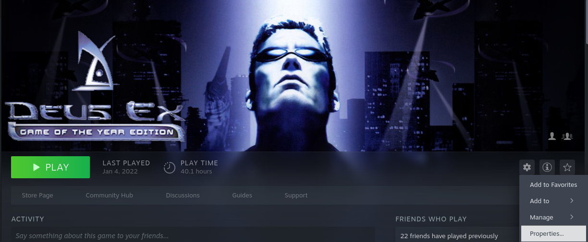
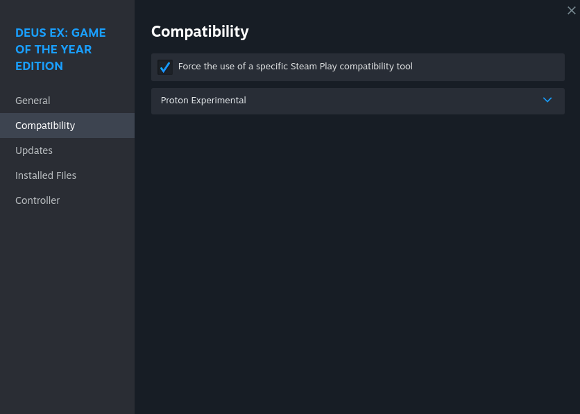
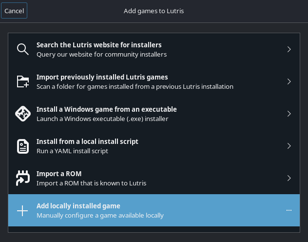
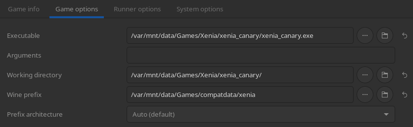
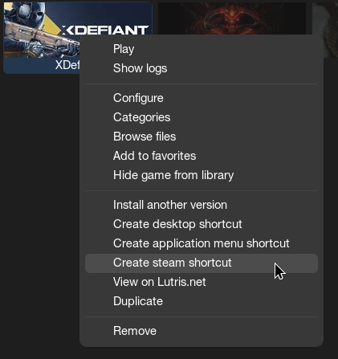

# Ігрові лаунчери

## Налаштування Steam { #steam-setup }

Steam може запускати ігри для Windows у Linux. Для сумісності з Windows він використовує багато проєктів і патчів, зібраних у вбудований у Steam компонент під назвою [**Proton**](https://github.com/ValveSoftware/Proton). Докладніше можна прочитати [тут](./gaming-intro.md#steam-games).

### Примусове використання певної версії Proton / інструмента Steam Play { #forcing-a-specific-proton-steam-play-tool-version }

#### Важливі примітки { #important-notes }

- В образах для ПК за замовчуванням використовуватиметься версія гри для Linux, якщо вона є.
- В образах для портативних пристроїв і HTPC засіб запуску за замовчуванням вибирає Valve.
- Деякі ігри краще працюють з певною версією Proton, ніж у версії для Linux, хоча іноді буває й навпаки.

Щоб запустити гру з певною версією, відкрийте **Властивості** гри (Properties) → **Сумісність** (Compatibility), увімкніть **Примусово використовувати певний інструмент сумісності Steam Play** (Force the use of a specific Steam Play compatibility tool) і виберіть версію у спадному меню.

!!! warning "Використовуйте **лише** версію Counter-Strike 2 для Linux (тобто ВИМКНІТЬ **Примусово використовувати певний інструмент сумісності Steam Play**). За запуск CS2 через Proton можна отримати VAC-бан."

#### Приклад на зображеннях { #image-example }

## Ігри не зі Steam { #non-steam-games }

Щоб керувати префіксами Proton, версіями Proton і [параметрами запуску](./launch-options-env-variables.md) для ігор не зі Steam, можна використовувати Lutris (попередньо встановлений) або інші лаунчери, як-от [**Heroic Games Launcher**](https://flathub.org/en/apps/com.heroicgameslauncher.hgl) (для ігор з GOG/Epic/Amazon) і [**Faugus**](https://flathub.org/en/apps/io.github.Faugus.faugus-launcher).

!!! note "Інші лаунчери можна встановити через **Bazaar**."

!!! info "Також можна додати ігри не зі Steam до Steam, і тоді Steam сам керуватиме префіксами. Це зручно в ігровому режимі Steam."

### Налаштування { #setup }

Зазвичай досить вказати розташування гри за допомогою пункту **Add locally installed game** (додати локально встановлену гру). Лаунчер автоматично створить префікс Proton і керуватиме ним. Якщо ви хочете самі керувати розташуванням префікса, у вибраному лаунчері також є відповідні параметри.

!!! note "Lutris пропонує два способи грати в ігри для Windows на Bazzite: скрипти від спільноти або додавання виконуваного файлу вручну. **Наполегливо рекомендуємо спосіб вручну**, бо деякі скрипти погано підтримуються."

### Додавання гри для Windows до Lutris вручну { #manually-adding-a-windows-game-to-lutris }

!!! note

    Більшість інших лаунчерів налаштовуються так само, як описано нижче.

За замовчуванням Lutris використовує теку `~/Games` як [**теку префікса**](./Managing_and_modding_games.md#what-is-a-proton-or-wine-prefix) кожної гри.

### Додавання ярликів і пунктів меню { #adding-shortcuts-and-desktop-entries }

Щоб додати ярлик гри до меню застосунків або на робочий стіл, відкрийте вкладку редагування чи контекстне меню (правою кнопкою миші) у вибраному лаунчері та виберіть відповідні пункти.
