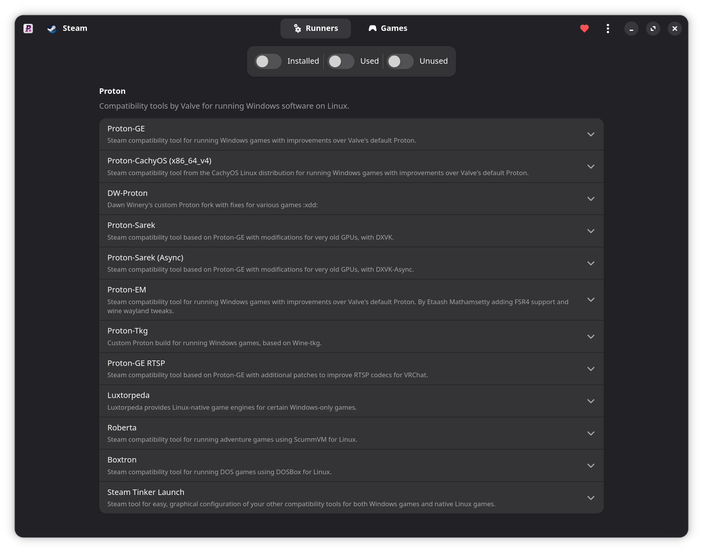
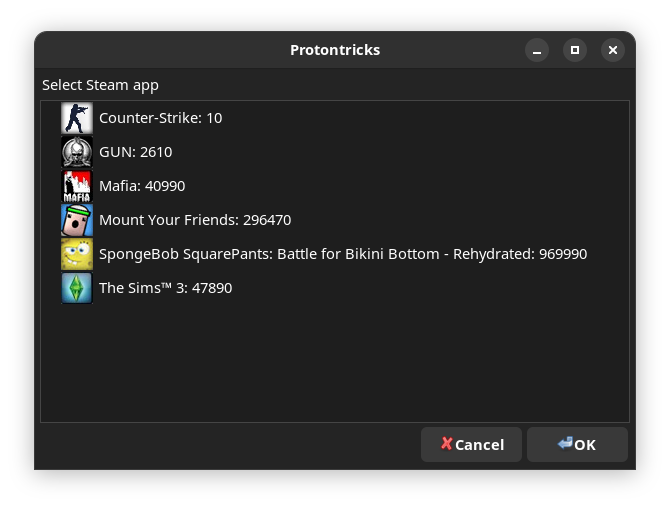
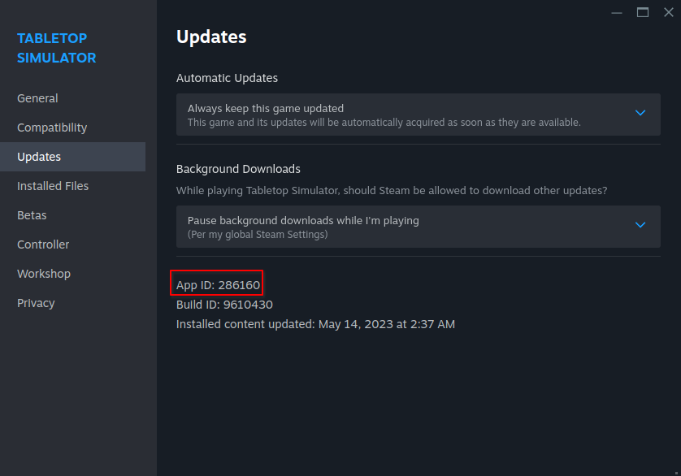

# Managing and Modding Games

## Compatibility Layers & Managing Windows Games



Windows games need to run through a **compatibility layer** (like Proton) on Bazzite. Install and update to the latest [GE-Proton](https://github.com/GloriousEggroll/proton-ge-custom), [Luxtorpeda](https://codeberg.org/luxtorpeda/luxtorpeda), and other tools using ProtonPlus.

## Protontricks



Some games require [Protontricks](https://github.com/Matoking/protontricks) (pre-installed) or [Winetricks](https://github.com/Winetricks/winetricks) (for non-Steam games, included with Lutris) to function properly by installing Windows DLLs into the prefix.

## Hidden Files in File Manager

!!! note

    Winecfg contains the option to show hidden files for Windows programs that require the filepicker.

Desktop Linux contains hidden files and directories that may include important files related to gaming.

**Show hidden files** by clicking the **hamburger menu** (_3 horizontal lines in the file manager_) and selecting "Show Hidden Files" to see every directory and file that is hidden by default.

These directories and files all start with a `.` before it


### What is a Proton (or Wine) Prefix?

It's the glue that holds everything together when you run a game through Proton and also is responsible for containing any of the files the game would drop outside of the installation folder.

!!! important

    This installation folder for **Steam games** is usually in: `~/.steam/root/steamapps/common/<game>`

Many PC games drop files in Windows folders like "My Documents" or "AppData" and both can be found in your prefix directory. This prefix directory may be useful for modding your games, backing up your saves, or configuration files.



For games on Steam, they are located in your `~/.steam/root/steamapps/compatdata/` folder, and then the **AppID number of the game**:

!!! tip
    
    You can open this folder by using ProtonPlus → **Games** tab and selecting **Open Prefix Folder** under each respective game.
    

- This ID by going into the game's properties on Steam in the games **Properties** → **Updates** → **App ID**
- Continue to `.../pfx/drive_c/` and wherever the game drops the file on Windows.

Non-Steam games can have the prefix folder anywhere you specify.  By default Lutris uses `~/Games` as the main folder.

#### Broken Proton Prefix?

!!! warning

    Deleting a Proton prefix **_can_** delete saves and configuration files!

=== "Using Protontricks"
    
    1. Select your game in Protontricks
    2. Click **Select the default wineprefix**
    3. Click **Delete ALL DATA AND APPLICATIONS INSIDE THIS PROTON PREFIX**
    
=== "Manual Removal"
    
    Open the prefix directory named with the corresponding App ID for the game and delete the data inside of it. 
    
    Be careful not to delete the root `.../compatdata` directory (or `~/Games`, or the custom directory that you set, for non-Steam games) which would remove the prefix data for all of the games!

## Modding

-   **Steam workshop** is the most straightforward method to obtain mods, though it may not necessarily be supported for every title or mod, and requires you to own the game on Steam.
-   Some mod managers have Linux ports like [r2modman](https://github.com/ebkr/r2modmanPlus).
-   Adding and replacing game files is still viable in both the game directory and prefix, but there may be some extra steps involved.
    -   Some mods require an [additional setting for WINE DLL override](#wine-dll-override)
-   You may also add some Windows-only mod managers and launchers as a non-Steam game on Steam, then use symlinks to link its prefix to the game's actual prefix.
    


### WINE DLL override

WINE DLL overrides can be set using any of the following methods:

=== "Protontricks (Steam games)"

    1. Select your game in Protontricks
    2. Click **Select the default wineprefix**
    3. Click **Run winecfg**
    4. Under the Libraries tab, add your DLL override
    
=== "Wine Configuration (Non-Steam games)"

    1. In Lutris, Faugus Launcher, or any other launcher, select your game and open **Wine Configuration**
    2. Under the Libraries tab, add your DLL override

=== "Environment Variable"
    
    Add your environment variable in Steam launch options, for example:
    **DirectInput8 DLL Override**: 
    ```bash
    WINEDLLOVERRIDES="dinput8=n,b" %command%
    ```
