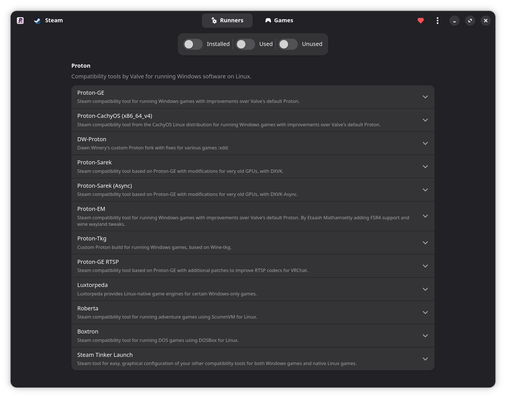
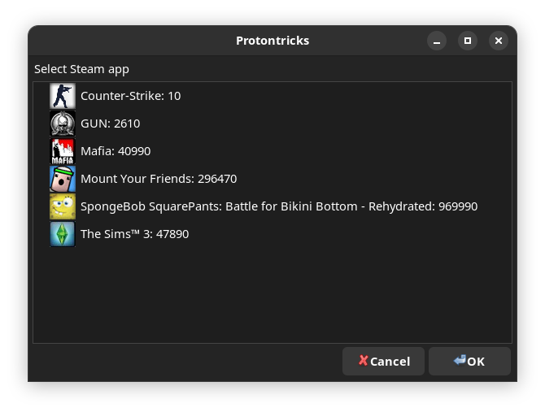
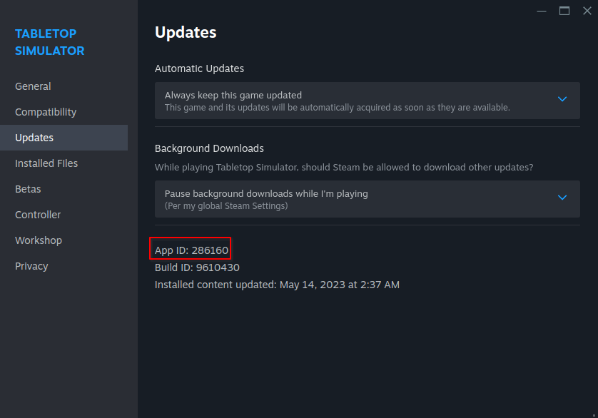

# Керування іграми та моди

## Шари сумісності та керування іграми для Windows { #compatibility-layers-managing-windows-games }



У Bazzite ігри для Windows запускаються через **шар сумісності** (наприклад, Proton). Встановлюйте й оновлюйте до найновіших версій [GE-Proton](https://github.com/GloriousEggroll/proton-ge-custom), [Luxtorpeda](https://codeberg.org/luxtorpeda/luxtorpeda) та інші інструменти за допомогою ProtonPlus.

## Protontricks { #protontricks }



Деяким іграм для правильної роботи потрібен [Protontricks](https://github.com/Matoking/protontricks) (попередньо встановлений) або [Winetricks](https://github.com/Winetricks/winetricks) (для ігор не зі Steam, входить до Lutris), щоб встановити в префікс DLL-бібліотеки Windows.

## Приховані файли у файловому менеджері { #hidden-files-in-file-manager }

!!! note

    У Winecfg є параметр, щоб показувати приховані файли в програмах для Windows, яким потрібне вікно вибору файлів.

У настільному Linux є приховані файли й теки, серед яких можуть бути важливі для ігор файли.

**Щоб показати приховані файли**, натисніть **меню-«гамбургер»** (_3 горизонтальні лінії у файловому менеджері_) і виберіть «Показати приховані файли» (Show Hidden Files). Тоді буде видно всі теки й файли, приховані за замовчуванням.

Назви цих тек і файлів починаються з крапки `.`


### Що таке префікс Proton (або Wine)? { #what-is-a-proton-or-wine-prefix }

Це «клей», який усе поєднує, коли ви запускаєте гру через Proton. Також у ньому зберігаються всі файли, які гра записує поза текою встановлення.

!!! important

    Тека встановлення **ігор зі Steam** зазвичай розташована тут: `~/.steam/root/steamapps/common/<game>`

Багато ігор для ПК записують файли в теки Windows на кшталт «Мої документи» (My Documents) або «AppData», і обидві можна знайти в теці префікса. Ця тека може знадобитися для модифікації ігор, резервного копіювання збережень або файлів конфігурації.



Для ігор у Steam вони розташовані в теці `~/.steam/root/steamapps/compatdata/`, а далі — в теці з **номером AppID гри**:

!!! tip
    
    Цю теку можна відкрити в ProtonPlus: вкладка **Ігри** (Games) → **Відкрити теку префікса** (Open Prefix Folder) під потрібною грою.
    

- Цей ID можна знайти у Steam у **Властивостях** гри (Properties) → **Оновлення** (Updates) → **App ID**
- Далі перейдіть у `.../pfx/drive_c/` і туди, куди гра записує файли у Windows.

Для ігор не зі Steam тека префікса може бути будь-де, де ви вкажете. За замовчуванням Lutris використовує як основну теку `~/Games`.

#### Префікс Proton пошкоджено? { #broken-proton-prefix }

!!! warning

    Видалення префікса Proton **_може_** видалити збереження і файли конфігурації!

=== "За допомогою Protontricks"
    
    1. Виберіть гру в Protontricks
    2. Натисніть **Вибрати wineprefix за замовчуванням** (Select the default wineprefix)
    3. Натисніть **Видалити УСІ ДАНІ ТА ПРОГРАМИ З ЦЬОГО WINEPREFIX** (Delete ALL DATA AND APPLICATIONS INSIDE THIS WINEPREFIX)
    
=== "Видалення вручну"
    
    Відкрийте теку префікса з App ID потрібної гри й видаліть її вміст.
    
    Будьте обережні й не видаліть кореневу теку `.../compatdata` (або `~/Games`, або власну теку, яку ви вказали для ігор не зі Steam), бо тоді буде видалено дані префіксів усіх ігор!

## Моди { #modding }

-   **Майстерня Steam** (Steam Workshop) — найпростіший спосіб отримати моди, хоча вона підтримується не для всіх ігор і модів, і гра має бути куплена у Steam.
-   Деякі менеджери модів мають версії для Linux, як-от [r2modman](https://github.com/ebkr/r2modmanPlus).
-   Додавати й замінювати файли гри як у теці гри, так і в префіксі досі можна, але це може потребувати додаткових кроків.
    -   Деяким модам потрібен [додатковий параметр перевизначення DLL у WINE](#wine-dll-override)
-   Також можна додати деякі менеджери модів і лаунчери, доступні лише для Windows, до Steam як гру не зі Steam, а потім за допомогою символічних посилань пов'язати їхній префікс із префіксом самої гри.
    


### Перевизначення DLL у WINE { #wine-dll-override }

Перевизначення DLL у WINE можна задати будь-яким із цих способів:

=== "Protontricks (ігри зі Steam)"

    1. Виберіть гру в Protontricks
    2. Натисніть **Вибрати wineprefix за замовчуванням** (Select the default wineprefix)
    3. Натисніть **Запустити winecfg** (Run winecfg)
    4. На вкладці Libraries додайте перевизначення DLL
    
=== "Конфігурація Wine (ігри не зі Steam)"

    1. У Lutris, Faugus Launcher або будь-якому іншому лаунчері виберіть гру й відкрийте **Wine Configuration**
    2. На вкладці Libraries додайте перевизначення DLL

=== "Змінна середовища"
    
    Додайте змінну середовища в параметри запуску Steam, наприклад:
    **Перевизначення DLL DirectInput8**: 
    ```bash
    WINEDLLOVERRIDES="dinput8=n,b" %command%
    ```
