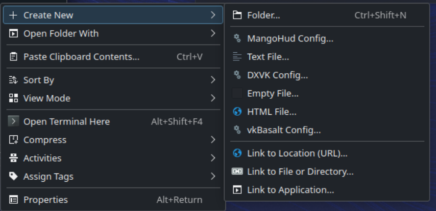
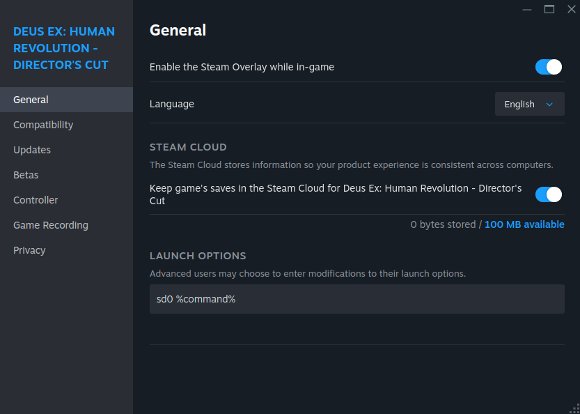

# Параметри запуску та змінні середовища

## Передмова { #preface }

Сьогодні ігри в Linux значно зрозуміліші, ніж кілька років тому. Проте в Bazzite досі є розширені параметри запуску й налаштування. У цьому посібнику показано приклади розширених ігрових налаштувань, які можна зробити в Bazzite.

## Шаблони конфігурації для DXVK, MangoHud і vkBasalt { #configuration-templates-for-dxvk-mangohud-vkbasalt }



Для деяких попередньо встановлених інструментів у Bazzite є шаблони: їх можна відкрити, клацнувши правою кнопкою миші будь-де у файловому менеджері. Також є застосунки на кшталт [**Mango Juice**](https://flathub.org/en/apps/io.github.radiolamp.mangojuice), які дають змогу налаштовувати MangoHud у графічному інтерфейсі.

## Параметри запуску Steam і скорочення { #steam-launch-options-and-shortcuts }

Параметри запуску Steam дають змогу передавати іграм під час запуску змінні середовища, аргументи й команди. Bazzite містить кілька скорочень і покращень, які спрощують використання поширених параметрів запуску, особливо на портативних пристроях.

### Поширені шаблони параметрів запуску { #common-launch-option-patterns }

Більшість параметрів запуску Steam мають такий вигляд: `ENVIRONMENT_VARIABLES command_or_script %command% --arguments`

- `%command%` позначає виконуваний файл гри й обов'язковий, окрім таких випадків:
  - параметри запуску порожні або містять лише аргументи;
  - команда чи скрипт запускає гру самостійно, без Steam.
- Змінні середовища мають стояти перед `%command%`, окрім таких випадків, коли їх можна пропустити:
  - ви вже задали глобальну змінну середовища в `~/.config/environment.d` або в іншому місці;
  - ви задали глобальну змінну середовища в Bazzite Portal (те саме, що й вище);
  - команда чи скрипт перед `%command%` уже задає її за вас.
- Додаткові аргументи (для самого виконуваного файлу гри) можна вказати після `%command%`

**Приклади:**
```bash
PROTON_LOG=1 %command%                    # Enable Proton logging
SteamDeck=0 %command%                     # Disable Steam Deck mode
PROTON_ENABLE_NGX_UPDATER=1 %command%     # Enable DLSS updates
%command% --in-process-gpu                # Fixes a blank screen in some Unity games
scb %command%                             # Use ScopeBuddy (a Gamescope helper) to launch the game
```

### Параметри запуску Proton { #proton-launch-options }
<small>_Щось знайоме? Цей розділ скопійовано з [вікі Proton-CachyOS](https://wiki.cachyos.org/configuration/gaming/#environment-variables)_</small>

У власних версіях Proton параметри конфігурації можуть змінюватися від версії до версії. Актуальну інформацію про них дивіться в документації відповідної версії.

- Proton-CachyOS
  - [Readme](https://github.com/CachyOS/proton-cachyos/blob/cachyos_main/README.md#proton-cachyos-config-options)
  - [Перелік змін](https://github.com/CachyOS/proton-cachyos/blob/cachyos_main/CHANGELOG.md)
- Proton-EM
  - [Readme](https://github.com/Etaash-mathamsetty/Proton/blob/em-11-hdr/README.md)
  - [EM-ADDITIONS](https://github.com/Etaash-mathamsetty/Proton/blob/em-10-hdrtest/docs/EM-ADDITIONS.md)
  - [FSR4](https://github.com/Etaash-mathamsetty/Proton/blob/em-10-hdrtest/docs/FSR4.md)
  - [Wine-Wayland](https://github.com/Etaash-mathamsetty/Proton/blob/em-10-hdrtest/docs/CHANGES.md)

### Скорочення параметрів запуску в Bazzite { #bazzites-launch-option-shortcuts }

Bazzite містить кілька скорочень, які спрощують поширені параметри запуску:

#### Керування режимом Steam Deck { #for-steam-deck-mode-control }

- **`sd0 %command%`** — скорочення для `SteamDeck=0 %command%`
  - Вимикає специфічні для Steam Deck функції, які можуть конфліктувати з вашим налаштуванням
  - Приклад: Expedition 33 приховує більшість графічних налаштувань, якщо не задати `SteamDeck=0`, і примусово вмикає налаштування, нижчі за найнижчі.

#### Для користувачів NVIDIA (dlss-swapper) { #for-nvidia-users-dlss-swapper }

- **`dlss-swapper %command%`** — вмикає найновіші пресети DLSS з оновлювачем NGX
  - Замінює: `PROTON_ENABLE_NGX_UPDATER=1 DXVK_NVAPI_DRS_SETTINGS=NGX_DLSS_SR_OVERRIDE=on,NGX_DLSS_RR_OVERRIDE=on,NGX_DLSS_FG_OVERRIDE=on,NGX_DLSS_SR_OVERRIDE_RENDER_PRESET_SELECTION=render_preset_latest,NGX_DLSS_RR_OVERRIDE_RENDER_PRESET_SELECTION=render_preset_latest %command%`
- **`dlss-swapper-dll %command%`** — те саме, але без оновлювача NGX

!!! info

    Для DLSS бувають причини (наприклад, продуктивність чи якість) залишитися на старішій моделі, тож можливість вручну вказати версію моделі досі актуальна. Тому цей спосіб і надалі буде доступний на додачу до новішого `PROTON_DLSS_UPGRADE=1`, який можна ввімкнути в Bazzite Portal.

#### Де задати параметри запуску { #where-to-set-launch-options }

1. Клацніть гру правою кнопкою миші в бібліотеці Steam
2. Виберіть **Властивості** (Properties)
3. На вкладці «Загальне» (General) знайдіть поле **Параметри запуску** (Launch Options)
4. Введіть параметри запуску



## Проблеми й непослідовність обмеження частоти кадрів { #frame-rate-limiting-issues-and-inconsistency }

У Gamescope частоту кадрів можна обмежити кількома способами. На жаль, не всі способи працюють у кожному середовищі, грі чи конфігурації обладнання.

Можна помітити чимало непослідовностей, особливо коли обмеження частоти кадрів застосовують у режимі робочого столу.

У таблицях нижче показано, як поводяться різні способи обмеження частоти кадрів.

=== "Ігровий режим Steam (сеанс Steam Gaming Mode)"

    | Спосіб | Як налаштувати | Потрібна V-Sync у грі? | Змінювати ліміт без перезапуску гри? | Затримка | Рекомендовано | Примітки |
    |---|---|---|---|---|---|---|
    | **Обмежувач FPS у Gamescope** | **Меню швидкого доступу → Продуктивність → Обмеження частоти кадрів** (Quick Access Menu → Performance → Framerate Limit) | Ні | Так | Зазвичай гірша | **Рекомендовано** | Коли обмеження ввімкнено, автоматично вмикає v-sync на рівні драйвера. Додається затримка. |
    | **MangoAPP (вбудований)** | - | - | - | - | – | Не застосовується — взагалі не працює. |
    | **MangoHUD (зовнішній)** | **Параметри запуску:** `MANGOHUD=1 %command%` | Ні | Так | Зазвичай гірша | – | Задайте `fps_limit=0,{fps}...` (`0` = без обмеження) у `MangoHud.conf` або скористайтеся [MangoJuice](https://flathub.org/en/apps/io.github.radiolamp.mangojuice). |
    | **Обмежувач кадрів DXVK/VKD3D** | **DXVK (D3D8/9/10/11):** `DXVK_FRAME_RATE={fps} %command%`<br>**VKD3D (D3D12):** `VKD3D_FRAME_RATE={fps} %command%` | Ні | Ні | Зазвичай краща | – | Діє лише для ігор через DXVK/VKD3D (не впливає на нативні ігри OpenGL чи Vulkan). |

=== "Режим робочого столу (сеанс GNOME / KDE Plasma)"

    | Спосіб | Як налаштувати | Потрібна V-Sync у грі? | Змінювати ліміт без перезапуску гри? | Затримка | Рекомендовано | Примітки |
    |---|---|---|---|---|---|---|
    | **Обмежувач FPS у Gamescope** | **Параметри запуску**: `gamescope -r {fps} -- %command%` / `--framerate-limit {fps}` | Так | Так* | Зазвичай гірша | – | *Щоб змінити обмеження на льоту без перезапуску, використовуйте `gamescopectl debug_set_fps_limit {fps}`. |
    | **MangoAPP (вбудований)** | **Параметри запуску:** `gamescope --mangoapp -- %command%` | Так | Так | Зазвичай гірша | – | Обмеження іноді не діє. Налаштовується так само, як MangoHUD. |
    | **MangoHUD (зовнішній)** | **Параметри запуску:** `MANGOHUD=1 %command%` | Ні | Так | Зазвичай краща | **Рекомендовано** | Обмеження майже завжди діє. Задайте `fps_limit=0,{fps}...` (`0` = без обмеження) у `MangoHud.conf` або скористайтеся [MangoJuice](https://flathub.org/en/apps/io.github.radiolamp.mangojuice). |
    | **Обмежувач кадрів DXVK/VKD3D** | **DXVK (D3D8/9/10/11):** `DXVK_FRAME_RATE={fps} %command%`<br>**VKD3D (D3D12):** `VKD3D_FRAME_RATE={fps} %command%` | Ні | Ні | Зазвичай краща | – |  Діє лише для ігор через DXVK/VKD3D (не впливає на нативні ігри OpenGL чи Vulkan). |

Якщо обмежувач частоти кадрів не працює, часто допомагає таке:

- Вимкніть адаптивну синхронізацію/VRR або приберіть прапорець `--adaptive-sync` з аргументів gamescope.
- Увімкніть V-Sync у грі.

!!! Note

    Затримка — складна тема, і вона різна для кожної конфігурації. Немає «найкращого» обмежувача кадрів для всіх випадків, і якщо ви хочете досягти найменшої затримки у своїй конфігурації, без ретельного тестування не обійтися.
    
    Крім того, починаючи з версії 3.0, в офіційних DXVK і VKD3D прибрали можливість задавати обмеження кадрів змінною середовища `DXVK_FRAME_RATE`. Підтримка цих змінних середовища тепер є лише в похідних збірках, як-от Proton-CachyOS та інших варіантах Proton (офіційний Proton від Valve використовує офіційні DXVK/VKD3D). Якщо вам потрібен обмежувач кадрів DXVK/VKD3D, використовуйте [власні версії Proton](#proton-launch-options) або [DXVK Low-Latency](https://github.com/netborg-afps/dxvk-low-latency) з WINE.
    
    Добрий варіант для початку — Proton-CachyOS, який містить DXVK-LL, що вмикається через `PROTON_DXVK_LOWLATENCY=1`.

## Розширене керування параметрами запуску за допомогою ScopeBuddy { #advanced-launch-options-management-using-scopebuddy }

Якщо вам потрібне складніше керування параметрами запуску, подивіться **[документацію ScopeBuddy](../Advanced/scopebuddy.md)** для ще гнучкішого керування параметрами запуску Gamescope.
