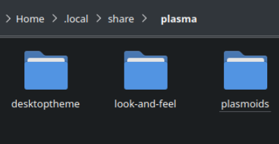

# Налаштування робочого середовища, теми й зміни вигляду

!!! warning
    
    Програми для налаштування робочого столу встановлюйте **на власний ризик**!

## Налаштування KDE Plasma за допомогою тем { #customizing-kde-plasma-with-themes }

KDE Plasma — робоче середовище Bazzite за замовчуванням, і його можна дуже гнучко налаштовувати. Зокрема, можна встановлювати власні стилі, курсори й піктограми за допомогою тем, створених спільнотою. Теми, встановлені через **Системні параметри** (System Settings), потрапляють у `~/.local/share/plasma`. Щоб видалити їх, можливо, доведеться вручну видалити теки встановлених тем.

## Встановлення тем вручну { #manually-installing-themes }

Покрокова інструкція зі встановлення власних тем у KDE Plasma.

1. Завантажте тему вручну з [**KDE Store**](https://store.kde.org/browse/).
2. Розпакуйте вміст у `~/.local/share/plasma/` <small>(_можливо, цю теку доведеться створити_.)</small>
3. Відкрийте системні параметри й виберіть тему, стиль, курсор тощо — вони вже мають з'явитися там.

## Куди розпаковувати теми { #theme-extraction-locations }

Нижче наведено, куди розпаковувати теми: <small>(_можливо, ці теки доведеться створити вручну._)</small>

-   Загальні теми (Global Themes): `~/.local/share/plasma/look-and-feel/`
-   Теми Plasma (Plasma Themes): `~/.local/share/plasma/desktoptheme/`
-   Обрамлення вікон Plasma (Plasma Window Decorations): `~/.local/share/aurorae/themes/`
-   Теми піктограм і курсорів: `~/.local/share/icons`
-   Звуки: `~/.local/share/sounds`
-   Вікно входу: Безпека і конфіденційність → Вікно входу (Security & Privacy → Login Screen)

!!! notice
    
    Після оновлення до Fedora 44 Bazzite перейшла на KDE Display Manager для керування входом до системи.

## Дозволи застосункам на використання тем { #application-permissions-to-use-themes }

Деяким Flatpak-застосункам, які мають проблеми з темами курсора, потрібні дозволи на доступ до файлової системи.

**Приклад**: (`~/.local/share/icons/:ro` у розділі «Filesystem» для кожного проблемного застосунку або для всіх одразу у Flatseal).

## Налаштування інших робочих середовищ і сеансів { #customizing-other-desktops-and-sessions }

Робоче середовище Bazzite за замовчуванням — KDE Plasma, яке до того ж має найглибші можливості налаштування серед сучасних робочих середовищ Linux. Тому цей посібник здебільшого стосується образів Bazzite з KDE Plasma.

### Керування розширеннями GNOME (образи `-gnome`) { #manage-gnome-extensions-gnome-images }

!!! warning

    Будьте обережні: розширення можуть зробити систему нестабільною, а якщо робочий стіл аварійно завершить роботу, GNOME вимкне всі розширення під час наступного запуску.

Застосунок «Extension Manager» дає змогу встановлювати нові розширення GNOME і керувати попередньо встановленими.

### Налаштування ігрового режиму Steam (образи `-deck`) { #steam-gaming-mode-customization-deck-images }

!!! warning

    Decky Loader іноді має проблеми з новими оновленнями Steam і Gamescope, і його, можливо, доведеться тимчасово видалити.

Встановіть [Decky Loader](https://decky.xyz/), а потім [CSS Loader](https://docs.deckthemes.com/), щоб змінити вигляд ігрового режиму Steam. Пам'ятайте, що сторонні плагіни можуть спричиняти проблеми. Якщо після використання Decky Loader виникнуть проблеми, прочитайте [документацію Bazzite про особливості ігрового режиму Steam](../Handheld_and_HTPC_edition/quirks.md), щоб вирішити поширені з них.

## Документація робочих середовищ { #desktop-environment-documentation }
- [**Документація KDE Plasma**](https://docs.kde.org/stable_kf6/uk/plasma-desktop/plasma-desktop/index.html)
- [**Документація GNOME**](https://help.gnome.org/users/gnome-help/stable/index.html.uk)
- [**Документація Bazzite про ігровий режим Steam**](../Handheld_and_HTPC_edition/Steam_Gaming_Mode.md)
