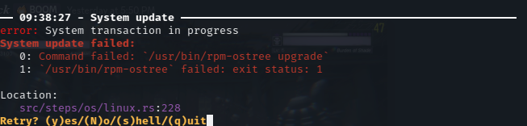
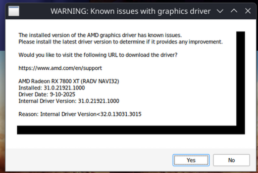

# Поширені запитання (FAQ)

## Для кого Bazzite? { #who-is-bazzite-for }

Bazzite підійде тим, хто шукає операційну систему, яка відповідає одному з цих критеріїв:

- Настільна операційна система для ігор, натхненна SteamOS, яка потребує досить мало обслуговування порівняно з іншими настільними системами Linux.
- Повноцінний інтерфейс, зручний для керування контролером, для гри на ПК з дивана.
- Альтернатива портативним пристроям на Windows, коли хочеться досвіду як у SteamOS, а SteamOS на цьому обладнанні поки працює погано або бракує функцій.
- Досвід як у SteamOS на портативних пристроях зі SteamOS (наприклад, Steam Deck або Lenovo Legion Go S SteamOS Edition), але з новішими системними пакунками, альтернативними робочими середовищами і тим самим підходом на основі образів для стабільності.

## Який образ Bazzite мені вибрати? { #what-bazzite-image-do-i-use }

[Сайт](https://bazzite.gg/#image-picker) Bazzite пропонує простий спосіб вибрати правильний образ: його буде підібрано залежно від обладнання, робочого середовища і того, чи включати ігровий режим Steam, якщо обладнання його підтримує.

Bazzite пропонує багато образів, але більшість із них належить до _одного з **трьох варіантів**_:

- **Варіант 1**: образи Bazzite **без** ігрового режиму Steam, які щодня автоматично оновлюються і містять попередньо встановлені ігрові пакунки.
- **Варіант 2**: образи Bazzite, які автоматично завантажуються в ігровий режим Steam (як SteamOS) і призначені для керування контролером.
- **Варіант 3**: образи Bazzite, призначені для розробки програм.

### 1. Desktop Edition (версія для ПК) { #1-desktop-edition }

**У цих образах немає ігрового режиму Steam!**

Призначена саме для настільних ПК і ноутбуків з акцентом на іграх; натхненна режимом робочого столу SteamOS і тим, що ChromeOS майже не потребує обслуговування. Це орієнтована на ігри операційна система на основі Fedora Atomic Desktop (Kinoite/Silverblue). Steam та інші ігрові утиліти входять до базової системи. Доступний відкат системи, а основа — надійна й стабільна Fedora Linux. Більшість сучасного обладнання для ПК має бути сумісним, за винятком окремих драйверів, які погано працюють у настільному Linux. [Flathub](https://flathub.org/) увімкнено одразу, тож усі застосунки, які є в SteamOS, доступні й у Bazzite. За замовчуванням оновлення системи і застосунків автоматично завантажуються у фоні й застосовуються після перезапуску.

### [2. Handheld Edition (Bazzite-Deck)](../Handheld_and_HTPC_edition/Steam_Gaming_Mode.md) { #2-handheld-edition-bazzite-deck }

«**Ігровий режим Steam**» попередньо встановлено, і на підтримуваному обладнанні всі його функції повністю працюють. Ця версія Bazzite завантажується одразу в сеанс ігрового режиму Steam і призначена для портативних пристроїв і гри на дивані. Також вона містить сеанс режиму робочого столу. Оновлення системи і застосунків запускаються вручну в ігровому режимі Steam і застосовуються після перезавантаження.

### [3. Bazzite-DX (Developer eXperience Edition)](https://dev.bazzite.gg/) { #3-bazzite-dx-developer-experience-edition }

Версія Bazzite, створена спеціально для розробки програм. Її не встановлюють з ISO-образу: на неї переходять, перебазувавшись із поточного образу на образ Bazzite-DX.

#### Приклад таблиці образів Bazzite { #bazzite-image-chart-example }

!!! note

    Це не повний перелік.

Щоб перевірити свій образ Bazzite, введіть у терміналі цю **команду**:

```
rpm-ostree status
```

!!! important

    Назва кожного образу Bazzite має починатися з `ostree-image-signed:docker://ghcr.io/ublue-os/...`.
    <sub> `...` — це заповнювач для справжньої **назви образу**, яку можна знайти в таблиці нижче. </sub>

| **Назва образу**            | Робоче середовище   | Ігровий режим Steam | Обладнання                               | Версія        |
| --------------------------- | ------------------- | ------------------- | ---------------------------------------- | ------------- |
| `bazzite`                   | KDE Plasma          | Ні                  | Відеокарти AMD/Intel                     | Desktop       |
| `bazzite-nvidia`            | KDE Plasma          | Ні                  | Відеокарти Nvidia                        | Desktop       |
| `bazzite-nvidia-open`       | KDE Plasma          | Ні                  | Відеокарти Nvidia (новіші)               | Desktop       |
| `bazzite-gnome`             | GNOME               | Ні                  | Відеокарти AMD/Intel                     | Desktop       |
| `bazzite-gnome-nvidia`      | GNOME               | Ні                  | Відеокарти Nvidia                        | Desktop       |
| `bazzite-gnome-nvidia-open` | GNOME               | Ні                  | Відеокарти Nvidia (новіші)               | Desktop       |
| `bazzite-deck`              | KDE Plasma          | Так                 | Відеокарти AMD/Intel Arc                 | Handheld      |
| `bazzite-deck-nvidia`       | KDE Plasma          | Так                 | Відеокарти Nvidia (новіші)               | Handheld      |
| `bazzite-deck-nvidia-gnome` | GNOME               | Так                 | Відеокарти Nvidia (новіші)               | Handheld      |
| `bazzite-deck-gnome`        | GNOME               | Так                 | Відеокарти AMD/Intel Arc                 | Handheld      |

## SteamOS базується на Arch Linux, то навіщо Fedora Atomic Desktop? { #steamos-is-based-on-arch-linux-so-why-use-fedora-atomic-desktop }

SteamOS отримує оновлення пакунків і драйверів рідше, попри модель постійних випусків (rolling release). Bazzite дотримується циклу випусків Fedora, тобто отримує нові драйвери відеокарт і оновлення ядра раніше, ніж SteamOS. Fedora Linux і Universal Blue використовують особливий «атомарний» підхід, який дає змогу підтримувати кілька образів, що отримують одні й ті самі оновлення одночасно, на відміну від похідних дистрибутивів Linux. **Мета Bazzite — операційна система, готова до ігор одразу після встановлення**.

### Які переваги дає Fedora Atomic Desktop як основа? { #what-are-the-advantages-to-using-fedora-atomic-desktop-as-a-base }

Оскільки Bazzite — це власний образ Fedora Atomic Desktop, він для стабільності використовує кореневу файлову систему лише для читання і збирається як [**завантажувальний образ контейнера**](https://containers.github.io/bootable/), що дає такі переваги:

- Низький ризик, що система перестане завантажуватися
- Можливість відкотити оновлення системи, а також закріпити поточне розгортання як резервну точку збереження без втрати даних користувача.
- Плавний перехід між основними випусками Fedora.
- Акцент на застосунках у контейнерах, які не впливають на основну систему.

> Більше про можливості цього проєкту — на [**домашній сторінці Universal Blue**](https://universal-blue.org).

## Чи встановлено драйвери для відеокарт AMD та Intel? { #are-amd-and-intel-graphics-card-drivers-pre-installed }

**Так**. Більшість драйверів обладнання вбудовані в ядро Linux і оновлюються разом із ним, а ядро оновлюється як частина системного образу Bazzite. В образах Bazzite неможливо вручну змінити версію драйверів чи ядра; натомість кожен образ Bazzite перевіряють, щоб поєднання патчів ядра, програм і середовищ виконання працювало, і лише потім він потрапляє у вашу систему.

### Чи встановлено драйвери для відеокарт Nvidia? { #are-nvidia-graphics-card-drivers-pre-installed }

**Так, в образах Nvidia**: вони оновлюються під час оновлення системи, коли виходять нові драйвери. Оновити їх вручну неможливо.

- Образ legacy (`-nvidia`) підтримує архітектури Pascal, Maxwell і Volta (GTX 900, GTX 1000, Nvidia Titan V, GTX 750 (Ti) і GTX 745).
- Сучасний образ (`-nvidia-open`) підтримує всі відеокарти Nvidia, починаючи з архітектури Turing (GTX 16 і всі RTX).

!!! notice "Якщо в деяких застосунках виникають проблеми з Nvidia, переконайтеся, що ви використовуєте [правильний образ](#bazzite-image-chart-example) для свого пристрою і що [середовище виконання Flatpak оновлено](./issues_and_resolutions.md#flatpak-apps-have-no-hardware-acceleration-on-nvidia)."

#### Чи з'явиться підтримка значно старіших відеокарт Nvidia? { #will-support-for-much-older-nvidia-graphics-cards-be-added }

Наразі не планується підтримувати Kepler і старіші архітектури (більшість відеокарт GTX 700 і старіші), бо офіційні драйвери Nvidia їх **більше не підтримують**.

-   Bazzite усе одно можна встановити з відкритим драйвером `nouveau`.
    -   Однак продуктивність і стабільність цього драйвера гірші, ніж в офіційних драйверів Nvidia: відкритий драйвер не може взаємодіяти із закритою прошивкою GSP, тому відеокарта застрягає на найнижчих частотах.
-   Вручну встановити пропрієтарні драйвери Nvidia для старої відеокарти в Bazzite **неможливо**.
-   Якщо ви хочете використовувати пропрієтарні драйвери Nvidia для своєї відеокарти, потрібен інший дистрибутив Linux, який це дозволяє. Для дистрибутивів на основі Fedora Nvidia фактично припинила підтримку цих відеокарт.

!!! info

    Nvidia додала першу підтримку протоколу Wayland лише у версії 495, а останнім драйвером із підтримкою Kepler і старіших відеокарт була версія 470. Bazzite не підтримує застарілий графічний сервер X11. Якщо вам потрібно запускати ігри на таких відеокартах, спробуйте інші дистрибутиви Linux, наприклад Linux Mint або Debian.

### Що робити, якщо я заміню обладнання? { #what-if-i-change-hardware }

Більшість змін обладнання **не** потребують ручного втручання, окрім того, що й так потрібне для конкретного обладнання незалежно від ОС. Однак якщо ви переходите з відеокарти Nvidia або на неї, знадобиться вручну виконати [перебазування](../Installing_and_Managing_Software/Updates_Rollbacks_and_Rebasing/bazzite_rollback_helper.md), щоб отримати відповідні графічні драйвери.

## Під час ручного оновлення системи з'являється `error: System transaction in progress` { #error-system-transaction-in-progress-shows-up-when-updating-the-system-manually }



Це попередження з'являється в [Desktop Edition](#1-desktop-edition), бо вона автоматично завантажує оновлення системи і застосунків у фоні. Його можна сміливо ігнорувати: система вже оновлюється сама.

## Ігри для Windows пишуть, що мої графічні драйвери застаріли. Як їх оновити? { #windows-games-claim-that-my-graphic-drivers-are-outdated-how-do-i-update-them }


Ігри для Windows не можуть правильно визначити графічні драйвери Linux.

-   Оскільки номери версій драйверів для Windows і Linux відрізняються, ігри іноді попереджають про застарілі драйвери.
-   **Такі попередження можна сміливо ігнорувати.**
-   [Докладніше — тут.](#are-amd-and-intel-graphics-card-drivers-pre-installed)

## Чи підтримує Bazzite завантаження CSM/Legacy? { #does-bazzite-support-csmlegacy-boot }

Ні. Якщо встановлювач виявить завантаження Legacy BIOS, з'явиться повідомлення з інструкціями, як вимкнути CSM: 

## Чи можна використовувати технології генерації кадрів, як-от AFMF і FSR-FG? { #am-i-able-to-use-frame-generation-technologies-such-as-afmf-and-fsr-fg }

**Так**, але лише якщо гра підтримує FSR3.1 або новіший. Зверніть увагу:

-   У відкритих драйверах немає генерації кадрів на рівні драйвера, подібної до AFMF.
-   Схожу функціональність можуть давати окремі моди для ігор або [плагіни Decky](https://github.com/xXJSONDeruloXx/Decky-Framegen).
-   З `Proton-CachyOS 11.0-20260702` або похідними від нього ігри з підтримкою FSR3.1+ автоматично отримуватимуть FSR4.1.1 (див. [сторінку випусків Proton-CachyOS на GitHub](https://github.com/CachyOS/proton-cachyos/releases/tag/cachyos-11.0-20260702-slr)). Крім того, у **Bazzite Portal** можна ввімкнути обхідне рішення FSR-MLFG для відеокарт RDNA3.
* Якщо у вас є [Lossless Scaling](https://store.steampowered.com/app/993090/Lossless_Scaling/) у Steam, можна налаштувати шар LSFG для Vulkan за допомогою відповідного пункту в **Bazzite Portal**.

## Чи можна змінити тему GRUB (завантажувача)? { #can-i-theme-my-grubbootloader }

!!! note
    
    У Bazzite меню GRUB за замовчуванням приховане.
    
Bazzite не підтримує зміну теми завантажувача (GRUB), і це може спричинити критичні проблеми, наприклад система перестане завантажуватися. Перш ніж повідомляти про проблеми, видаліть усі теми GRUB.

## Чи можна змінити ім'я хоста пристрою? { #can-i-change-the-hostname-of-my-device }

!!! note

    Через обмеження контейнерів Distrobox ім'я хоста має бути **коротшим за 20 символів**.

Відкрийте термінал і введіть таку **команду**

```
hostnamectl hostname <hostname>
```

Замість `<hostname>` вкажіть потрібне ім'я хоста.

## Після встановлення Windows Bazzite не завантажується { id="windows-bootloader-override" }

Зазвичай це означає, що Windows «з'їла» завантажувач Bazzite. Запишіть Live ISO Bazzite на флешку, завантажтеся з неї і запустіть **засіб відновлення завантажувача Bazzite** (Bazzite Bootloader Restoration Tool).

## Чи можна перейти на інше робоче середовище в поточній інсталяції? { #can-i-switch-to-a-different-desktop-environment-on-my-current-installation }

<sub> (Наприклад, перейти з KDE Plasma на GNOME або навпаки) </sub>

**Переходити між робочими середовищами не рекомендується**, бо файли конфігурації в них мають різні стандарти, **що зазвичай ламає систему після перебазування на образ Bazzite з іншим робочим середовищем**. На власний ризик можна спробувати [Mending Wall](https://flathub.org/en/apps/org.indii.mendingwall), який допомагає впоратися з цими файлами конфігурації.

Найбезпечніший і єдиний рекомендований нами спосіб змінити робоче середовище — зробити резервну копію особистих файлів і перевстановити Bazzite.

## Чи можна встановити _таке-то_ робоче середовище або _такий-то_ віконний менеджер? { #am-i-able-to-install-this-desktop-environment-or-that-window-manager }

Створіть [власний образ на основі Bazzite](../Advanced/creating_custom_image.md) з потрібним робочим середовищем або окремим віконним менеджером.

## Що означають `:0` і `:1` у меню GRUB під час завантаження? { #what-is-the-0-and-1-in-the-grub-menu-at-boot }

Це дає змогу відкотити невдале оновлення системи, вибравши попереднє розгортання.

- `:0` = поточне розгортання / найновіше оновлення
- `:1` = попереднє розгортання / оновлення.

Розгортання також можна закріпити, щоб мати змогу відкотитися до них у майбутньому, тож можуть існувати й `:2`, `:3` тощо, поки на диску вистачає місця.

## Чому Bazzite так називається? { #why-is-it-called-bazzite }

[Атомарні робочі середовища Fedora Linux](https://fedoraproject.org/atomic-desktops/) спочатку називали за [мінералами.](https://fedoraproject.org/atomic-desktops/kinoite/) Bazzite — це мінерал, відомий тим, що він міцний, легкий і [синій](https://universal-blue.org/).

## Я хочу Bazzite на пристрій, де ігри не головне { #i-want-bazzite-on-a-device-where-video-games-are-not-a-priority }

Universal Blue пропонує ще дві настільні операційні системи, схожі на Bazzite, але без акценту на ПК-іграх. На них теж можна запускати ігри, але в них менше попередньо встановлених ігрових програм і оптимізацій. Усі три проєкти спільно використовують ресурси й розробку, і часто над ними працюють ті самі люди:

- [**Aurora**](https://getaurora.dev/), якщо вам потрібне робоче середовище **KDE Plasma**
- [**Bluefin**](https://projectbluefin.io/), якщо вам потрібне робоче середовище **GNOME**.

## У мене є запитання чи проблеми, на які документація не відповідає { #i-have-questions-or-concerns-that-cannot-be-answered-in-the-documentation }

!!! note

    Спершу пошукайте відповідні ключові слова в документації Bazzite, а вже потім переходьте до наступних кроків.

Настійно радимо [повідомити про це в трекер проблем](https://github.com/ublue-os/bazzite/issues). Майте на увазі, що деякі питання й теми не залежать від нас, особливо проблеми з драйверами Nvidia, сумісністю ігор чи інші проблеми, які загалом властиві сучасному настільному Linux, незалежно від того, чи у вас Bazzite, чи інша операційна система Linux.
