# Посібник зі встановлення Bazzite

## Відеоінструкція { #video-walkthrough }

https://www.youtube.com/watch?v=lBqbk6Z8HrQ

## Системні вимоги { #system-requirements }

- Системні вимоги Bazzite описано в [**посібнику з сумісності обладнання**](../../Gaming/Hardware_compatibility_for_gaming.md).
- Secure Boot і модуль TPM (Trusted Platform Module) підтримуються на більшості обладнання, але [**наш ключ потрібно зареєструвати під час або після встановлення**](#secure-boot).
- [**Також підтримується подвійне завантаження з Windows**](#dual-booting-windows).

### Що потрібно для встановлення { #installer-requirements }

- Спосіб завантажити ISO-образ Bazzite
  - Менеджер завантажень (наприклад, [**Motrix**](https://motrix.app/)), якщо пряме завантаження ISO-образу Bazzite не вдається або йде надто повільно.
- Завантажувальний носій від 16 ГБ, наприклад флешка
  - Завантаження з SD- або microSD-картки може спрацювати, але не всі прошивки це підтримують.
- Одна з цих програм, щоб записати або завантажити ISO-образ:
  - **Fedora Media Writer (рекомендовано)** ([Windows/macOS](https://github.com/FedoraQt/MediaWriter/releases), [Linux](https://flathub.org/en/apps/org.fedoraproject.MediaWriter))
  - **Rufus** ([Windows](https://rufus.ie/))
  - **Ventoy** ([Windows, Linux](https://www.ventoy.net/)) (зверніть увагу: для роботи Secure Boot у Ventoy [**потрібні додаткові кроки**](https://www.ventoy.net/en/doc_secure.html))
- Фізична дротова клавіатура **рекомендована**, а **для пристроїв без сенсорного екрана — обов'язкова**.
  - Є екранна клавіатура на випадок, якщо у вас немає фізичної USB-клавіатури.
    - Щоб нормально користуватися встановлювачем, потрібен сенсорний екран або миша.

### Робочі середовища { #desktop-environments }

Усі образи пропонують на вибір робоче середовище [**KDE Plasma**](https://kde.org/plasma-desktop/) або [**GNOME**](https://www.gnome.org/).

[**Ігровий режим Steam**](../../Handheld_and_HTPC_edition/Steam_Gaming_Mode.md) доступний як додатковий сеанс поряд із KDE Plasma або GNOME.

Більше про відмінності між варіантами образів можна прочитати в [**FAQ Bazzite**](../../General/FAQ.md).

=== "KDE Plasma"

    #### KDE Plasma (за замовчуванням) { #kde-plasma-default }

    

    - Стандартний інтерфейс KDE Plasma має традиційне та звичне компонування
    - Дуже гнучкий, з безліччю налаштувань
    - Фреймворк Qt
    - KDE Plasma використовують популярні дистрибутиви Linux, як-от SteamOS

=== "GNOME"

    #### GNOME (образи `-gnome`) { #gnome-gnome-images }

    

    - Стандартний інтерфейс GNOME має елегантне компонування, зручне для сенсорних екранів
    - Простий і лаконічний
    - Фреймворк GTK
    - GNOME використовують популярні дистрибутиви Linux, як-от Ubuntu

=== "Ігровий режим Steam"

    #### Ігровий режим Steam (образи `-deck`) { #steam-gaming-mode-deck-images }

    

    !!! note

        Під час увімкнення пристрій автоматично завантажується в сеанс ігрового режиму Steam, а режим робочого столу можна відкрити з «**меню живлення**» в ігровому режимі Steam.

    

    - **Потрібен обліковий запис [Steam](https://store.steampowered.com/)**
    - Входить до [образів Bazzite-Deck](../../Handheld_and_HTPC_edition/Steam_Gaming_Mode.md)
    - Інтерфейс розроблено для портативних пристроїв і гри на дивані
    - Зручний для керування контролером
    - На вибір KDE Plasma або GNOME як сеанс режиму робочого столу
    - Додаткові можливості з [плагінами Decky](https://github.com/SteamDeckHomebrew/decky-loader) [(див. усі плагіни)](https://plugins.deckbrew.xyz/)

    

## Резервна копія { #backup-device }

Перш ніж починати встановлення, збережіть свої особисті дані з диска, на який плануєте встановити Bazzite, у надійне місце.

## Завантаження Bazzite { #download-bazzite }

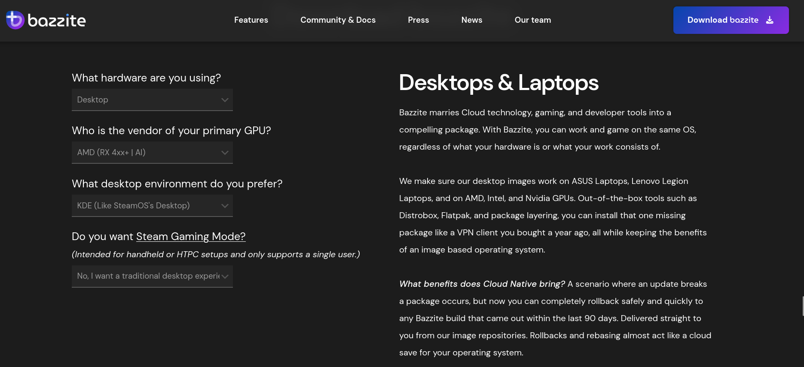

Завантажте потрібний ISO-образ Bazzite. Виберіть обладнання, на яке плануєте встановити Bazzite, виробника основного відеоадаптера, бажане робоче середовище, а також чи потрібен вам ігровий режим Steam — це варіант Bazzite-Deck для HTPC і портативних пристроїв.

### Обчислення контрольної суми SHA256 для ISO-образу { #calculating-iso-sha256-checksum-hash }

**Відеоінструкція**:

https://www.youtube.com/watch?v=wUDbMJtR1sM

## Запис ISO-образу { #flash-iso }

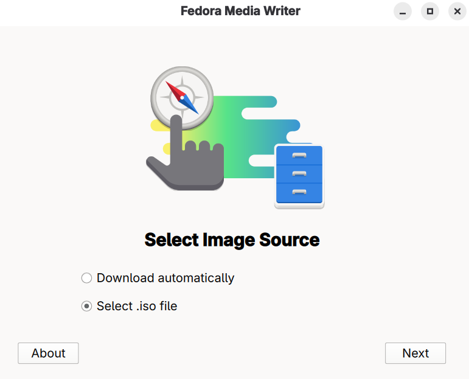
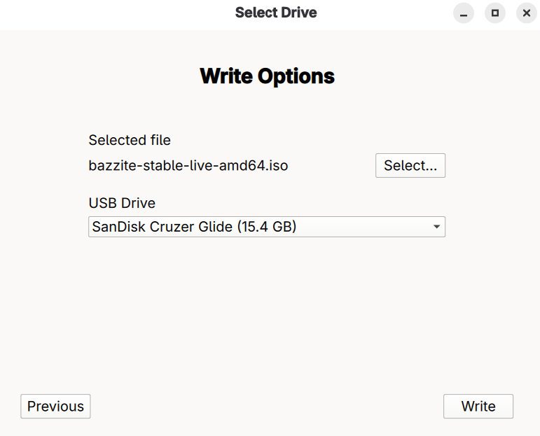

Запишіть Bazzite на завантажувальний носій за допомогою Fedora Media Writer і **після цього безпечно вийміть носій**.

## Запуск встановлювача { #booting-the-installer }

- Під'єднайте завантажувальний носій до пристрою і завантажтеся з нього.
- Після під'єднання носія завантажтеся у встановлювач Bazzite.
- Як саме — залежить від материнської плати, але найчастіше це функціональна клавіша, наприклад <kbd>F9</kbd> або схожа.
  - Іноді доводиться зазирнути в інструкцію, пошукати свій пристрій в інтернеті або прочитати підказки клавіш, які з'являються під час увімкнення ПК.
    - Інший варіант — змінити налаштування BIOS, щоб завантажуватися із завантажувального носія раніше за поточний диск, але після встановлення Bazzite залишати так **не рекомендується**.

### Портативні пристрої { #handheld-devices }

Утримуйте кнопку зменшення гучності (<kbd>-</kbd>) і натисніть кнопку живлення. Коли пролунає звуковий сигнал, відпустіть обидві кнопки — відкриється менеджер завантаження (Boot Manager). У меню завантаження виберіть свій носій, щоб запустити встановлювач Bazzite.

## Live-середовище { #live-environment }

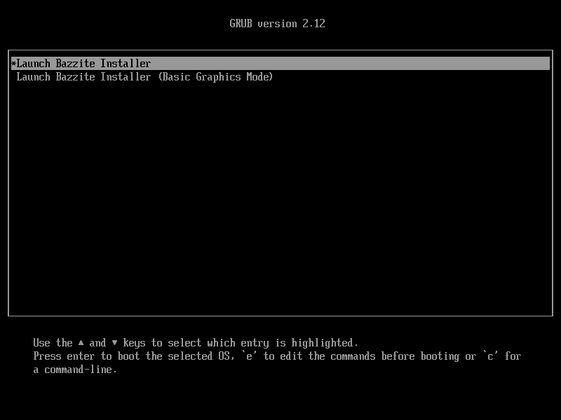

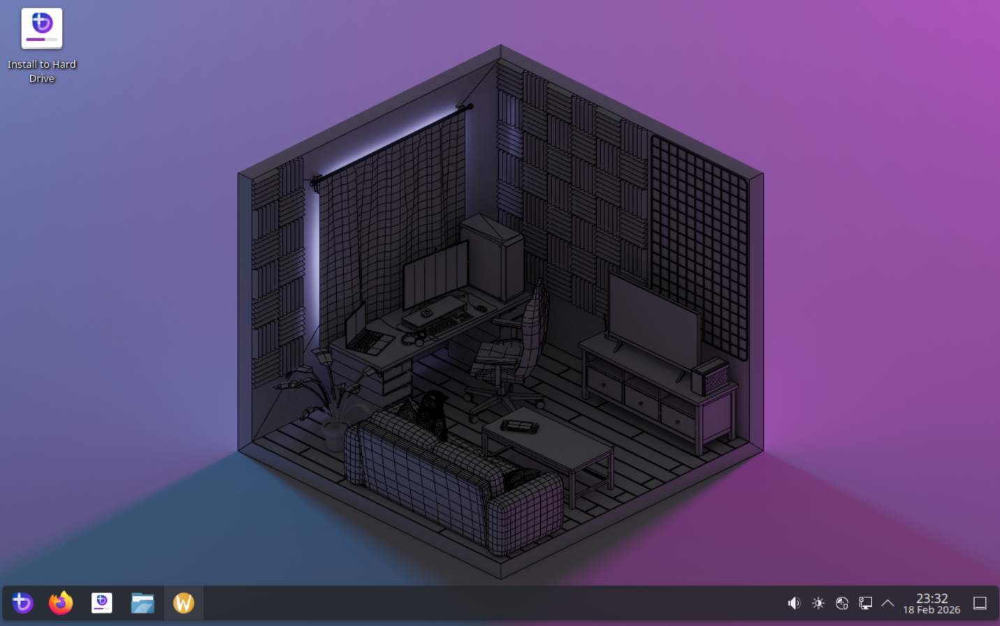

Live-сеанс встановлювача Bazzite дає змогу переглянути попередньо встановлені застосунки та ознайомитися з інтерфейсом.

Будь ласка, не намагайтеся грати в live-сеансі: продуктивність не відповідатиме тій, що буде після повноцінного встановлення на диск.
Також варто знати, що середовище встановлення не містить усієї підтримки обладнання Bazzite (наприклад, звуку на Steam Deck), бо воно працює на іншому ядрі, ніж звичайний Bazzite.

### Налаштування мережі в live-середовищі { #network-setup-in-live-environment }

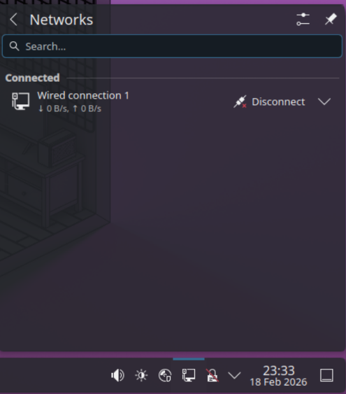

Зверніть увагу: для встановлення Bazzite підключення до інтернету не потрібне, але воно стане в пригоді, якщо ви хочете випробувати Bazzite в live-середовищі. **Коли будете готові до встановлення, відкрийте встановлювач Bazzite.**

## Вибір мови, регіону та розкладки клавіатури { #select-your-language-region-and-keyboard-layout }

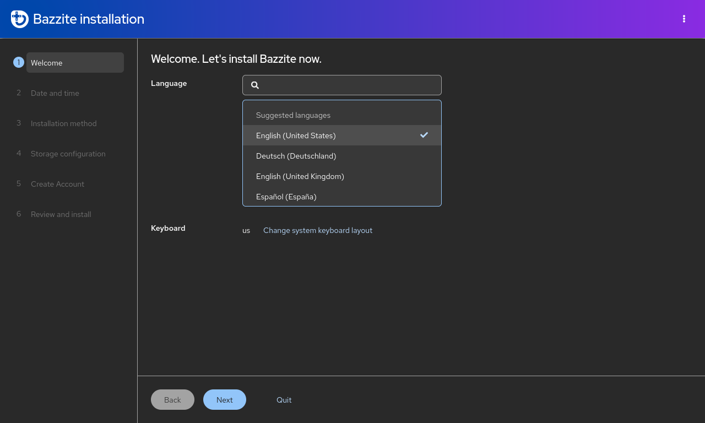

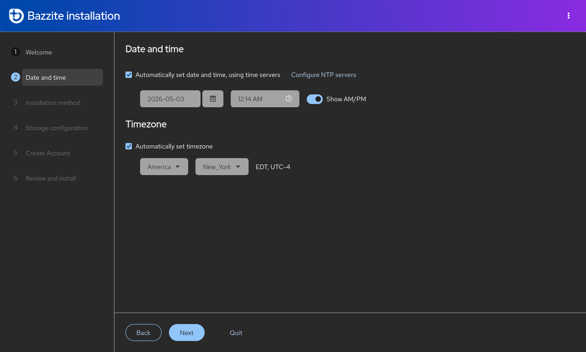

Перші кроки встановлення Bazzite — вибрати мову системи, регіон для часового поясу та розкладку клавіатури, щоб клавіші вводили правильні символи.

## Розмітка диска { #partitioning-setup }

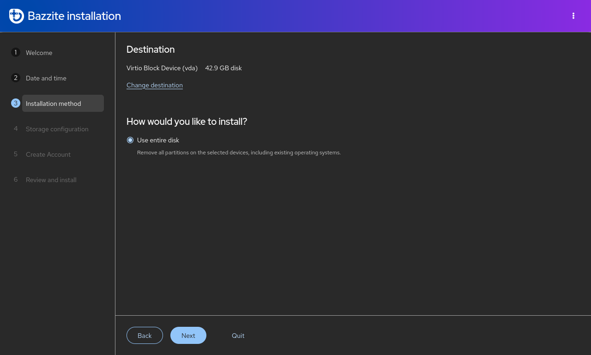

!!! warning

    Вибирайте лише потрібні диски, щоб не втратити дані на інших. Перед продовженням найкраще безпечно від'єднати всі зовнішні диски.

Виберіть диск, на який плануєте встановити Bazzite. Зверніть увагу: усі дані на вибраному диску буде стерто.

## Подвійне завантаження з Windows { #dual-booting-windows }

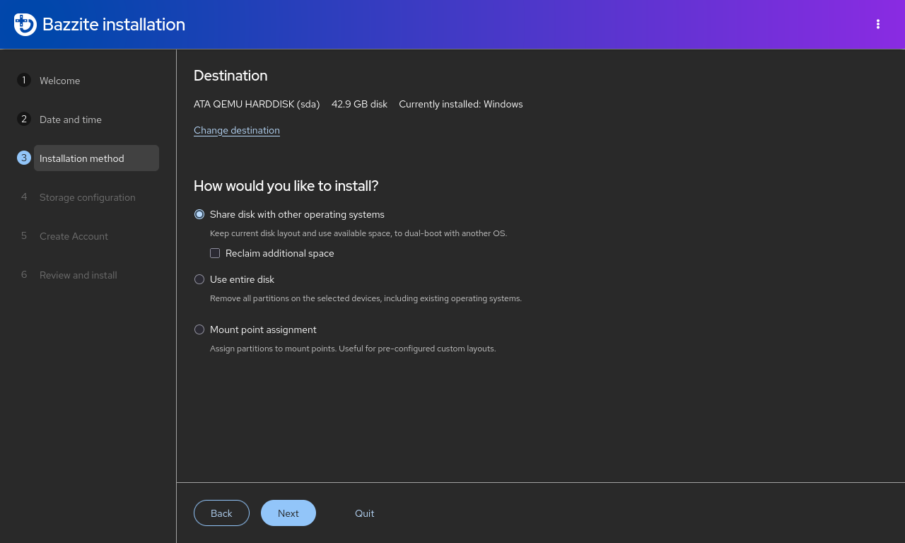

!!! note

    Пропустіть цей розділ, якщо плануєте встановити Bazzite без подвійного завантаження з Windows.

!!! warning

     Кнопка «format as efi» під час подвійного завантаження повідомляє, що відформатує EFI-розділ Windows, але насправді лише додає до нього Bazzite. Це помилка самого встановлювача (upstream).

Для подвійного завантаження з Windows використовуйте автоматичну розмітку: це єдиний варіант у live ISO, але для більшості сценаріїв подвійного завантаження його достатньо. Якщо потрібна ручна розмітка, завантажте legacy ISO і дотримуйтеся [**посібника зі встановлення з legacy ISO**](./legacy-install.md). Для подвійного завантаження з Windows на **окремих** дисках користуйтеся меню завантаження UEFI материнської плати, бо завантажувач GRUB може неправильно розпізнавати пункти завантаження.

### Відеоінструкція { #video-walkthrough_1 }

https://www.youtube.com/watch?v=KAt49B6rSFI

### Текстова інструкція { #written-walkthrough }

1. Встановлення Bazzite на спільний диск.
2. Встановлення Bazzite на окремий диск.

=== "Спільний диск (автоматична розмітка)"

    1. (У Windows) Вимкніть **шифрування BitLocker** і **швидкий запуск**, потім перезавантажтеся.
    2. (У Windows) Зменште розділ Windows за допомогою застосунку «Керування дисками», щоб звільнити достатньо місця для Bazzite.
    Зазвичай це виглядає приблизно так:
    
    <i><small>Джерело: [diskpart.com](https://www.diskpart.com/windows-10/windows-10-disk-management-0528.html)</small></i>
    3. Запустіть встановлювач Bazzite з автоматичною розміткою.
    4. Завантажтеся в Bazzite і виконайте в терміналі `ujust regenerate-grub`, щоб додати Windows до GRUB.

=== "Окремий диск"

    **Якщо є можливість виділити окремий диск, рекомендуємо саме цей спосіб.**

    Встановіть Bazzite на окремий внутрішній або зовнішній диск.

    1. Встановіть іншу операційну систему (наприклад, Windows) на один диск.
    2. Встановіть Bazzite на **другий** диск.
    3. За бажанням зробіть Bazzite **першим** у порядку завантаження.

    Якщо Windows встановлюєте другою, від'єднайте диск з Bazzite, щоб встановлювач Windows не використав його EFI-розділ.

    Якщо вільного внутрішнього диска немає, для подвійного завантаження можна також встановити Windows на зовнішній диск у режимі Windows To Go за допомогою [Rufus](https://rufus.ie/en/).

### Подвійне завантаження з іншими операційними системами Linux { #dual-booting-other-linux-operating-systems }

!!! note 

    Подвійне завантаження з **іншими дистрибутивами Linux**, особливо з **неатомарною Fedora**, офіційно не підтримується. Щоб уникнути несподіваних проблем, рекомендуємо користуватися меню завантаження UEFI материнської плати або взагалі відмовитися від подвійного завантаження. Якщо щось піде не так, відновіть завантажувач Bazzite за допомогою **засобу відновлення завантажувача** (Bootloader Restoring Tool) у Live ISO.

Для образів Fedora Atomic Desktop на **тому самому** диску: щоб використовувати подвійне завантаження з іншим **образом Fedora Atomic Desktop** (наприклад, [Bluefin](https://projectbluefin.io/)), встановленим поряд із Bazzite, потрібно створити додатковий EFI-розділ і перемикатися між системами через меню завантаження UEFI материнської плати.

## Шифрування диска { #disk-encryption }

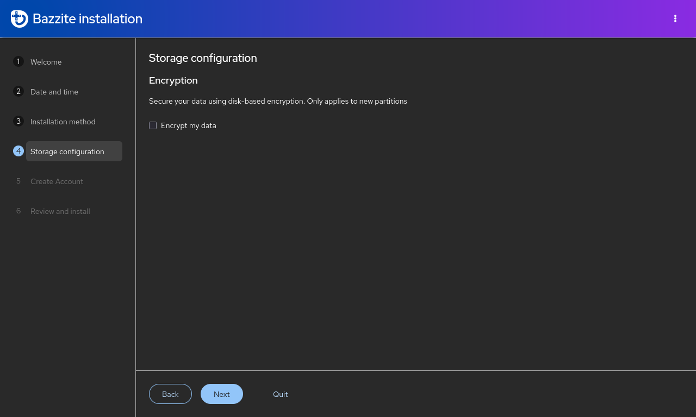

!!! warning

    Якщо ви забудете пароль шифрування, розшифрувати диск буде неможливо, і дані буде втрачено!

Шифрування диска **необов'язкове**, але доступне через [LUKS](https://docs.fedoraproject.org/en-US/quick-docs/encrypting-drives-using-LUKS/). **Щоб розшифрувати диск, знадобиться фізична USB-клавіатура!** Пропустіть цей крок, якщо шифрування диска на цьому пристрої вам не потрібне. У більшості звичайних випадків цей крок не обов'язковий, хіба що ви побоюєтеся, що зловмисник отримає фізичний доступ до диска з Bazzite.

## Створення облікового запису користувача { #user-account-setup }

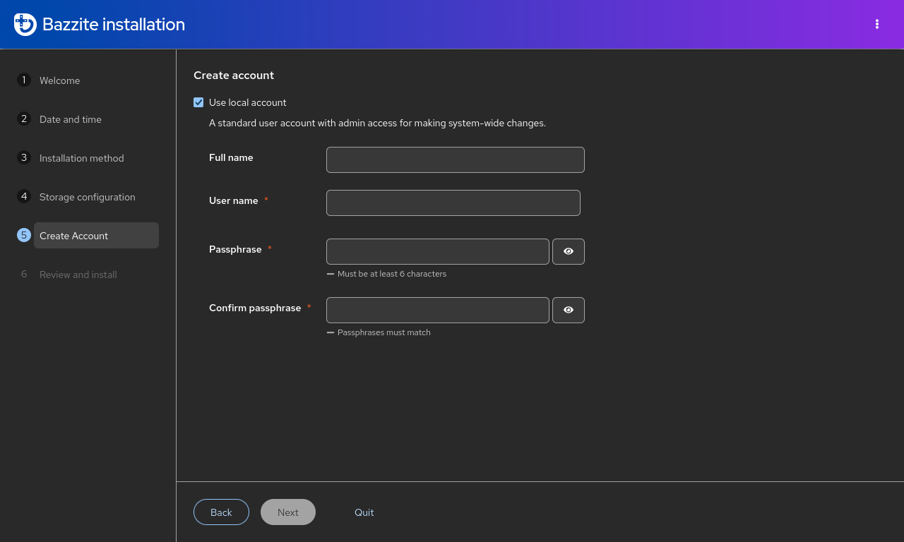

!!! warning

    Вмикати обліковий запис root не рекомендується.

Створіть ім'я користувача та пароль для входу в обліковий запис Bazzite. Цей самий пароль використовуватиметься для дій з правами адміністратора. **Виберіть пароль, який ви запам'ятаєте**.

## Встановлення Bazzite { #installing-bazzite }

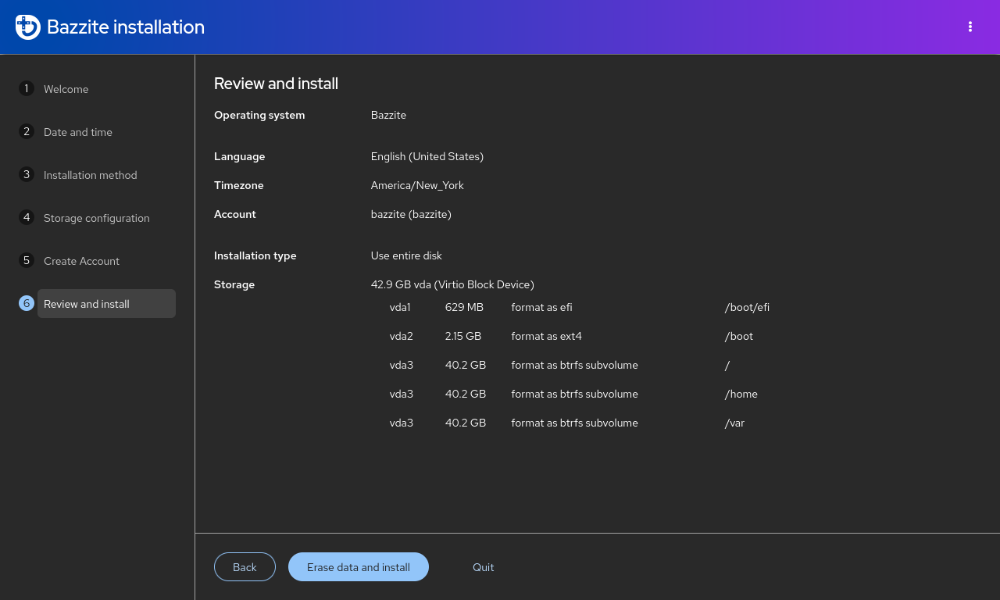

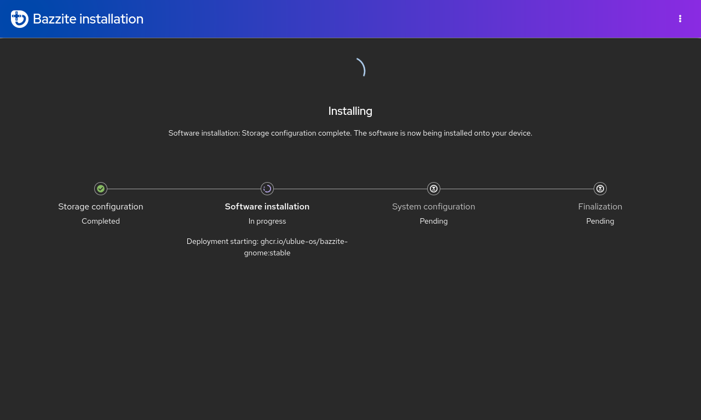

Перегляньте зміни, які встановлювач збирається внести. **Уважно прочитайте все, перш ніж продовжити встановлення**. Дочекайтеся, поки Bazzite встановиться. Це може зайняти деякий час.

## Перезавантаження { #reboot }

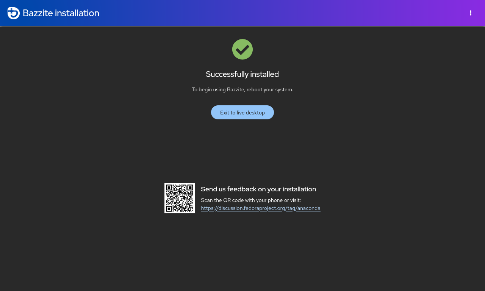

Перезавантажте пристрій. Коли пристрій знову почне завантажуватися, можна вийняти носій, з якого ви встановлювали Bazzite.

## Secure Boot { #secure-boot }

!!! note

    Пропустіть цей розділ, якщо Secure Boot не ввімкнено або ваше обладнання його не підтримує.

!!! important

    Запит на реєстрацію ключа використовує англійську розкладку QWERTY незалежно від вашої фізичної клавіатури. Тому інші розкладки можуть змінити символи пароля (наприклад, у розкладці AZERTY `A` і `Q` поміняні місцями).

Bazzite підтримує Secure Boot, але для цього потрібно зареєструвати ключ Universal Blue. Інакше, якщо Secure Boot у BIOS залишиться ввімкненим, Bazzite не завантажиться.

### Важливі примітки щодо Secure Boot { #important-secure-boot-notes }

- Під час введення пароля символи з міркувань безпеки не відображаються, тож ви не бачитимете, що вводите!
- Оновлення BIOS може знову ввімкнути Secure Boot. Тоді після оновлення, можливо, доведеться виконати **«Спосіб B»**, щоб позбутися чорного екрана під час завантаження з повідомленням про те, що спершу потрібно завантажити ядро.
- Steam Deck постачається **без** увімкненого Secure Boot і без жодних зареєстрованих ключів. Не вмикайте Secure Boot на Steam Deck, якщо не знаєте напевно, що робите.

### Повідомлення про помилку (якщо ключ **не** зареєстровано правильно) { #error-message-if-key-is-not-enrolled-properly }

```
error: ../../grub-core/kern/efi/sb.c:182:bad shim signature.
error: ../../grub-core/loader/i386/efi/linux.c:256:you need to load the kernel first.

Press any key to continue...
```

Якщо ви бачите це повідомлення, дотримуйтеся **способу B** нижче, щоб виправити помилку й продовжити.

### **Спосіб A** — під час встановлення { #method-a-during-installation-method }


!!! note

    Цей екран також з'явиться під час наступного завантаження, якщо ви ввімкнете Secure Boot, який був вимкнений під час встановлення.

Після виходу зі встановлювача Bazzite з'явиться синій екран із пропозицією зареєструвати підписані ключі.

Якщо Secure Boot увімкнено, виберіть `Enroll MOK`. Якщо попросять ввести пароль, **введіть**:

```command
universalblue
```

Якщо Secure Boot вимкнено або ваше обладнання його не підтримує, виберіть `Continue boot`.

### **Спосіб B** — після встановлення { #method-b-after-installation-method }

**Перш ніж продовжити, вимкніть Secure Boot у BIOS**, а **після реєстрації ключа** знову ввімкніть його.

Якщо Bazzite уже встановлено, **введіть цю команду в терміналі основної системи**:

```
ujust enroll-secure-boot-key
```

Якщо з'явиться запит на реєстрацію потрібного ключа, **введіть пароль у терміналі основної системи**:

```command
universalblue
```

**Тепер можна знову ввімкнути Secure Boot у BIOS.**
Щоб завантажитися одразу в BIOS системи (якщо підтримується), скористайтеся командою:

```command
ujust bios
```
### Завершення реєстрації MOK під час завантаження { #complete-mok-enrollment-at-boot }

Під час наступного завантаження ви побачите синій екран MokManager:

1.  Виберіть **Enroll MOK**.
2.  Коли попросять пароль, введіть:
    ```command
    universalblue
    ```

Після перезавантаження ключ буде зареєстровано, і Secure Boot можна залишити ввімкненим. Тепер система має нормально завантажуватися з увімкненим Secure Boot.

## **Вирішення проблем зі встановленням**: { #troubleshooting-installation }

Способи обійти проблеми зі встановленням описано в [**посібнику з вирішення проблем**](./troubleshoot_guide.md) та [**альтернативному посібнику зі встановлення**](./alternate-install-guide.md).

## Після встановлення { #post-installation }

Bazzite встановлено. Рекомендовані наступні кроки описано в [**посібнику з налаштування після встановлення**](./post-installation.md)!
