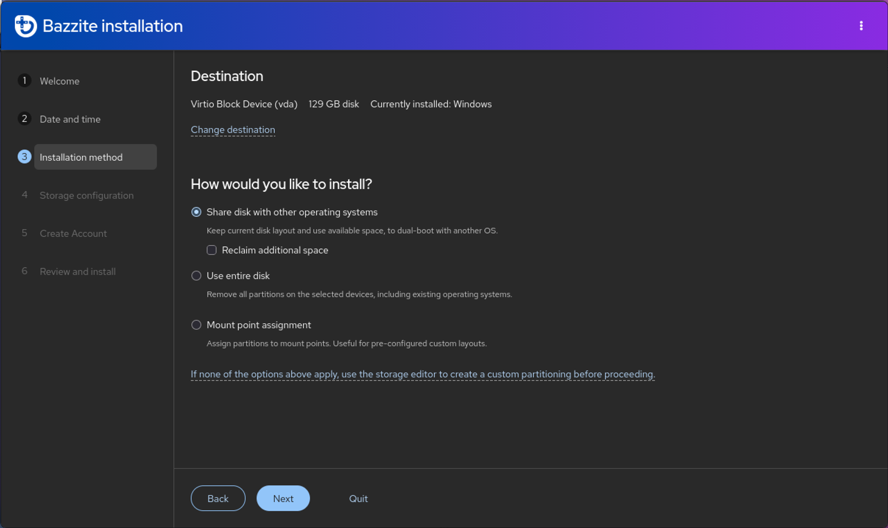
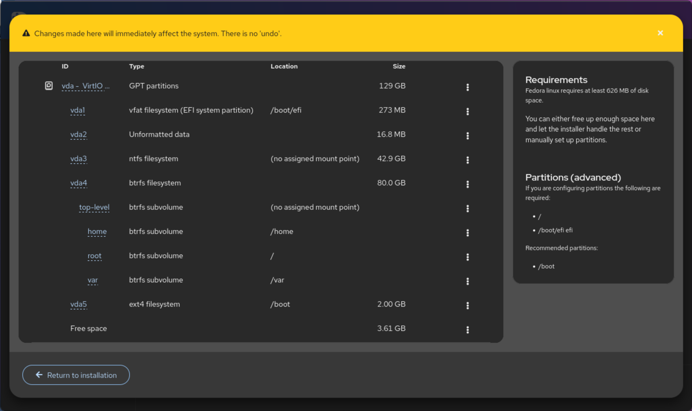
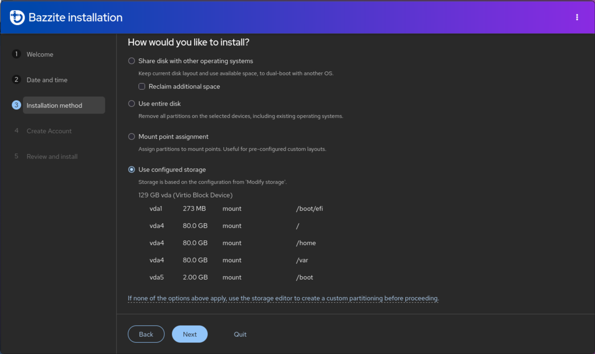

# Manual Partitioning

!!! warning "Only users who are dual booting on the same drive should use these instructions. Automatic partitioning is preferred in other cases."

!!! warning "Bazzite only supports the BTRFS filesystem for `/`"

This guide is for the live ISO installer. For the legacy ISO, follow the [**legacy ISO installation guide**](./legacy-install.md).

## Before You Start { #before-you-start }

- Make free space on the drive for Bazzite first, for example by shrinking the Windows partition in Windows Disk Management. See the [**Dual Boot Setup Guide**](./dual_boot_setup_guide.md) for the steps in Windows.
- If you dual boot with Windows, you can use the existing EFI system partition, like automatic partitioning does. The installer adds Bazzite's boot files to it and keeps the Windows files.

!!! note "Temporary step"

    If **BTRFS** is missing from the type list in the storage editor, connect to the internet, open a terminal in the live session and run:

    ```
    sudo dnf5 install udisks2-btrfs && sudo systemctl daemon-reload && sudo systemctl restart udisks2
    ```

    Do this before you start the installer. If the installer is already open, quit it and start it again.

## Manual Partitioning Instructions { #manual-partitioning-instructions }

!!! warning "Changes made in the storage editor are applied to the drive immediately. There is no undo."

1.  Start the installer and continue to **Installation method**.
2.  Select the link **If none of the options above apply, use the storage editor to create a custom partitioning before proceeding** at the bottom of the page.

3.  Set up the following partitions and devices:
  - **/boot/efi**
    Open the menu (**⋮**) of the existing EFI system partition, select **Edit mount point** and enter `/boot/efi`.
    If you want a separate EFI partition instead, select **Create partition** in the menu of the free space:
    ```
    type:        EFI system partition
    mount point: /boot/efi
    size:        1GB
    ```
    Leave the existing EFI system partition without a mount point. It stays unchanged.
    A separate EFI partition keeps Bazzite's bootloader apart from Windows, so Windows updates are less likely to affect it. Some firmware doesn't handle two EFI partitions on one drive.
  - **/boot**
    Select **Create partition** in the menu of the free space:
    ```
    type:        EXT4
    mount point: /boot
    size:        2GB
    ```
  - **btrfs partition**
    Select **Create partition** in the menu of the free space:
    ```
    type:        BTRFS
    mount point:
    size:        [max]
    ```
  - **Subvolumes**
    Open the menu of the **top-level** subvolume of the new btrfs partition and select **Create subvolume**. Do this three times:
    ```
    name: root   mount point: /
    name: home   mount point: /home
    name: var    mount point: /var
    ```
4.  Check that your layout looks like this, then select **Return to installation**. The installer should show **Detected valid storage layout**. Select **Continue**.

5.  **Use configured storage** is now selected under Installation method. Continue with the installation.

6.  If you dual boot with Windows, reboot into Bazzite after the installation and run `ujust regenerate-grub` in the terminal to add Windows to the GRUB menu.

## Troubleshooting { #troubleshooting }

- **"Storage requirements not met" when returning to the installation**
  If the message says that the EFI System Partition must be mounted on `/boot/efi`, open the menu of the EFI system partition, select **Edit mount point** and enter `/boot/efi`.
- **The installation fails with an `e2label` error**
  The separate `/boot` partition is missing. It is required, even though the installer only lists it as recommended.
- **"You must create a new file system on the root device"**
  The subvolumes were created in an earlier installer session. Delete them and create them again before you install.
- **Warning that `/boot/efi` is less than 500 MiB**
  Existing Windows EFI partitions are often smaller. You can continue.
