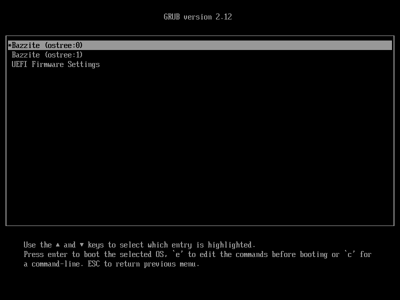
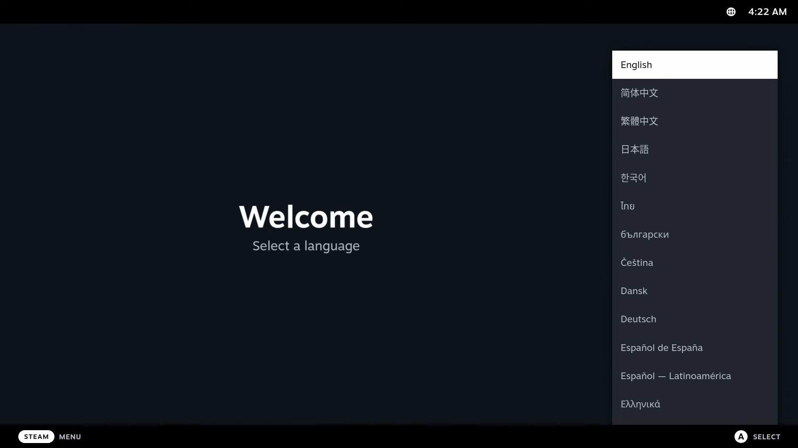
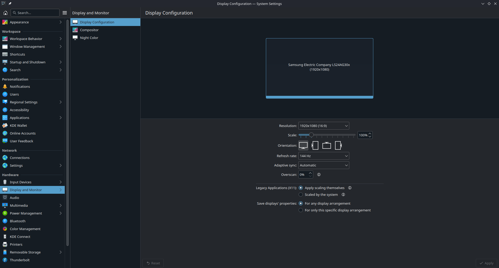
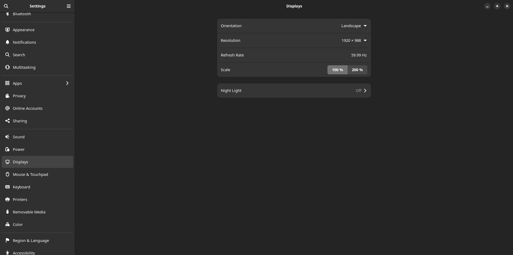
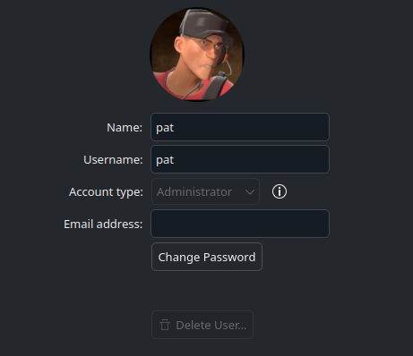
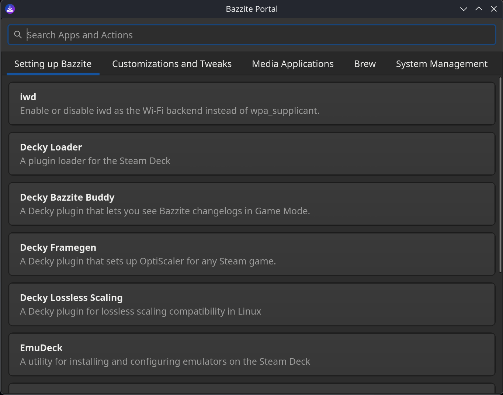
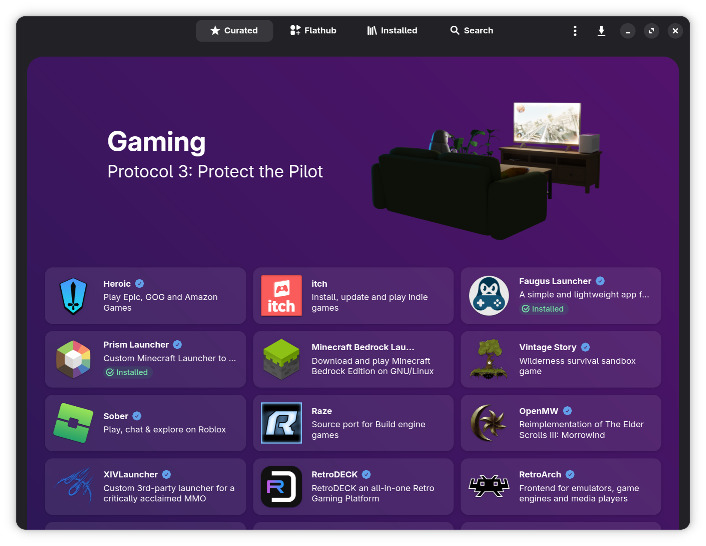

# Налаштування після встановлення

## Перше завантаження { #first-boot-setup }



Під час першого завантаження з'явиться екран із поточним і попереднім розгортанням. Важливо знати, що меню GRUB можна використати для відкату розгортань Bazzite, якщо виникнуть проблеми.

Докладніше про це — в [**документації про оновлення, відкат і перебазування**](../../Installing_and_Managing_Software/Updates_Rollbacks_and_Rebasing/index.md).

## Налаштування ігрового режиму Steam (лише для образів Bazzite-Deck) { #setting-up-steam-gaming-mode-bazzite-deck-images-only }



Якщо перед завантаженням ISO-образу ви вибрали ігровий режим Steam, у вас буде версія Bazzite-Deck. Після виконання всіх кроків вище наступне завантаження буде в ігровому режимі Steam, де потрібно додатково налаштувати Steam.

Більше про образи для HTPC і портативних пристроїв — у [**документації Bazzite-Deck**](../../Handheld_and_HTPC_edition/index.md).

## Налаштування системи { #configure-system-settings }

Під час першого завантаження важливо налаштувати систему під себе, особливо якщо масштабування відображається неправильно. Щоб почати, відкрийте застосунок системних налаштувань у сеансі робочого столу.

### Масштабування { #scaling-settings }


**_Застосунок «Системні параметри» в KDE Plasma_**


**_Застосунок «Параметри» в GNOME_**

Налаштуйте систему на свій смак.

### Зміна стандартного пароля { #changing-default-password }
<sub> (Якщо його не змінили у встановлювачі legacy ISO) </sub>



Змініть його в налаштуваннях режиму робочого столу, у розділі «Користувачі».

## Налаштування після встановлення для подвійного завантаження { #dual-boot-post-configuration-setup }

!!! note

    Це стосується лише користувачів Bazzite, які використовують подвійне завантаження з Windows.

Щоб під час завантаження в меню GRUB можна було вибрати і Windows, і Bazzite, **введіть у терміналі команду**:

```
ujust regenerate-grub
```

### Bazzite як основна система завантаження { #bazzite-as-primary-boot }

Якщо в `OS Boot Manager` першим у порядку завантаження стоїть `Windows Boot Manager`, після встановлення пристрій може завантажуватися одразу у Windows, а не в Bazzite. Можливо, це доведеться виправити в налаштуваннях BIOS.

Зверніть увагу, що меню GRUB може не з'являтися. У такому разі під час увімкнення часто натискайте клавішу <kbd>↓</kbd>.

### Завантаження у Windows зі Steam { #boot-into-windows-from-steam }

Додає до Steam скрипт для завантаження у Windows.

```
ujust setup-boot-windows-steam
```

### Збільшення місця на диску під час подвійного завантаження з Windows { #expanding-storage-size-in-a-windows-dual-boot-scenario }

!!! note

    Це на майбутнє, коли ви вже деякий час користуватиметеся подвійним завантаженням.

**Подивіться відеоінструкцію про те, як збільшити місце на диску**:

https://www.youtube.com/watch?v=uy8mi1pAj8E

<hr>

## Наступні кроки { #next-steps }

### Налаштування системи за допомогою Bazzite Portal { #configure-your-system-with-the-bazzite-portal-application }



Ознайомтеся з Bazzite Portal: він виконує обслуговування системи, встановлює невеликий набір додаткових застосунків і налаштовує розширені параметри системи.

### Встановлення програм з магазину Bazaar { #install-additional-software-with-the-bazaar-app-store }



Встановлюйте додаткові програми для Bazzite з магазину застосунків Bazaar. Саме звідти ви отримуватимете більшість застосунків. Якщо потрібного там немає, загляньте в розділ [**Встановлення застосунків і керування ними**](../../Installing_and_Managing_Software/index.md).

<hr>

## Можна грати { #ready-to-game }

**Bazzite встановлено!**

Почніть грати, прочитавши наш [**посібник з ігор**](../../Gaming/index.md), де описано:

- Встановлення та налаштування **Steam** і **Proton** для сумісності з іграми для Windows
- Налаштування **Lutris** та інших ігрових лаунчерів (Epic Games, GOG, Amazon Games тощо)
- Керування іграми та їх модифікацію
- Вирішення поширених проблем з іграми

Насолоджуйтеся Bazzite і обов'язково [**повідомляйте про помилки**](../../General/reporting_bugs.md), які трапляються, щоб їх могли якнайшвидше виправити.
