# Вирішення проблем зі встановленням

## Завантаження ISO-образу { #downloading-the-iso }

Якщо пряме завантаження не вдається або йде надто повільно, скористайтеся менеджером завантажень (наприклад, [**Motrix**](https://motrix.app/)).

## Диски { #drives }

Вибирайте лише потрібні диски, щоб не втратити дані на інших. Перед продовженням найкраще безпечно від'єднати всі зовнішні диски.

---

## Помилка «Failed to open \EFI\BOOT\mmx64.efi - Not Found» { #failed-to-open-efibootmmx64efi-not-found-error }

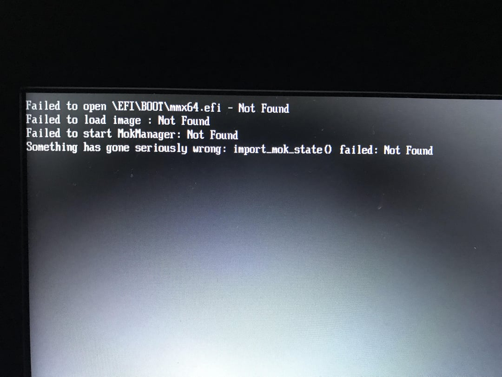

Щоб обійти цю проблему, завантажтеся з файлу. Відкрийте UEFI (BIOS), виберіть EFI-розділ, на якому встановлено Bazzite, а потім виберіть для завантаження файл /EFI/fedora/grubx64.efi.
Після цього менеджер завантаження має працювати як звичайно і показувати пункт «FEDORA».

---

## Встановлювач не запускається { #installer-wont-boot }

!!! note

    Новий встановлювач може не запуститися, якщо BIOS працює в режимі CSM Legacy, а не UEFI. Докладніше — в [**системних вимогах Bazzite**](../../Gaming/Hardware_compatibility_for_gaming.md#minimum-system-requirements).

Скористайтеся [legacy ISO](./legacy-install.md) або спробуйте [альтернативний спосіб](./alternate-install-guide.md) встановлення Bazzite.

---

## Помилка з кодом 1 { #error-code-1 }

Помилка «code 1» — загальний код помилки, який з'являється під час встановлення, коли конкретнішого повідомлення немає. Наразі ми знаємо кілька випадків, коли вона виникає, але їх може бути й більше:

- **Наявна інсталяція Linux:** якщо раніше на тому самому диску вже був встановлений інший Linux, встановлювач може завершитися помилкою «bootloader write config» під час встановлення завантажувача.
  - Це може статися, навіть якщо попередня інсталяція Linux уже не працює. Відомо, що таке трапляється як з дистрибутивами **на основі Fedora** (Fedora, Fedora Atomic, Bazzite, Nobara тощо), так і **на основі Ubuntu** (Ubuntu, Mint, PopOS тощо).
  - **Рішення 1:** окремий диск. Якщо ваше обладнання підтримує більше одного SSD, встановіть Bazzite на інший диск, на якому ще ніколи не було Linux.
  - **Рішення 2:** вручну видаліть наявний Linux з EFI: [інструкцію див. нижче.](#how-to-remove-an-orphaned-copy-of-grub)
  - **Рішення 3:** видаліть наявний EFI-розділ на диску. Якщо ви НЕ плануєте подвійне завантаження, зробіть це за допомогою GParted або «Дисків».
    - **Попередження:** це **незворотно**, і з диска буде видалено всі інші операційні системи, **зокрема Windows**
  - **Рішення 4:** створіть новий EFI-розділ. Для цього можна скористатися ручною розміткою, як описано в [посібнику з ручної розмітки](./manual_partitioning.md), і створити новий EFI-розділ поряд із наявним.
    - Попередження: деякі BIOS не підтримують другий EFI-розділ на диску.
- **Неправильна файлова система:** ця помилка виникає, якщо для кореневого розділу використано EXT4 або будь-яку іншу файлову систему. Для кореневого розділу потрібна BTRFS.
- **Пошкоджений ISO-образ:** переконайтеся, що ISO-образ не пошкоджено, обчисливши контрольні суми.
- **Перегрів USB-флешки:** щоб уникнути перегріву, використовуйте флешку USB 3.0 або новішу і підключайте її до порту USB 3.0 або новішого.

---

## Помилка «No Space left on Device» { #no-space-left-on-device-error }
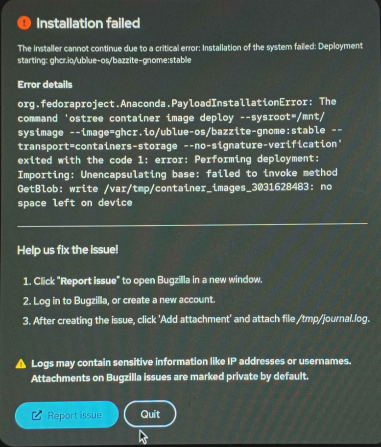

Ця помилка вводить в оману: насправді вона може з'являтися, коли встановлювачу не вистачає оперативної пам'яті. [**Для встановлення Bazzite потрібно щонайменше 8 ГБ оперативної пам'яті.**](./Installing_Bazzite_for_Desktop_or_Laptop_Hardware.md#minimum-system-requirements)

---

## Помилка «Bad shim signature, you need to load the kernel first» { #bad-shim-signature-you-need-to-load-the-kernel-first-error }


Щоб пройти цей екран, вимкніть Secure Boot у BIOS. Якщо хочете користуватися Secure Boot, дотримуйтеся [**посібника з Secure Boot** (спосіб B)](./secure_boot.md).

**Відеоінструкція**:

https://www.youtube.com/watch?v=Z_DsWqTuipU

---

## Помилка «grub_memalign:552:out of memory» { #grub_memalign552out-of-memory-error }

```console
error: ../../grub-core/loader/i386/efi/linux.c:kernel_alloc:159:can't allocate kernel.
error: ../../grub-core/kern/mm.c:grub_memalign:552:out of memory.

Press any key to continue...
```

Здебільшого цю проблему вирішує вимкнення TPM у BIOS/UEFI.

---

## Помилка «Device is Active» { #device-is-active-error }

Ця помилка виникає, коли встановлювач натрапляє на розділ, зашифрований BitLocker. Є два варіанти:

A. **Якщо потрібне подвійне завантаження:** перед встановленням зменште розділ у Windows так, щоб звільнити достатньо місця для Bazzite.
B. **Лише Bazzite:** перед встановленням видаліть розділ BitLocker за допомогою інструмента на кшталт GParted.

**Подивіться відео з демонстрацією**:

https://www.youtube.com/watch?v=FBGLLkIKp-w

---

### «Error checking storage configuration» { #error-checking-storage-configuration }

**Подивіться відео зі способом обійти проблему**:

https://www.youtube.com/watch?v=VTnm9EiBdPA

---

## Помилка «Unable to allocate requested partition scheme» { #unable-to-allocate-requested-partition-scheme-error }

Ця помилка виникає під час встановлення на диски, більші за 2 ТБ, коли перші 2 ТБ або більше вже зайняті одним чи кількома розділами. Повідомлення про помилку показано на зображенні нижче.

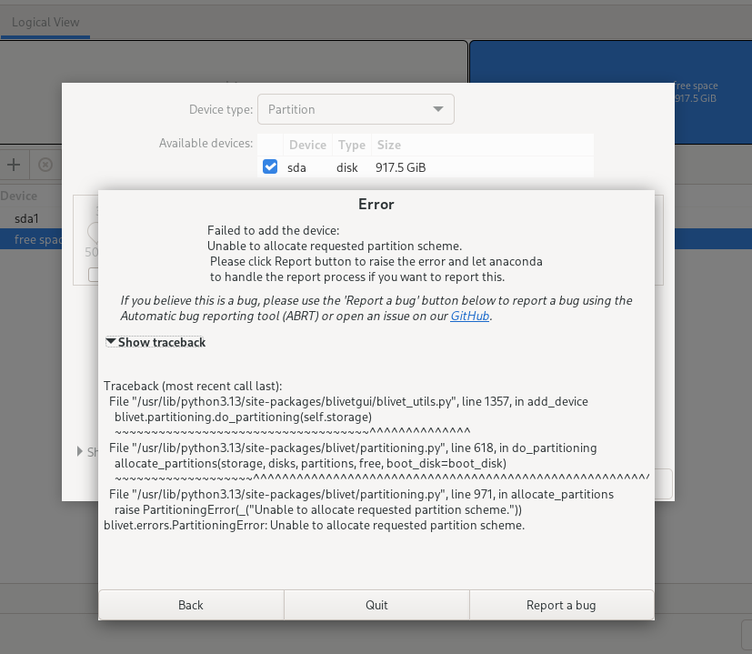

Схоже, встановлювач Anaconda не може створювати розділи після позначки 2 ТБ.

Можливі способи вирішення:

- Встановіть Bazzite на інший накопичувач, де Bazzite займе весь диск.
- Якщо використовуєте подвійне завантаження з Windows, зменште розділ Windows до розміру менше 2 ТБ. Якщо «Керування дисками» у Windows не може цього зробити, скористайтеся сторонньою програмою, наприклад [EaseUS Partition Master](https://www.easeus.com/partition-master/), щоб змінити розмір розділів, поки Windows не запущена.
- Якщо на диску немає важливих даних, можна видалити всі розділи і почати встановлення заново.

---

## Накопичувач не відображається у встановлювачі { #storage-is-not-showing-up-in-the-installer }

Так буває, коли накопичувач налаштовано як RAID-масив Intel. Некорпоративні версії Linux не містять драйверів для Intel RST, тому встановлювач не бачить накопичувач.

Рішення: вимкніть Intel RAID у BIOS.

Зазвичай цей параметр називається:

- VMD
- RST
- Rapid Storage Tech(nology)
- Storage mode: AHCI
!!! warning "Розформування RAID зламає наявні інсталяції Windows. Якщо хочете використовувати подвійне завантаження з Windows, перед вимкненням RAID дотримуйтеся цієї інструкції: https://support.thinkcritical.com/kb/articles/switch-windows-10-from-raid-ide-to-ahci"

!!! note "У деяких BIOS вимкнення RAID не видаляє наявні RAID-масиви. У такому разі, щоб успішно встановити Bazzite, вручну видаліть залишковий RAID-масив. Як це зробити, дивіться в інструкції від виробника."

---

## Альтернативний спосіб встановлення { #alternative-installation-method }

!!! note

    **Альтернативний спосіб встановлення дає змогу завантажити менший ISO-образ і може вирішити інші проблеми, але на більшості екранів портативних пристроїв встановлювач відображається некоректно**.

Якщо жодна з наведених вище помилок не стосується вашої проблеми або Bazzite досі не вдається встановити, спробуйте наш альтернативний спосіб встановлення:

[**Спробуйте встановити Bazzite, перебазувавшись з Fedora Kinoite (KDE Plasma) або Fedora Silverblue (GNOME)**](./alternate-install-guide.md).

---

## Як видалити залишкову копію GRUB { #how-to-remove-an-orphaned-copy-of-grub }
1. Завантажтеся у встановлювач Bazzite (legacy-встановлювач для цього не підійде) і відкрийте меню застосунків
   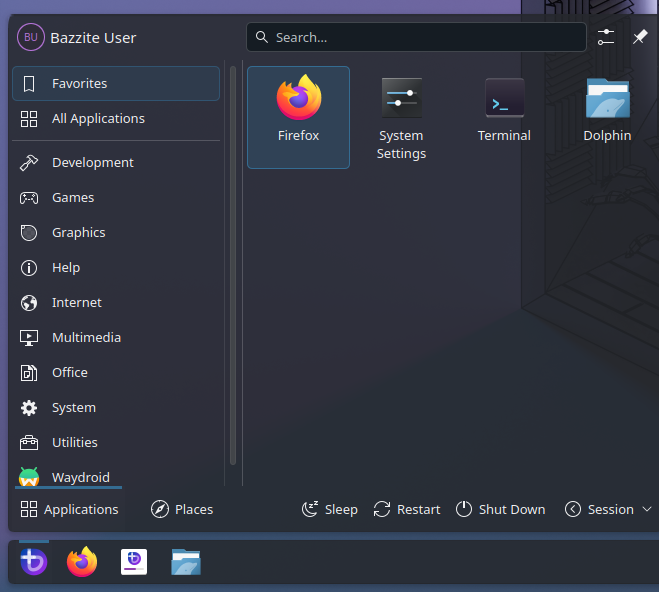
2. Введіть «disk» і відкрийте застосунок «Диски» (Disks)
   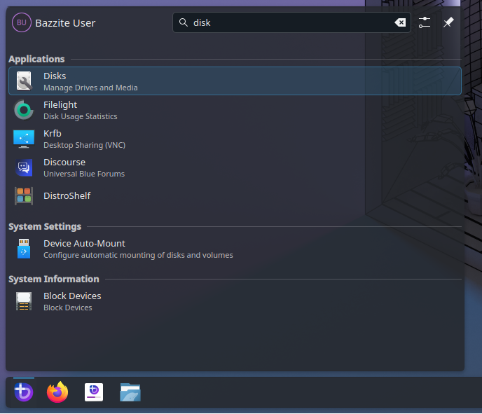
3. Виберіть диск, на який хочете встановити Bazzite
   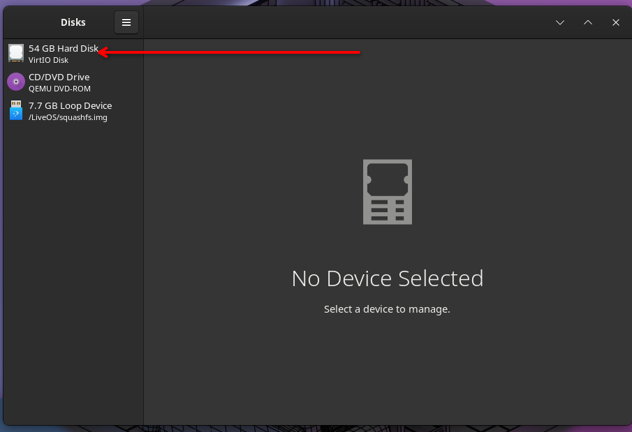
4. Знайдіть свій EFI-розділ: у нього файлова система FAT, і зазвичай він дуже малий
   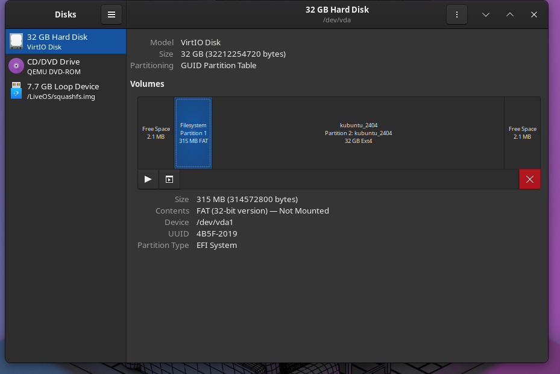
5. Змонтуйте EFI-розділ (якщо він ще не змонтований), натиснувши кнопку «Відтворити» (▶)
   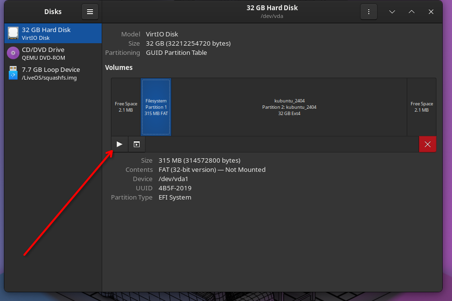
6. Натисніть синій текст поруч із написом «Mounted at» («Змонтовано в»)
   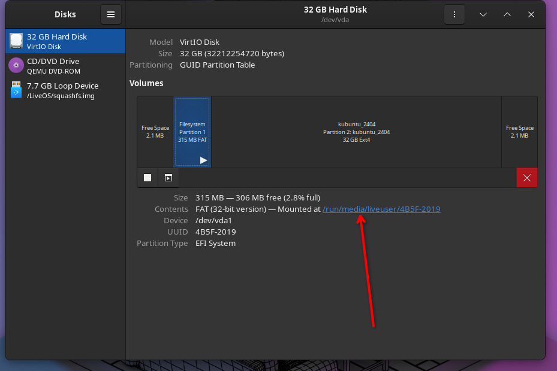
7. Двічі клацніть теку EFI
   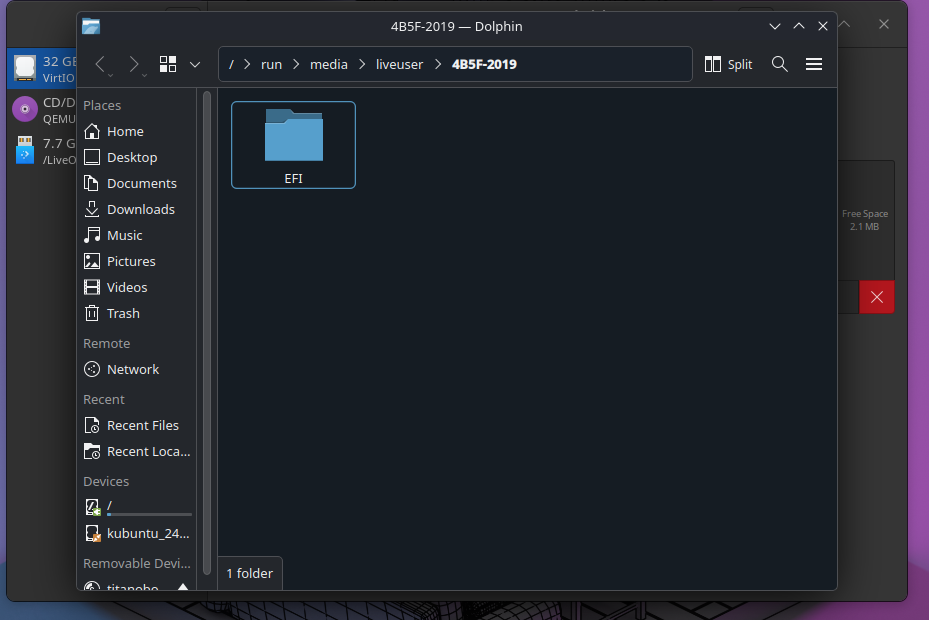
8. Знайдіть теку «Ubuntu» або «Fedora» і перемістіть її до смітника
   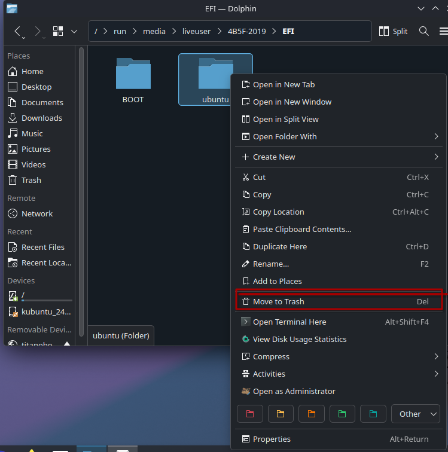
!!! warning 
    Не видаляйте жодних інших тек, наприклад Boot, Dell, HP або Microsoft, інакше Windows може не завантажуватися!
9. Перезавантажтеся і запустіть встановлювач знову. Можливо, варто видалити розділи, створені під час першої спроби встановлення.
   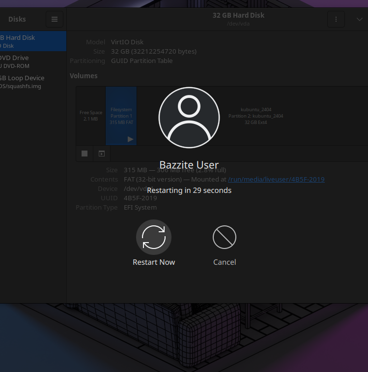
