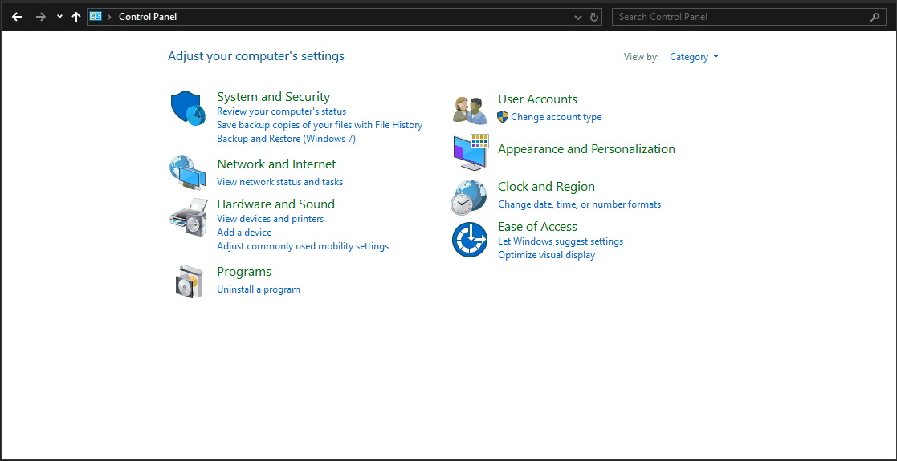

# Поширені проблеми та їх вирішення

## Зміст { #index }

- [Дисплей і графіка](#1-display-and-graphics)
- [Контролери та ігрове введення](#2-controllers-and-gaming-inputs)
- [Мережа і Wi-Fi](#3-network-and-wi-fi)
- [Робоче середовище і налаштування системи](#4-desktop-environment-and-system-configuration)
- [Застосунки та програмне забезпечення](#5-application-and-software)

---

## 1. Дисплей і графіка { #1-display-and-graphics }

### Курсор блимає або зник { #cursor-is-flickering-or-has-disappeared }

Зазвичай це через помилки в драйверах відеокарти. Як тимчасове рішення можна вимкнути апаратний курсор.

=== "KDE Plasma"

    Додайте змінну середовища цією командою:

    ```bash
    echo "KWIN_FORCE_SW_CURSOR=1" > ~/.config/environment.d/99-kwin-force-sw-cursor.conf
    ```

=== "GNOME"

    Додайте змінну середовища цією командою:

    ```bash
    echo "MUTTER_DEBUG_DISABLE_HW_CURSORS=1" > ~/.config/environment.d/99-mutter-disable-hw-cursor.conf
    ```

!!! warning "Це рішення може скоротити час роботи ноутбука або портативного пристрою від батареї."

---

### Flatpak-застосунки не мають апаратного прискорення на Nvidia { #flatpak-apps-have-no-hardware-acceleration-on-nvidia }

Якщо ви нещодавно оновили Bazzite на пристрої з відеокартою Nvidia, Flatpak-застосунки можуть працювати погано і/або без апаратного прискорення, і/або показувати попередження про **невідповідність середовища виконання Flatpak для Nvidia** (Nvidia Flatpak Runtime mismatch).

У такому разі оновіть усі Flatpak-застосунки в **Bazaar** або, якщо не хочете оновлювати інші Flatpak-застосунки, виберіть **Update Flatpak libraries for NVIDIA** у **Bazzite Portal** → **Troubleshoot**.

!!! info "Bazzite має службу systemd, яка робить це автоматично, але в деяких ситуаціях (наприклад, якщо під час запуску немає інтернету) оновлення все одно може знадобитися виконати вручну. Найкращим рішенням було б, щоб Flatpak і Nvidia покращили роботу з цими середовищами виконання, або щоб з'явився пакет, який надає драйвер Nvidia для Flatpak на основі системних бібліотек, але для цього потрібно набагато більше роботи."

---

### HDMI-CEC працює нестабільно { #hdmi-cec-does-not-work-consistently }

У [Bazzite Portal](../Installing_and_Managing_Software/Bazzite_Portal.md) виберіть **Troubleshoot → Change CEC mode**:

!!! note "Відомо, що `cecd` заважає виходу зі сну на HTPC, які використовують адаптери. Спробуйте режим dGPU і перевірте, чи HDMI-CEC працюватиме стабільно."

*   Режим dGPU (застарілий): використовує «застарілі» служби cec-control на основі `libcec` і `cec-ctl`, які добре працюють на HTPC з адаптерами на кшталт pulse8 і ugreen. Такі адаптери зазвичай використовують, бо на дискретних відеокартах не підключено контакт CEC 13.
*   Нативний режим (новий): використовує новішу систему Valve `linux-cec`/`cecd` і маскує застарілі служби.

!!! info "Нативний режим збирає `linux-cec` з репозиторію Valve на GitLab і містить модулі inputattach для CEC і linuxconsoletools, тож адаптери типу Pulse-Eight можна підключити до підсистеми CEC ядра. Проте відомо, що адаптери HDMI від Ugreen працюють у нативному режимі нестабільно."

---

### Відеокарта Nvidia Optimus не визначається на ноутбуках { #nvidia-optimus-gpu-not-detected-on-laptops }

Якщо Bazzite працює на ноутбуці з відеокартою Nvidia Optimus, ігри можуть працювати погано і, схоже, запускатися на вбудованій відеокарті.

У такому разі налаштуйте живлення відеокарт у попередньо встановленому застосунку [Cardwire](https://github.com/OpenGamingCollective/cardwire). Щоб відкрити його, просто знайдіть **cardwire** у пошуку.

> Більше про Cardwire [тут](../Advanced/cardwire.md)!

!!! info "Якщо вам потрібні **розширені функції Optimus**, на жаль, зараз **немає** робочого способу динамічно перемикати MUX, окрім дуже ранніх напрацювань для AMD SmartMUX. Зміна налаштувань MUX наразі **потребує** перезавантаження."

---

## 2. Контролери та ігрове введення { #2-controllers-and-gaming-inputs }

### Геймпади й джойстики портативних пристроїв не працюють у режимі робочого столу { #gamepads-and-handheld-joysticks-dont-work-in-desktop-mode }

Відкрийте **Налаштування Steam → Контролер → Неігрові розкладки контролера → Розкладка для режиму робочого столу** (Steam Settings → Controller → Non-Game Controller Layouts → Desktop Layout). Натисніть **Редагувати** (Edit) → **Увімкнути введення Steam** (Enable Steam Input) і налаштуйте, як контролер має працювати як клавіатура й миша в режимі робочого столу.

!!! Tip "**Чутливість правого джойстика** (Right Joystick Sensitivity) зазвичай треба знизити приблизно до 50–80 %. Інакше курсор миші рухатиметься надто швидко й неточно."

!!! Notice "У KDE Plasma 6.7 з'явилася функція керування робочим столом за допомогою контролера. Вона конфліктує з описаним вище способом емуляції в Steam, тож вимкніть її або, навпаки, вимкніть емуляцію Steam, якщо хочете користуватися вбудованою підтримкою контролерів у Plasma."

---

### Контролер Xbox через Bluetooth постійно підключається, а кнопка Xbox блимає { #xbox-controller-over-bluetooth-is-stuck-on-a-connecting-loop-and-the-xbox-button-keeps-flashing }

Це тому, що на контролері не найновіша прошивка.

Найпростіше рішення — підключити контролер до комп'ютера з Windows, завантажити застосунок Xbox Accessories і оновити прошивку контролера до найновішої. Після цього контролер має підключатися без проблем.

Складніший спосіб — запустити віртуальну машину з Windows, передати в неї контролер (passthrough) і оновити прошивку там.

---

## 3. Мережа і Wi-Fi { #3-network-and-wi-fi }

### Немає підключення до мережі в Bazzite при подвійному завантаженні з Windows { #no-network-connection-in-bazzite-when-dual-booting-with-windows }

Якщо у вас подвійне завантаження Windows і Bazzite, а Wi-Fi або дротове підключення працює у Windows, але іноді не працює в Bazzite, найімовірніше, причина у функції швидкого запуску Windows (Fast Startup).

Швидкий запуск — це функція Windows, яка переводить комп'ютер у гібридний стан між вимкненням і глибоким сном (гібернацією), щоб Windows запускалася швидше. Проте це налаштування може блокувати пристрої, зокрема Wi-Fi, Ethernet та, можливо, інше обладнання. Одне з рішень — вибирати «Перезавантажити» замість «Завершити роботу», бо тоді комп'ютер повністю вимикається й вмикається. Але краще просто вимкнути швидкий запуск.

Для цього:

-   Відкрийте **Панель керування** (Control Panel)
-   Натисніть **Устаткування та звук** (Hardware and Sound)
-   У розділі «Електроживлення» (Power Options) натисніть **Дії кнопок живлення** (Change what the power buttons do)
-   Натисніть **Змінення недоступних зараз параметрів** (Change settings that are currently unavailable)
-   Зніміть прапорець **Увімкнути швидкий запуск (рекомендовано)** (Turn on fast startup (recommended))
-   (Необов'язково) Зніміть також прапорець **Режим глибокого сну** (Hibernate), якщо ви ним не користуєтеся, бо він може спричиняти ті самі проблеми, що й швидкий запуск
-   Натисніть **Зберегти зміни** (Save changes)

!!! note "В українській Windows назви цих пунктів можуть дещо відрізнятися залежно від версії, тому в дужках наведено англійські назви."



Тепер, коли ви вибиратимете «Завершити роботу», Windows повністю вимикатиметься й не заважатиме Bazzite.

---

### Wi-Fi повільний або з'являються стрибки затримки { #wi-fi-is-slow-wi-fi-lag-spikes }

Функція енергозбереження Wi-Fi у Linux на деяких пристроях може працювати погано. Якщо у Windows цієї проблеми немає, спробуйте рішення нижче.

> Для пристроїв з образом `-deck` дотримуйтеся [цих інструкцій](../Handheld_and_HTPC_edition/quirks.md#wi-fi-is-slow-wi-fi-lag-spikes).

Відкрийте термінал і виконайте `ip link show`. Команда покаже всі мережеві пристрої, і результат має виглядати приблизно так:


```

1: lo: <LOOPBACK,UP,LOWER_UP> mtu 65536 qdisc noqueue state UNKNOWN mode DEFAULT group default qlen 1000
link/loopback 00:00:00:00:00:00 brd 00:00:00:00:00:00
2: wlp6s0: <BROADCAST,MULTICAST,UP,LOWER_UP> mtu 1500 qdisc noqueue state UP mode DORMANT group default qlen 1000
link/ether 00:00:00:00:00:00 brd ff:ff:ff:ff:ff:ff permaddr 00:00:00:00:00:00

```

Нас цікавить пристрій Wi-Fi. У цьому прикладі (ROG Ally) він називається `wlp6s0`.

!!! tip "Ще одна поширена назва пристрою Wi-Fi — `wlan0`."

Далі виконайте `iw wlp6s0 get power_save` (замініть `wlp6s0`, якщо ваш пристрій називається інакше), щоб перевірити, чи ввімкнено енергозбереження:

```

Power save: on

```

Тепер можна налаштувати NetworkManager так, щоб вимкнути енергозбереження для всіх пристроїв Wi-Fi. Відкрийте термінал і виконайте:

```bash
echo -e "[connection]\nwifi.powersave = 2" | sudo tee /etc/NetworkManager/conf.d/wifi-powersave-off.conf
systemctl restart NetworkManager

```

Потім виконайте `iw wlp6s0 get power_save`, щоб переконатися, що енергозбереження вимкнено:

```
Power save: off

```

!!! warning "Це рішення може скоротити час роботи ноутбука або портативного пристрою від батареї."

Щоб скасувати цю зміну, видаліть файл конфігурації:

```bash
sudo rm /etc/NetworkManager/conf.d/wifi-powersave-off.conf
systemctl restart NetworkManager

```

---

### Проблеми, характерні для `iwd` { #iwd-specific-issues }

??? quote "Розгорніть, щоб дізнатися більше"

    Розробку [`iwd`](https://wiki.archlinux.org/title/Iwd) припинено, бо Intel змістила свої пріоритети з відкритого коду. Його більше немає в нових образах, бо він не працює з новішими ядрами, а ці інструкції залишено лише для повноти.

    !!! warning "Нижче описано проблеми, характерні для [`iwd`](https://wiki.archlinux.org/title/Iwd). Наполегливо радимо [змінити бекенд Wi-Fi](#switching-wi-fi-backends) на [`wpa_supplicant`](https://wiki.archlinux.org/title/Wpa_supplicant), бо Intel більше не підтримує проєкт [`iwd`](https://wiki.archlinux.org/title/Iwd)."

    !!! info "У нових образах, де [`iwd`](https://wiki.archlinux.org/title/Iwd) видалено, бекенд автоматично зміниться на [`wpa_supplicant`](https://wiki.archlinux.org/title/Wpa_supplicant) під час завантаження нового образу. Інструкції нижче стосуються лише образів, у яких [`iwd`](https://wiki.archlinux.org/title/Iwd) ще є."

    ---

    #### Зміна бекенду Wi-Fi { #switching-wi-fi-backends }

    Щоб змінити бекенд Wi-Fi, відкрийте [Bazzite Portal](../Installing_and_Managing_Software/Bazzite_Portal.md) і на сторінці **Troubleshooting** виберіть **Change Wi-Fi system back-end**.

    ---

    #### Wi-Fi повільний або з'являються стрибки затримки (IWD) { #wi-fi-is-slow-wi-fi-lag-spikes-iwd }

    Налаштуємо iwd так, щоб він не використовував енергозбереження для жодного пристрою Wi-Fi. Відкрийте термінал і виконайте:

    ```bash
    echo -e "[DriverQuirks]\nPowerSaveDisable = *" | sudo tee /etc/iwd/main.conf
    systemctl restart iwd
    ```

    Потім виконайте `iw wlp6s0 get power_save`, щоб переконатися, що енергозбереження вимкнено:
    ```
    Power save: off
    ```

    !!! warning "Це рішення може скоротити час роботи ноутбука або портативного пристрою від батареї."

    Щоб скасувати цю зміну, видаліть файл конфігурації:
    ```bash
    sudo rm /etc/iwd/main.conf
    systemctl restart iwd
    ```

    ---

    #### Помилка під час підключення до Wi-Fi: «Failed to add new connection: 802.1x connections must have IWD provisioning files» { #error-on-connecting-to-wi-fi-failed-to-add-new-connection-8021x-connections-must-have-iwd-provisioning-files }

    З бекендом `iwd` NetworkManager не може автоматично створювати підключення 802.1x.

    Якщо вам потрібно й далі користуватися бекендом `iwd` і ви просто хочете підключитися до `eduroam`, виконайте такі кроки:

    ```bash
    sudo nano /var/lib/iwd/eduroam.8021x
    ```

    Потім додайте таке:

    ```bash
    [Security]
    EAP-Method=PEAP
    EAP-Identity=anonymous@<university.domain>
    EAP-PEAP-Phase2-Method=MSCHAPV2
    EAP-PEAP-Phase2-Identity=<username@university.domain>
    EAP-PEAP-Phase2-Password=<password>

    [Settings]
    AutoConnect=true
    ```

    Обов'язково замініть `<university.domain>`, `<username@university.domain>` і `<password>` своїми даними для входу. Потім натисніть `Ctrl+X` і `Y`, щоб зберегти файл і вийти.

    Тепер спробуйте підключитися знову. Якщо підключитися все одно не вдається, виконайте:

    ```bash
    nmcli connection modify eduroam 802-1x.phase1-auth-flags 32
    ```

    І спробуйте підключитися ще раз.

    ---

    #### Помилка під час підключення до Wi-Fi: «IP configuration was unavailable» у бездротових мережах 802.1x { #error-on-connecting-to-wi-fi-ip-configuration-was-unavailable-when-connecting-to-8021x-wireless-networks }

    !!! warning "Ця проблема характерна для [`iwd`](https://wiki.archlinux.org/title/Iwd). Наполегливо радимо [змінити бекенд Wi-Fi](#switching-wi-fi-backends) на [`wpa_supplicant`](https://wiki.archlinux.org/title/Wpa_supplicant), бо Intel більше не підтримує проєкт [`iwd`](https://wiki.archlinux.org/title/Iwd)."

    !!! warning "[`iwd`](https://wiki.archlinux.org/title/Iwd) більше немає в нових образах, бо він не працює з новішими ядрами. Ці інструкції залишено лише для повноти."

    Перевірте системний журнал командою `ujust logs-this-boot | grep NetworkManager`. Ви маєте побачити щось подібне:

    ```console
    NetworkManager[1563]: <info>  [1770094603.8488] device (wlan0): state change: failed -> disconnected (reason 'none', managed-type: 'full')
    NetworkManager[1563]: <info>  [1770094603.8568] dhcp4 (wlan0): canceled DHCP transaction
    NetworkManager[1563]: <info>  [1770094603.8569] dhcp4 (wlan0): activation: beginning transaction (timeout in 45 seconds)
    NetworkManager[1563]: <info>  [1770094603.8569] dhcp4 (wlan0): state changed no lease
    ```

    З бекендом `iwd` NetworkManager може не отримати адресу DHCP у корпоративній мережі, якщо ви раніше підключалися до неї з іншим бекендом або в іншій ОС.

    Якщо ви хочете й далі користуватися бекендом `iwd`, виконайте такі кроки:

    ```bash
    sudo mkdir -p /etc/iwd/
    sudo nano /etc/iwd/main.conf
    ```

    Потім додайте таке:

    ```ini
    [General]
    AddressRandomization=network
    ```

    Після цього натисніть `Ctrl+X` і `Y`, щоб зберегти файл і вийти, а потім перезапустіть `iwd`:

    ```bash
    systemctl daemon-reload
    systemctl restart iwd
    ```

    Тепер ви маєте змогти підключитися до корпоративної мережі.

---

## 4. Робоче середовище і налаштування системи { #4-desktop-environment-and-system-configuration }

### Вимкнення спливної панелі спецсимволів у KDE Plasma { #disable-special-character-pop-up-on-kde-plasma }

У KDE Plasma 6.7 з'явилася функція Plasma Keyboard, яка показує на екрані спливну панель, коли певні клавіші утримують деякий час.

Її можна вимкнути в **Системні параметри → Клавіатура → Екранна клавіатура → Показувати контекстну панель при утримання клавіші** (System Settings → Keyboard → On-Screen Keyboard → Show popup when holding a key).


---

### Спільний доступ SMB у Dolphin не працює { #dolphin-smb-share-does-not-work }

Це тому, що в атомарних системах групи й користувачі влаштовані трохи інакше й зберігаються не там, де їх очікує Dolphin, тож кнопка додавання користувача до групи насправді не працює.

Вам потрібно вручну додати свого користувача до групи **`usershares`**.

> Докладні інструкції — [тут](../Advanced/add-user-to-group.md).

---

### Автоматичний вхід у настільних версіях Bazzite { #setting-bazzites-desktop-editions-to-automatically-login }

=== "KDE Plasma"

    Відкрийте **Системні параметри → Безпека і конфіденційність → Вікно входу** (System Settings → Security & Privacy → Login Screen). Позначте **«Автоматично увійти»** (Automatically log in), виберіть свого користувача, а як сеанс виберіть **«Плазма»** (Plasma) і не забудьте натиснути кнопку **«Застосувати»** (Apply).

=== "GNOME"

    Відкрийте **Параметри → Система → Користувачі** (Settings → System → Users). Натисніть кнопку **Розблокувати…** (Unlock) у верхньому правому куті. Потім увімкніть **Автоматичний вхід** (Automatic Login).

---

### Вихід зі сну не працює з деякими материнськими платами Gigabyte { #waking-from-sleep-doesnt-work-with-some-gigabyte-motherboards }

<small>_Чому життя спить? ...Бо материнські плати Gigabyte не можуть прокинутися._</small>

Після переходу в сон материнська плата Gigabyte може не вийти з нього правильно, і екран залишається чорним до перезавантаження.

Це можна виправити, вимкнувши пробудження від GPP0 і GPP8. Для цього є прихована команда ujust, яка вмикає і вимикає це виправлення:

```bash
ujust _toggle-gigabyte-wake-fix

```

---

## 5. Застосунки та програмне забезпечення { #5-application-and-software }

### Firefox і KeePassXC не працюють разом { #firefox-and-keepassxc-does-not-work-together }

Це тому, що KeePassXC (або інший менеджер паролів, встановлений через Flatpak) працює в ізольованому середовищі (пісочниці), і до нього може звертатися лише застосунок поза пісочницею.

Можна спробувати встановити Firefox і KeePassXC через distrobox, хоча можуть виникнути проблеми з апаратним прискоренням.

!!! info "Також можна спробувати [цей посібник](https://discourse.flathub.org/t/how-to-run-firefox-and-keepassxc-in-a-flatpak-and-get-the-keepassxc-browser-add-on-to-work/437). Зверніть увагу, що Bazzite офіційно не підтримує й не схвалює цей посібник, і його наведено лише для повноти. Дотримуйтеся його лише **на власний ризик**."

---

### Налаштування HTPC на застарілому обладнанні { #htpc-legacy-hardware-setup }

Ігровий режим Steam підтримується не на всіх відеокартах, тож посібник нижче допоможе налаштувати схожий досвід на настільному образі Bazzite.

[Увімкніть автоматичний вхід](#setting-bazzites-desktop-editions-to-automatically-login) і налаштуйте Steam так, щоб він автоматично запускався в режимі Big Picture. Так ви отримаєте зручний досвід для гри з дивана.

Є відеопосібник для образу Bazzite з GNOME і відеокартою Nvidia (знятий ще до того, як ігровий режим Steam запрацював на обладнанні Nvidia, але ідея та сама):

https://www.youtube.com/watch?v=F9l-RQvCPMo

!!! info "Якщо ви користуєтеся образом Bazzite з KDE Plasma, можна пропустити розділ «Making Gnome look more familiar to Windows users», просто увімкнути автоматичний вхід і додати режим Big Picture у Steam до автозапуску в **Системні параметри → Автозапуск** (Settings → Autostart)."

---

### Режим Big Picture у Steam працює повільно { #steam-big-picture-mode-is-slow }

Якщо вибрати **Steam → Вигляд → Режим Big Picture** (Steam Menu → View → Big Picture), інтерфейс працює повільно, хоча ігри, запущені з нього, працюють плавно.

У такому разі повністю закрийте Steam і запустіть його через ярлик **Режим Steam Big Picture** (Steam Big Picture Mode) у меню застосунків. Також переконайтеся, що в налаштуваннях Steam увімкнено **Налаштування Steam → Інтерфейс → Пришвидшити візуалізацію веб-сторінок за допомогою відеокарти (потрібен перезапуск)** (Steam Settings → Interface → Enable GPU accelerated rendering in web views (requires restart)).

> **Примітка**: це також усуває проблеми з продуктивністю в ігровому режимі Steam на відеокартах Nvidia, але меню Steam і бічне меню іноді можуть відображатися неправильно.

---
