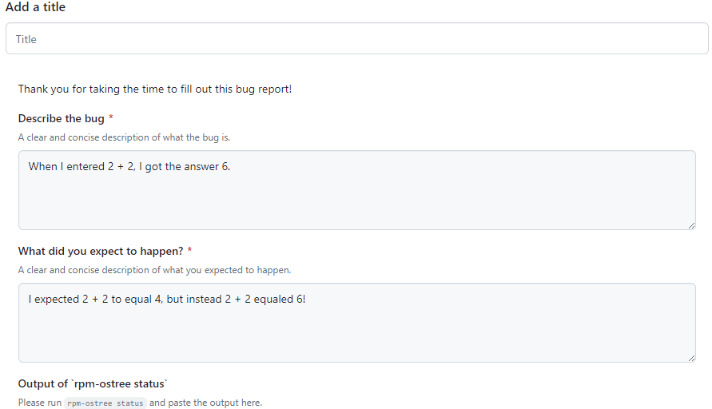

# Повідомлення про помилки

## Повідомляйте про помилки в правильному місці { #submit-bug-reports-in-the-appropriate-place }

Повідомляйте про помилки в Bazzite в нашому [**трекері проблем**](https://github.com/ublue-os/bazzite/issues)! Не радимо повідомляти про помилки на форумах Discourse: там повідомлення можуть загубитися, і розробники Bazzite переглядають їх рідше, ніж трекер проблем.

Якщо ви не впевнені, чи те, з чим ви зіткнулися, — помилка, можна запитати в каналах #bazzite-help на [Discord-сервері Bazzite](../community.md#discord-no-discord-account).

>Будь ласка, пишіть звіт про помилку англійською! Якщо перекладаєте його за допомогою LLM, додайте також свій оригінальний текст рідною мовою, щоб можна було помітити помилки або втрачений під час перекладу зміст.
    
>Якщо вам складно писати звіти про помилки англійською, можете додати [Needs Translation] до заголовка звіту. Учасники спільноти можуть допомогти його перекласти.

## Як заповнювати шаблон звіту про проблему Bazzite { #bazzite-issue-template-walkthrough }




## Оновіть Bazzite перед тим, як повідомляти { #update-bazzite-before-reporting }

Іноді помилки виправляються в оновленнях, тож перш ніж надсилати звіт, спробуйте оновити й перезавантажити пристрій і перевірте, чи проблема не зникла.

>**Як оновити Bazzite на вашому пристрої**:
>[**Посібник з оновлення**](../Installing_and_Managing_Software/Updates_Rollbacks_and_Rebasing/updating_guide.md)

## Обов'язково додайте системні журнали { #make-sure-to-attach-system-logs }

Відкрийте термінал основної системи і **введіть**:

```
ujust device-info
```

Додайте до звіту посилання на системні журнали, яке виведе команда.

## Система аварійно завершує роботу? { #experience-system-crashes }

```command
ujust logs-last-boot
```
Скопіюйте вивід у звіт про помилку. 
