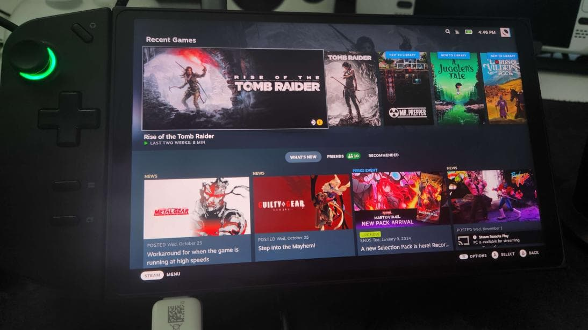
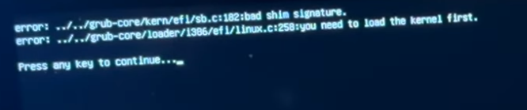

# Lenovo Handhelds

!!! disclaimer

    This wiki may contain outdated information.

## Lenovo Legion Go / Lenovo Legion Go 2 / Lenovo Legion Go S



---

### Known Issues

- Gyroscope is temporarily broken in Bazzite Deck 44 for the Legion Go 1
  - A patch to re-enable it is in development.
- Performance overlay may report inaccurate power consumption.
- Adaptive/auto display brightness is currently broken.
  - Manual brightness slider in Steam's UI should still work.
- Updating UEFI/BIOS and can be done by using ```fwupd``` or the "Firmware" flatpak, or in Windows if available, **at your own risk**.
  - **It is advised to disable Secure Boot before attempting a firmware update!**
- OGUI (OpenGamepadUI) will not control TDP or CPU Behavior at this time for Legion Go 2 devices, Decky or OGUI plugins may be needed for additional controls
- As of Deck 44, Charge limits can be set via desktop mode under power settings for you chosen Desktop Environment, the feature is not yet available in OGUI or the Steam QAM

---

### BIOS update breaks Secure Boot key



Read our [Secure Boot guide](/General/Installation_Guide/secure_boot.md#method-b-after-installation-method) to re-enroll the key after a BIOS update if you keep Secure Boot enabled, which is the default for this device.

!!! info

    As of July 2025, external monitors works without issues. The external display can be set to its respective native resolution and refresh rate.

If your screen doesn't display the correct output or looks grainy, noisy, or oddly colorful then you will have to enter a [TTY session](/Handheld_and_HTPC_edition/quirks.md#stuck-at-bazzite-logo) (see the TTY Method tab) or establish an ssh connection and enter this command:

```bash
mv ~/.config/kwinoutputconfig.json ~/.config/kwinoutputconfig.json.old
```

---

## External Resource

For more information, check out the [Legion Go Tips and Tricks guide](https://github.com/aarron-lee/legion-go-tricks) which includes useful scripts for this handheld.
