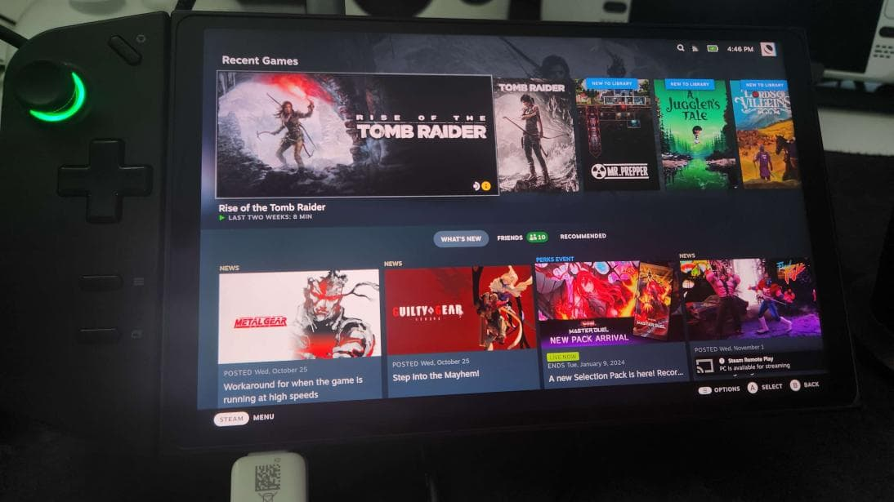
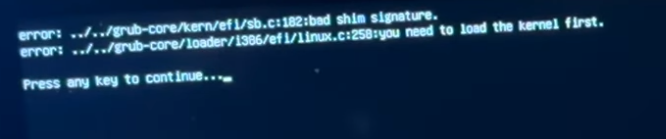

# Портативні пристрої Lenovo

!!! disclaimer

    Ця вікі може містити застарілу інформацію.

## Lenovo Legion Go / Lenovo Legion Go 2 / Lenovo Legion Go S { #lenovo-legion-go-lenovo-legion-go-2-lenovo-legion-go-s }



---

### Відомі проблеми { #known-issues }

- У Bazzite Deck 44 гіроскоп на Legion Go 1 тимчасово не працює
  - Латка, яка знову його ввімкне, у розробці.
- Оверлей продуктивності може показувати неточне енергоспоживання.
- Адаптивна (автоматична) яскравість дисплея зараз не працює.
  - Ручний повзунок яскравості в інтерфейсі Steam має працювати.
- Оновити UEFI/BIOS можна за допомогою ```fwupd``` або Flatpak-застосунку «Firmware», або у Windows, якщо вона є, **на власний ризик**.
  - **Перед оновленням прошивки радимо вимкнути Secure Boot!**
- OGUI (OpenGamepadUI) поки що не керує TDP і поведінкою процесора на пристроях Legion Go 2, тож для додаткового керування можуть знадобитися плагіни Decky або OGUI
- Починаючи з Deck 44, обмеження заряду можна задати в режимі робочого столу в налаштуваннях живлення вашого робочого середовища. В OGUI і QAM у Steam цієї функції поки немає

---

### Оновлення BIOS ламає ключ Secure Boot { #bios-update-breaks-secure-boot-key }



Якщо ви залишаєте Secure Boot увімкненим (а на цьому пристрої так за замовчуванням), після оновлення BIOS зареєструйте ключ повторно за нашим [посібником з Secure Boot](../../General/Installation_Guide/secure_boot.md#method-b-after-installation-method).

!!! info

    Станом на липень 2025 року зовнішні монітори працюють без проблем. Для зовнішнього дисплея можна встановити його рідну роздільність і частоту оновлення.

Якщо екран показує неправильне зображення або воно зернисте, шумне чи з дивними кольорами, відкрийте [сеанс TTY](../quirks.md#stuck-at-bazzite-logo) (вкладка «Через TTY») або підключіться через ssh і введіть цю команду:

```bash
mv ~/.config/kwinoutputconfig.json ~/.config/kwinoutputconfig.json.old
```

---

## Зовнішній ресурс { #external-resource }

Докладніше — у посібнику [Legion Go Tips and Tricks](https://github.com/aarron-lee/legion-go-tricks), де є корисні скрипти для цього портативного пристрою.
