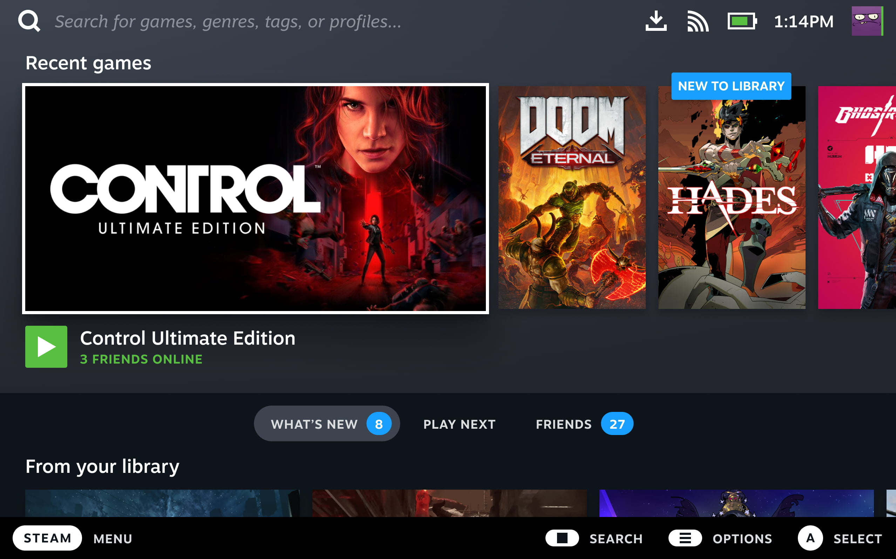

# Загальний огляд Bazzite-Deck

## Що таке Bazzite-Deck? { #what-is-bazzite-deck }

**Bazzite для домашніх кінотеатрів (HTPC) і портативних ПК**. Це середовище, зручне для керування контролером, яке дає «консольний» досвід, схожий на SteamOS на Steam Deck. Воно призначене як для портативних пристроїв, так і для домашніх кінотеатрів. Bazzite схожий на SteamOS і має багато спільних із нею пакунків, тож він готовий до ігор одразу після завершення встановлення.

Ця документація може не охоплювати деяких тем, бо вважається, що користувач уже знає, що таке SteamOS і як вона працює. Якщо вам щось незрозуміло, а в нашій документації цього немає, пошукайте своє питання, додавши ключові слова «SteamOS» або «Steam Deck». Або поставте запитання на наших [**форумах**](https://universal-blue.discourse.group/c/bazzite/5) чи в [**Discord**](https://discord.gg/f8MUghG5PB).

## Що таке ігровий режим Steam? { #what-is-steam-gaming-mode }

>Налаштування після встановлення і поширені проблеми на **портативних пристроях** описано в [**документації для портативних пристроїв**](../Handheld_and_HTPC_edition/Handheld_Wiki/index.md).

!!! note "Зверніть увагу: порівняно з традиційними робочими середовищами ігровий режим Steam має високі [вимоги до відеокарти](../Gaming/Hardware_compatibility_for_gaming.md)."

!!! important

    Бета-версія клієнта Steam **не** підтримується. Перш ніж повідомляти про проблеми, поверніться на стабільну версію клієнта.

https://www.youtube.com/watch?v=zXK1CXUyzXQ
**Огляд інтерфейсу Steam Deck від [Linux For Everyone](https://www.youtube.com/@LinuxForEveryone)**

Bazzite використовує ігровий режим Steam для портативних пристроїв і гри на дивані. Саме навколо ігрового режиму Steam побудовано SteamOS на Steam Deck: це простий інтерфейс, зручний для контролера, на основі інтерфейсу режиму Big Picture у Steam. Мінімальний сеанс запускає у фоні лише найнеобхідніше, тож більшість ресурсів обладнання йде на гру, у яку ви граєте.

[**Gamescope**](https://github.com/ValveSoftware/gamescope) — головна складова ігрового режиму Steam: він дає змогу обмежити частоту кадрів, налаштувати масштабування роздільної здатності тощо. Ігровий режим Steam також називають «gamepadUI» і «gamescope-session», але для однаковості в документації Bazzite його зазвичай називають «ігровим режимом Steam» (Steam Gaming Mode).

### Steam Input { #steam-input }

!!! note
        
    Деяким іграм і емуляторам для правильної роботи керування може знадобитися **вимкнути** Steam Input.

> Можете прочитати цей [посібник у Steam](https://steamcommunity.com/sharedfiles/filedetails/?id=2804823261) з **порадами щодо керування на Steam Deck; частина інформації стосується й усіх пристроїв з Bazzite-Deck**.

### Як відкрити бічні меню з фізичної клавіатури? { #how-do-i-open-the-side-menus-with-a-physical-keyboard }

**Головне меню Steam**: <kbd>Ctrl</kbd>/<kbd>Win</kbd>+<kbd>1</kbd>
**Меню швидкого доступу (QAM)**: <kbd>Ctrl</kbd>/<kbd>Win</kbd>+<kbd>2</kbd>

## Офіційний посібник Valve щодо SteamOS { #valves-official-steamos-guide }

!!! info

    Не вся інформація стосуватиметься Bazzite-Deck або буде для нього точною.

Valve написала [**посібник**](https://help.steampowered.com/en/faqs/view/7DD4-C618-182E-0E49) для Steam Deck, у якому може бути корисна інформація і для Bazzite.
