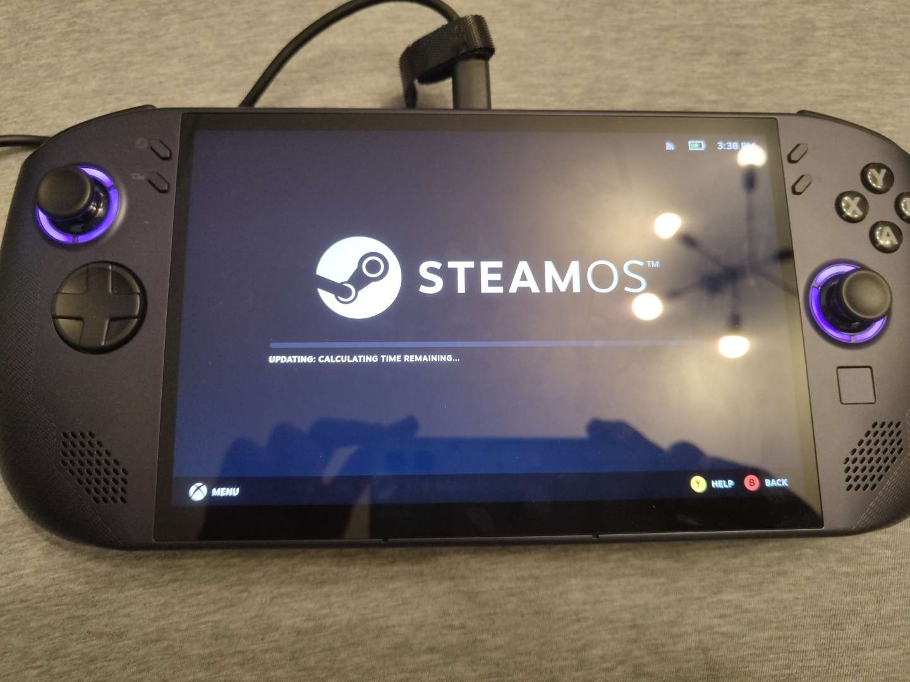
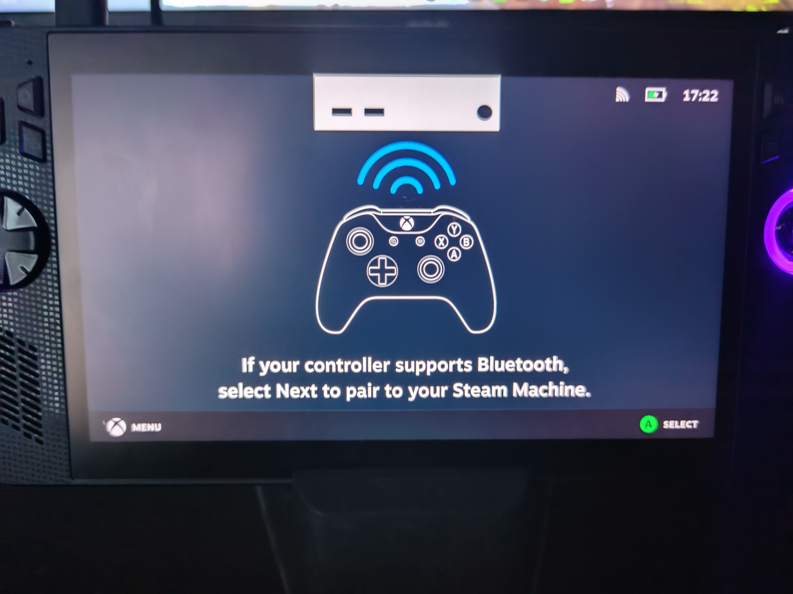

# Особливості ігрового режиму Steam і способи їх обійти

> Загальніший посібник — у розділі [Сумісність портативних пристроїв](./Handheld_Wiki/index.md).

## Зміст { #index }

- [Проблеми із завантаженням і запуском](#1-boot-and-startup-issues)
- [Дисплей і виведення відео](#2-display-and-video-output)
- [Проблеми зі звуком](#3-audio-issues)
- [Введення, клавіатура й контролери](#4-input-keyboard-and-controllers)
- [Продуктивність, живлення й обладнання](#5-performance-power-and-hardware)
- [Decky Loader, OGUI і доповнення](#6-decky-loader-ogui-and-addons)
- [Накопичувачі й файлова система](#7-storage-and-file-system)
- [Інше](#8-miscellaneous)

---

## 1. Проблеми із завантаженням і запуском { #1-boot-and-startup-issues }

### Чорний екран під час завантаження в ігровий режим { #black-screen-when-booting-into-gaming-mode }

Якщо:

- після індикатора завантаження Bazzite з'являється чорний екран,
- немає підключення до інтернету,
- очевидно, що Steam намагається оновитися, але не може через відсутній або повільний інтернет;

можете скористатися [цими інструкціями](#unable-to-progress-past-controller-screen), щоб завантажитися в режим робочого столу.

---

### Завантаження зупиняється на логотипі Bazzite { #stuck-at-bazzite-logo }

!!! info "Інструкції нижче підходять і для випадку, коли [Steam та ігровий режим Steam не працюють](#steam-and-steam-gaming-mode-are-broken)."

=== "Через режим робочого столу"

    Відкрийте Bazzite Portal → Troubleshoot → Reset Steam installation, а потім перезавантажте пристрій.

=== "Через TTY (_якщо не вдається увійти в режим робочого столу_)"

    Відкрийте сеанс TTY комбінацією <kbd>Ctrl</kbd>+<kbd>Alt</kbd>+<kbd>F4</kbd>, увійдіть зі своїм іменем користувача й паролем Bazzite, а потім введіть цю команду:
    
    !!! info "Якщо ви не задали ім'я користувача й пароль під час встановлення, за замовчуванням обидва — `bazzite`."
    
    ```bash
    ujust fix-reset-steam
    ```
    Потім можна перезавантажити пристрій цією командою:
    
    ```bash
    systemctl reboot
    ```

=== "Через резервну копію"

    !!! warning

        Перш ніж виконувати наступні кроки, спробуйте просто перезавантажити пристрій! Якщо зробити це неправильно, можна втратити ігри, збереження та інші дані.

    Натисніть <kbd>Ctrl</kbd>+<kbd>Alt</kbd>+<kbd>F4</kbd>, щоб відкрити TTY, увійдіть зі своїм іменем користувача й паролем Bazzite і виконайте цю команду.
    
    !!! info "Якщо ви не задали ім'я користувача й пароль під час налаштування, за замовчуванням обидва — `bazzite`."
    
    ```bash
    mv ~/.local/share/Steam ~/.local/share/Steam.bak
    ```

    2.  Ця команда перейменує теку `Steam` на `Steam.bak`. Після перезапуску Steam автоматично створить теку `Steam` заново.
    3.   Якщо раніше у вас були ігри у внутрішньому сховищі, ви можете перенести їх із перейменованої теки `Steam.bak` у нову теку `Steam`.
    4.  Щоб вийти з TTY, натисніть <kbd>Ctrl</kbd>+<kbd>Alt</kbd>+<kbd>F2</kbd>.

> Також можна скористатися відеопосібником нижче:
https://www.youtube.com/watch?v=gE1ff72g2Gk

---

### Оновлення зависає на «Update calculating: Time Remaining» { #stuck-on-update-calculating-time-remaining }



Перезавантажте пристрій.

---

### Steam та ігровий режим Steam не працюють { #steam-and-steam-gaming-mode-are-broken }

Якщо ігровий режим Steam не запускається через проблему з клієнтом Steam:

Скористайтеся [цими інструкціями](#stuck-at-bazzite-logo).

---

### Не вдається пройти далі екрана підключення контролера { #unable-to-progress-past-controller-screen }

!!! info "Інструкції нижче підходять і для випадку [чорного екрана під час завантаження в ігровий режим](#black-screen-when-booting-into-gaming-mode)."



1. Відкрийте сеанс TTY за допомогою **зовнішньої фізичної клавіатури** цією **комбінацією клавіш**:
    <kbd>Ctrl</kbd>+<kbd>Alt</kbd>+<kbd>F4</kbd>
2. Увійдіть під своїм користувачем.
3. Введіть цю команду:
```bash
steamosctl switch-to-desktop-mode
```
4. Увійдіть у Steam у режимі робочого столу й перезавантажте пристрій.

---

## 2. Дисплей і виведення відео { #2-display-and-video-output }

### Мерехтіння й нестабільна робота на деяких дисплеях { #flickering-and-instability-on-some-displays }

Причина в тому, як відеокарти AMD змінюють стани живлення. Про цю проблему вже повідомили розробникам першоджерела (upstream), щоб її виправили.

Щоб обійти її, можна скористатися такими способами.

1. Завжди тримайте VRR увімкненим в ігровому режимі Steam.
2. У режимі робочого столу встановіть частоту оновлення 60 Гц, а **Адаптивну синхронізацію** (Adaptive Sync) — **Ніколи** (Never) або **Завжди** (Always).

Або, доки проблему не виправлять, можна за допомогою LACT перевести відеокарту на максимальне живлення й зберегти це як профіль за замовчуванням.

> Якщо хочете допомогти з повідомленням про цю помилку, це можна зробити [тут](https://gitlab.freedesktop.org/drm/amd/-/work_items/5649).

---

### Райдужне зображення { #rainbow-display }


Вимкніть і знову ввімкніть HDR у меню швидкого доступу.

??? note "Можливо, також доведеться ввімкнути параметр **«Примусове компонування»** (Force Composite) у параметрах розробника."

    Для цього:

    1. Налаштування Steam → Система → **Режим розробника** (Steam Settings → System → Enable Developer Mode)
    2. Налаштування Steam → Розробник → позначте **Примусове компонування** (Steam Settings → Developer → Force Composite)

---

### VRR не працює на дисплеях із підтримкою VRR { #vrr-not-working-on-vrr-compatible-displays }

!!! info "Підтримку HDMI 2.1 FRL, VRR і DSC для відеокарт AMD додано в ядро Linux версії 7.2. [Оновіться до найновішої версії Bazzite](../Installing_and_Managing_Software/Updates_Rollbacks_and_Rebasing/updating_guide.md), щоб користуватися цією функцією!"

Увімкніть її в **Bazzite Portal → Tweak Systems → Enable HDMI 2.1 for AMD graphics cards**.

!!! note "На деяких дисплеях це може спричинити мерехтіння й нестабільну роботу."

> Докладніше про це можна прочитати [тут](https://www.phoronix.com/news/HDMI-2.1-OSS-Rejected).

---

### Проблеми ігрового режиму Steam, характерні для відеокарт Nvidia { #nvidia-gpu-exclusive-issues-with-steam-gaming-mode }

- Щоб інтерфейс працював швидше, у налаштуваннях Steam треба ввімкнути «Пришвидшити візуалізацію веб-сторінок за допомогою відеокарти (потрібен перезапуск)» (Enable GPU accelerated rendering in web views (requires restart)).
  - Найімовірніше, з цим параметром в іграх з'являться графічні артефакти, через які грати неможливо.

---

### Вибір правильного монітора для ігрового режиму (лише HTPC) { #specifying-correct-monitor-for-gaming-mode-htpc-only }

У режимі робочого столу відкрийте термінал хост-системи й виконайте цю **команду**, щоб дізнатися назву виходу дисплея:

=== "KDE"

    ```bash
    kscreen-doctor -o
    ```

=== "GNOME"

    ```bash
    gnome-randr
    ```
    !!! note

        Повідомляють, що на деяких системах `gnome-randr` може неправильно показувати назву виходу дисплея. Команда нижче покаже назви всіх підключених виходів без подробиць. Порівняйте їх із результатом попередньої команди, щоб знайти справжню назву виходу дисплея.
    
        ```bash
        grep -r '^connected' /sys/class/drm/*/status | grep -Po 'card.?-\K([^/]*)'
        ```

Знайшовши правильну назву виходу дисплея, створіть файл, який вкаже ігровому режиму Steam використовувати ваш дисплей.

=== "Через графічний інтерфейс"
    
    У режимі робочого столу або у вкладеному робочому столі (Nested Desktop):
    
    1. Створіть теку `~/.config/environment.d`, якщо її ще немає.
    
    2. Створіть у цій теці файл `10-gamescope-session.conf`, якщо його ще немає.

    3. Додайте у файл такий рядок:
        `OUTPUT_CONNECTOR=DP-1`
    !!! info "Обов'язково замініть `DP-1` на назву свого виходу дисплея!"
    
    4. Збережіть файл, перезавантажте пристрій і переконайтеся, що зображення виводиться на правильний дисплей.
    
=== "Через командний рядок"
    
    Створіть файл такими командами:
    
    !!! info "Обов'язково замініть `DP-1` на назву свого виходу дисплея!"
    
    ```bash
    mkdir -p ~/.config/environment.d
    echo "OUTPUT_CONNECTOR=DP-1" >> ~/.config/environment.d/10-gamescope-session.conf
    ```

---

## 3. Проблеми зі звуком { #3-audio-issues }

### Не працює виведення звуку (пристрій за замовчуванням) { #audio-output-not-working-default-device }

Зазвичай це трапляється зі звуком через HDMI на телевізорі. Перейдіть у режим робочого столу й у **Системних параметрах** (System Settings) вимкніть пристрої, які не відповідають виходу звуку, яким ви користуєтеся.

!!! info "Типове рішення — вимкнути все, крім HDMI, для звуку з телевізора."

---

## 4. Введення, клавіатура й контролери { #4-input-keyboard-and-controllers }

### Зміна розкладки фізичної клавіатури для ігрового режиму Steam { #change-physical-keyboard-layout-for-steam-gaming-mode }

В ігровому режимі Steam немає офіційного способу змінити розкладку фізичної клавіатури, і за замовчуванням використовується американська розкладка (US). Щоб змінити її, можна задати розкладку глобально через змінну середовища.

=== "Через графічний інтерфейс"
    
    У режимі робочого столу або у вкладеному робочому столі (Nested Desktop):
    
    1. Створіть теку `~/.config/environment.d`, якщо її ще немає.
    
    2. Створіть у цій теці файл `10-gamescope-session.conf`, якщо його ще немає.

    3. Додайте у файл такий рядок, замінивши `us` на потрібну розкладку.
        ```console
        XKB_DEFAULT_LAYOUT=us
        ```
    4. Збережіть файл, перезавантажте пристрій і переконайтеся, що розкладка клавіатури правильна.
    
=== "Через командний рядок"
    
    Створіть файл такими командами, замінивши `us` на потрібну розкладку:
    
    ```bash
    mkdir -p ~/.config/environment.d
    echo "XKB_DEFAULT_LAYOUT=us" >> ~/.config/environment.d/10-gamescope-session.conf
    ```
    
!!! info 

    Назва розкладки зазвичай збігається з [дволітерним кодом країни](https://en.wikipedia.org/wiki/ISO_3166-1_alpha-2#Officially_assigned_code_elements).
    Також можна скористатися однією з цих команд, щоб побачити список без описів:

    -   `localectl list-x11-keymap-models`
    -   `localectl list-x11-keymap-layouts`
    -   `localectl list-x11-keymap-variants [layout]`
    -   `localectl list-x11-keymap-options`

!!! note 

    Це рішення працює і в режимі робочого столу, зокрема у вкладеному Gamescope (Nested Gamescope) або вкладеному робочому столі (Nested Desktop), але має свої особливості:
    
    -   <kbd>altgr</kbd> + <kbd>2</kbd>, щоб набрати `@` у норвезькій розкладці, однаково не працюватиме, хоча сама розкладка працює. На щастя, для звичайного набору тексту в норвезькій розкладці клавіша <kbd>altgr</kbd> не потрібна.
    -   Повідомляють, що у французькій розкладці клавіша <kbd>altgr</kbd> працює.
    -   З іншими розкладками результат може відрізнятися.

---

### Використання SteamDeckGyroDSU не на Steam Deck { #use-steamdeckgyrodsu-on-non-steam-deck-hardware }

Зазвичай SteamDeckGyroDSU не працює поза Steam Deck, але можна спробувати вимкнути введення Steam: залежно від обладнання й сценарію використання це _може_ спрацювати.

---

### Вимкнення деяких функцій «Steam Deck» { #disabling-certain-steam-deck-features }

**Коли це потрібно**:

- клавіатура й миша не працюють у певній грі;
- не запускається лаунчер гри для налаштування графіки або встановлення модів;
- деякі функції або параметри графіки недоступні.

Відкрийте властивості гри в Steam і [**додайте цей параметр запуску**](../Gaming/launch-options-env-variables.md#where-to-set-launch-options):

```bash
sd0 %command%
```
> Докладніше про параметри запуску та змінні середовища — [тут](../Gaming/launch-options-env-variables.md)

---

## 5. Продуктивність, живлення й обладнання { #5-performance-power-and-hardware }

### Немає керування вентиляторами { #fan-control-functionality-missing }

[Bazzite Deck 44](https://universal-blue.discourse.group/t/bazzites-biggest-update-deck-44-has-launched-happy-birthday-to-universal-blue/12373) приносить великі зміни в наш набір компонентів для портативних пристроїв. З цим новим набором деякі пристрої можуть утратити керування вентиляторами, але для OGUI розробляється плагін, який його поверне. Якщо це стосується вас, напишіть нам на GitHub, і ми повідомимо вас, коли він з'явиться.

---

### Немає керування TDP { #tdp-controls-missing }

> Див. [Сумісність портативних пристроїв](./Handheld_Wiki/index.md#tdp-controls).

---

### Вибір відеокарти для ігрового режиму Steam { #specifying-steam-gaming-mode-gpu-usage }

Відкрийте сеанс TTY за допомогою **зовнішньої фізичної клавіатури** цією **комбінацією клавіш**: <kbd>Ctrl</kbd>+<kbd>Alt</kbd>+<kbd>F4</kbd>

!!! info "У Bazzite-Deck 44 цю функцію замінив новий менеджер відеокарт [CardWire](https://github.com/OpenGamingCollective/cardwire)."
   
```bash
export-gpu
```

---

### Wi-Fi повільний або з'являються стрибки затримки { #wi-fi-is-slow-wi-fi-lag-spikes }

Функція енергозбереження Wi-Fi у Linux на деяких пристроях може працювати погано. Якщо у Windows цієї проблеми немає, спробуйте рішення нижче.

!!! info "Цей розділ стосується пристроїв з образами `-deck`. Для настільних образів дивіться [тут](../General/issues_and_resolutions.md#wi-fi-is-slow-wi-fi-lag-spikes)."

Якщо ви користуєтеся ігровим режимом Steam (тобто система не завантажується одразу в робоче середовище на кшталт KDE або GNOME), спробуйте:

1. Налаштування Steam → Система → Режим розробника (Steam Settings → System → Enable Developer Mode)
2. Налаштування Steam → Розробник → зніміть позначку **Увімкнути керування енергоспоживанням Wi-Fi** (Steam Settings → Developer → Enable Wi-Fi Power Management)
3. Перезавантажте пристрій

---

## 6. Decky Loader, OGUI і доповнення { #6-decky-loader-ogui-and-addons }

### Плагіни Decky Loader не працюють { #decky-loader-plugins-not-functioning }

Деякі плагіни створено саме для SteamOS або Steam Deck, і вони не обов'язково працюватимуть у Bazzite або на іншому обладнанні.

- Наприклад, [плагін DeckMTP](https://github.com/dafta/DeckMTP) працює лише на моделях Steam Deck і не працюватиме на іншому обладнанні.

---

### Немає меню геймпада { #missing-gamepad-menu }

!!! tip "Якщо не знаєте, як відкрити меню OGUI на підтримуваних пристроях, дивіться [Сумісність портативних пристроїв](./Handheld_Wiki/index.md#how-do-i-open-the-ogui-overlay)."

!!! info "На Steam Deck і HTPC OpenGamepadUI за замовчуванням вимкнено."

Bazzite використовує список дозволених пристроїв, щоб вибірково вмикати OpenGamepadUI на портативних пристроях, яким він потрібен для роботи вбудованих джойстиків і бамперів. Якщо ввімкнути OpenGamepadUI на пристроях, яким він не потрібен, можуть виникнути непередбачувані проблеми.

Проте OpenGamepadUI можна ввімкнути або вимкнути цією командою:

```bash
ujust configure-opengamepadui
```

> Список дозволених пристроїв можна переглянути [тут](https://github.com/ublue-os/bazzite/blob/main/system_files/desktop/shared/usr/libexec/hwsupport/steamos-manager-hardware). Також [тут](https://github.com/ublue-os/bazzite/blob/main/system_files/desktop/shared/usr/libexec/hwsupport/powerstation-hardware) є список портативних пристроїв не від Valve, яким для керування TDP потрібен PowerStation.

---

### Помилка «Something went wrong while displaying this content» { #something-went-wrong-while-displaying-this-content-error }

Найімовірніше, причина у зламаному плагіні Decky Loader, і проблему можна виправити, видаливши цей плагін.

!!! note "Деякі теми CSS Loader теж можуть спричиняти цю проблему."

---

## 7. Накопичувачі й файлова система { #7-storage-and-file-system }

### Використання картки MicroSD, яка раніше працювала в Steam Deck зі SteamOS { #using-a-microsd-card-that-was-previously-used-on-a-steam-deck-running-steamos }

Відкрийте термінал хост-системи й введіть цю **команду**:

```bash
ujust switch-to-ext4
```

---

## 8. Інше { #8-miscellaneous }

### Немає ярлика «Return to Gaming Mode» { #return-to-gaming-mode-shortcut-missing }

Ярлик можна відновити, відкривши термінал і виконавши:

```bash
ujust restore-gamemode-shortcut
```

---
