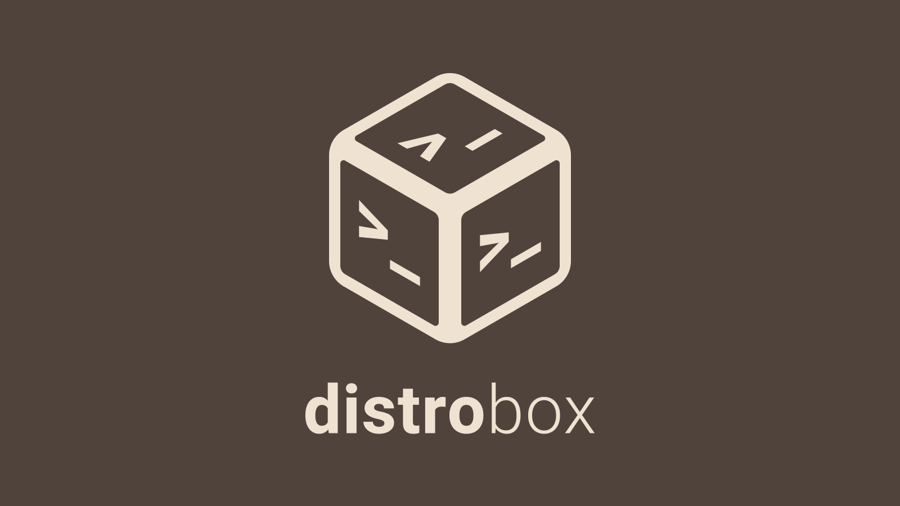
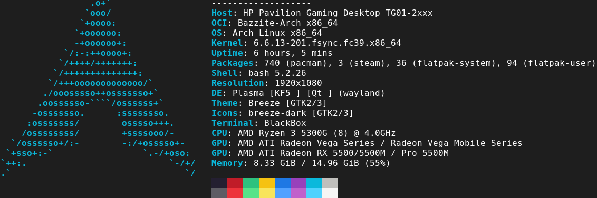
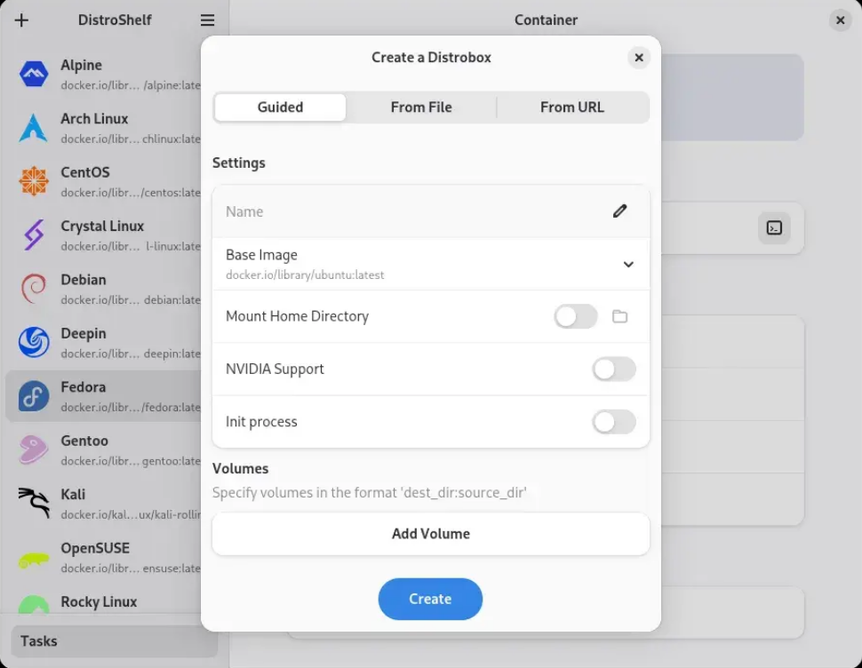

# Контейнери Distrobox



## Основи використання { #basic-usage }

Запускайте в Bazzite мінімальні варіанти популярних дистрибутивів Linux у контейнері й користуйтеся пакетами кожного дистрибутива так, щоб їхні залежності й бібліотеки не впливали на хост-систему.

- Контейнери — **не** віртуальні машини.
- Контейнери задумані як **одноразові**, й іноді їх доводиться створювати заново.
- Щоб отримувати програми цим способом, **потрібно розуміти, як встановлюються пакети в традиційних операційних системах Linux**.
  - Спершу створіть тестовий контейнер, щоб ознайомитися з базовими командами Linux.

Контейнери Distrobox запускають підсистеми інших популярних [дистрибутивів Linux](https://distrobox.it/compatibility/#containers-distros) з доступом до їхніх менеджерів пакетів (`apt`, `dnf`, `pacman` тощо), форматів пакетів (`.deb`/`.rpm`) і додаткових репозиторіїв, як-от [AUR](https://aur.archlinux.org/). Контейнери Distrobox можна використовувати і як **середовища розробки**, і для **встановлення застосунків, недоступних іншими способами встановлення**, бо деякі з них є лише для певних менеджерів пакетів.

### **Приклади дистрибутивів Linux**: { #linux-distribution-examples }

| ОС                                  | Менеджер пакетів    | Пошук пакетів                                                       |
| ----------------------------------- | ------------------ | ------------------------------------------------------------------------- |
| [Fedora][fedora]                    | [`dnf`][dnf]       | [Пакети Fedora][fedora_pkgs] / [Пакети COPR][copr]                    |
| [Arch][arch]                  | [`pacman`][pacman] | [Пакети Arch Linux][arch_pkgs] / [Пакети AUR][aur_pkgs]               |
| [Debian][debian] / [Ubuntu][ubuntu] | [`apt`][apt]       | [Пакети Debian][deb_pkgs] / [Пакети Ubuntu][ubuntu_pkgs] ([PPA][ppa]) |
| [openSUSE][osuse]                   | [`zypper`][zypper] | [Пакети openSUSE][osuse_pkgs]                                           |
| [Void][void]                  | [`xbps`][xbps]     | [Пакети Void Linux][void_pkgs]                                          |
| [Alpine][alpine]              | [`apk`][apk]       | [Пакети Alpine Linux][alpine_pkgs]                                      |

#### Приклад контейнера Distrobox з Arch Linux: { #arch-linux-distrobox-container-example }



<small>_I use Arch (у контейнері) btw._</small>

## Сценарії використання { #use-cases }

Контейнери Distrobox можна використовувати і як **середовища розробки**, і для **встановлення застосунків, недоступних іншими способами встановлення**, бо деякі з них є лише для певних менеджерів пакетів.

## Графічний інтерфейс для Distrobox { #distrobox-graphical-interface }



Створювати контейнери Distrobox і керувати ними можна в графічному застосунку, який уже встановлено: [**Kontainer**](https://github.com/DenysMb/Kontainer) на нових встановленнях з KDE Plasma або [**DistroShelf**](https://github.com/ranfdev/DistroShelf) на образах з GNOME і старіших встановленнях з KDE Plasma.

## Інтеграція з робочим столом { #desktop-integration }

Застосунки з графічним інтерфейсом можна інтегрувати в систему з ярликом у меню, якщо експортувати застосунок такою командою у вікні термінала контейнера:

```bash
distrobox-export --app <package>
```
Щоб скасувати експорт застосунку, введіть цю команду у вікні термінала контейнера:

```bash
distrobox-export --delete --app <package>
```

## Створення попередньо налаштованих контейнерів Distrobox вручну { #manually-create-pre-configured-distrobox-containers }

```command
ujust distrobox-assemble
```

Виберіть контейнер, який хочете використовувати.

> **Для досвідчених користувачів**: описуйте власні контейнери Distrobox за [документацією `distrobox-assemble`](https://distrobox.it/usage/distrobox-assemble/).

### Вхід у контейнер { #entering-the-container }

Перемикайтеся між контейнерами в хост-системі через термінал або **введіть**:

```
distrobox enter <container>
```

## Видалення контейнерів Distrobox { #removing-distrobox-containers }

Видаляйте контейнери в графічному застосунку Kontainer або DistroShelf.

Або скористайтеся командним рядком:

```command
distrobox stop <container_name>
```

```commmand
distrobox rm -f <container_name>
```

## Відеопосібник з Distrobox { #distrobox-video-guide }

https://youtu.be/5m0YfIiypwA

## Сайт проєкту { #project-website }

https://distrobox.it/

[fedora]: https://fedoraproject.org/
[dnf]: https://docs.fedoraproject.org/en-US/quick-docs/dnf/
[fedora_pkgs]: https://packages.fedoraproject.org/index-static.html
[copr]: https://copr.fedorainfracloud.org/
[arch]: https://archlinux.org/
[pacman]: https://wiki.archlinux.org/title/Pacman
[arch_pkgs]: https://archlinux.org/packages/
[aur_pkgs]: https://aur.archlinux.org/packages?SB=l&SO=d
[debian]: https://www.debian.org/
[ubuntu]: https://ubuntu.com/
[apt]: https://ubuntu.com/server/docs/package-management
[deb_pkgs]: https://packages.debian.org/stable/
[ubuntu_pkgs]: https://packages.ubuntu.com/
[ppa]: https://launchpad.net/ubuntu/+ppas
[osuse]: https://get.opensuse.org/
[zypper]: https://documentation.suse.com/smart/systems-management/html/concept-zypper/index.html
[osuse_pkgs]: https://search.opensuse.org/packages/
[void]: https://voidlinux.org/
[xbps]: https://docs.voidlinux.org/xbps/index.html
[void_pkgs]: https://voidlinux.org/packages/
[alpine]: https://www.alpinelinux.org/
[apk]: https://wiki.alpinelinux.org/wiki/Alpine_Package_Keeper
[alpine_pkgs]: https://pkgs.alpinelinux.org/packages
