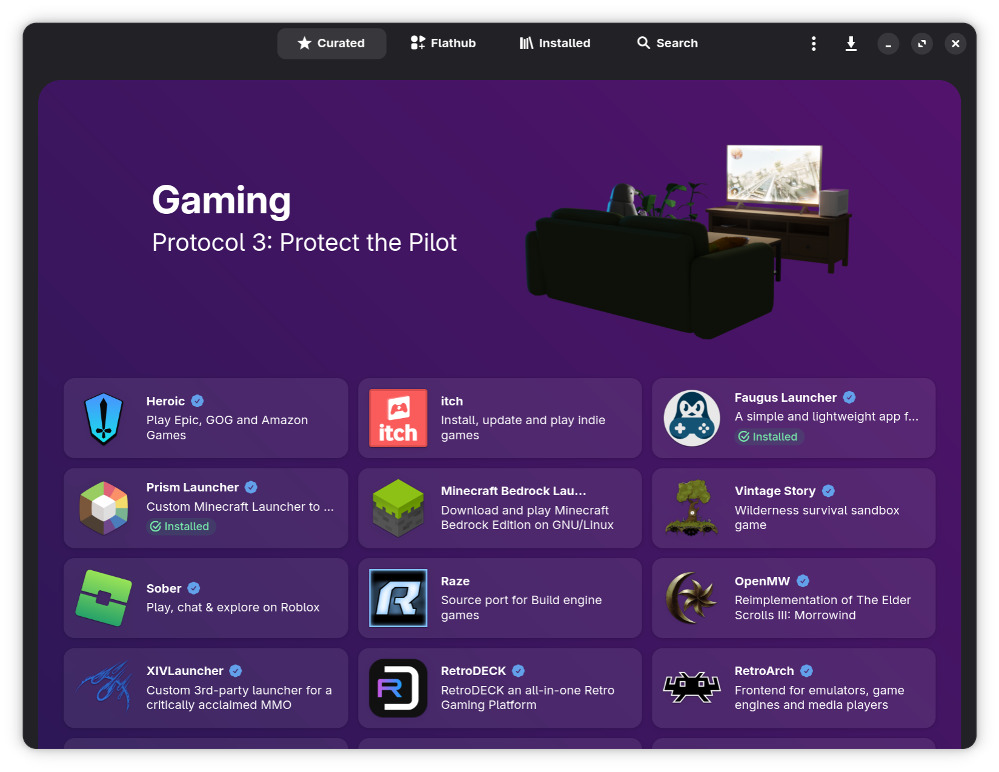

# Магазин застосунків Bazaar



## Призначення { #purpose }

Bazaar — **основний спосіб встановлювати застосунки в Bazzite** _(окрім невеликого набору програм, доступних у [Bazzite Portal](./Bazzite_Portal.md) або як [команда `ujust`](./ujust.md))_. Коли це можливо, більшість програм рекомендуємо встановлювати саме з Bazaar, а не в інших форматах. Bazaar — це графічний інтерфейс для [Flatpak](https://flatpak.org/)-застосунків з [Flathub](https://flathub.org/).

## Що таке Flatpak? { #what-is-flatpak }

Flatpak — універсальний формат пакунків у контейнерах, який намагається ізолювати застосунки за допомогою гнучких дозволів, що визначають, до чого застосунок має доступ у вашій системі. Це **основний спосіб встановлювати застосунки в Bazzite**, і саме його ми рекомендуємо, за винятком кількох програм із Bazzite Portal, які мають пріоритет. Flatpak-застосунки можна встановлювати, оновлювати й видаляти в графічному інтерфейсі через магазин застосунків Bazaar.

### Встановлення через термінал { #terminal-installation }

**Або відкрийте термінал основної системи і введіть**:

```
flatpak install <application>
```

## Керування Flatpak-застосунками { #manage-flatpaks }

Керуйте Flatpak-застосунками за допомогою [Flatseal](https://github.com/tchx84/Flatseal) і [Warehouse](https://github.com/flattool/warehouse) — обидва попередньо встановлені.

### Flatseal { #flatseal }

**Flatseal** дає змогу за потреби змінювати [дозволи застосунків](https://github.com/tchx84/Flatseal/blob/92e675e5ad2129f2aabf324261570eef442494f6/DOCUMENTATION.md).

Іноді на сайті проєкту або в його [репозиторії на GitHub](<https://github.com/flathub/com.discordapp.Discord/wiki/Rich-Precense-(discord-rpc)#flatpak-applications>) є інформація про те, які дозволи потрібно змінити для певної функції.

### Warehouse { #warehouse }

**Warehouse** — утиліта з графічним інтерфейсом, яка дає змогу **повертатися до старіших версій застосунків**, на власний ризик додавати джерела Flatpak, окрім Flathub, і створювати резервні копії даних застосунків.

## Сайт проєкту { #project-website }

https://github.com/kolunmi/bazaar
