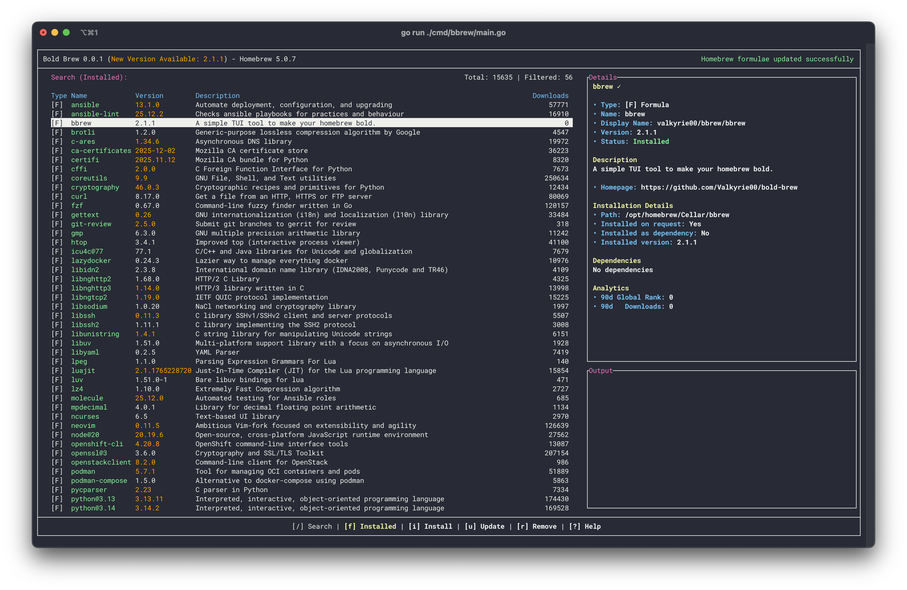

# Homebrew

## Що таке Homebrew? { #what-is-homebrew }


!!! note

    Будь-яка [формула](#formulae-and-casks), якій потрібні права root, потребуватиме або контейнера Distrobox із правами root, або накладання через `rpm-ostree`.

Homebrew — менеджер пакетів, який встановлює пакети у власний префікс. Його здебільшого використовують для застосунків з інтерфейсом командного рядка (CLI) і текстовим інтерфейсом (TUI). Homebrew також може встановлювати графічні застосунки з прапорцем `--cask`, але більшість із них для macOS, бо підтримка cask у Linux ще розвивається. Встановлюйте пакети в застосунку Bold Brew або в терміналі командою нижче.

Встановлюйте пакети в терміналі хост-системи цією **командою**:

```
brew install <package>
```

!!! note

    Лише для систем із кількома користувачами або нетипових налаштувань: для встановлення пакетів Homebrew знадобляться права root (`sudo`), бо Homebrew встановлює їх від імені користувача `linuxbrew`.

## Формули й cask { #formulae-and-casks }

Homebrew встановлює два види пакетів:

- **Формули** (formulae) — програми командного рядка, наприклад `go` або `node`. Вони встановлюються в префікс Homebrew (`/home/linuxbrew/.linuxbrew`).
- **Cask** — готові застосунки, здебільшого графічні, а також шрифти. Графічні cask додають ярлик у меню застосунків. [Bazzite Portal](./Bazzite_Portal.md) встановлює деякі застосунки як cask, наприклад Visual Studio Code (`visual-studio-code-linux`).

Команда вище встановлює формули. Щоб встановити cask, додайте `--cask`:

```
brew install --cask <cask>
```

!!! note

    Деякі cask змінюють системні файли, наприклад додають системну службу. Під час встановлення, оновлення або видалення такі cask можуть запитувати пароль через `sudo`. Якщо автоматичне оновлення не може оновити такий cask, оновіть його вручну в терміналі:

    ```
    brew upgrade --cask <cask>
    ```

    Якщо запит пароля не з'являється і команда завершується помилкою `sudo`, запустіть її так. Тоді `sudo` запитає пароль у терміналі, а не в окремому вікні:

    ```
    env -u SUDO_ASKPASS brew upgrade --cask <cask>
    ```

## Bold Brew { #bold-brew }



Застосунок [Bold Brew](https://bold-brew.com/) має текстовий інтерфейс (TUI) для встановлення поширених пакетів Homebrew.

## Шрифти { #fonts }

Homebrew також використовують для встановлення шрифтів: перегляньте [цю сторінку](https://formulae.brew.sh/cask-font/) і встановіть улюблені шрифти. Вони будуть скопійовані в `~/.local/share/fonts`

- Шрифти Microsoft:

Якщо вам потрібні шрифти Microsoft для сумісності з деякими документами, більшість із них є в Homebrew.

Пам'ятайте, що авторські права на деякі з цих шрифтів належать Microsoft.
Microsoft UK підтвердила, що ви можете ними користуватися, якщо маєте копію одного з цих продуктів:

- Microsoft PowerPoint Viewer (безплатний, більше не підтримується)
- Можливо, PowerPoint Mobile (безплатний)
- Microsoft Office (будь-яка версія, для Windows або Mac)

Calibri, Cambria, Candara, Consolas, Constantia і Corbel входять до font-microsoft-office, решту треба встановлювати окремо. Встановити всі одразу можна такою командою в терміналі:

```
brew tap colindean/fonts-nonfree && brew install --cask font-microsoft-office font-microsoft-aptos font-arial font-arial-black font-courier-new font-times-new-roman font-georgia
```

## Сайт проєкту { #project-website }

https://brew.sh/
