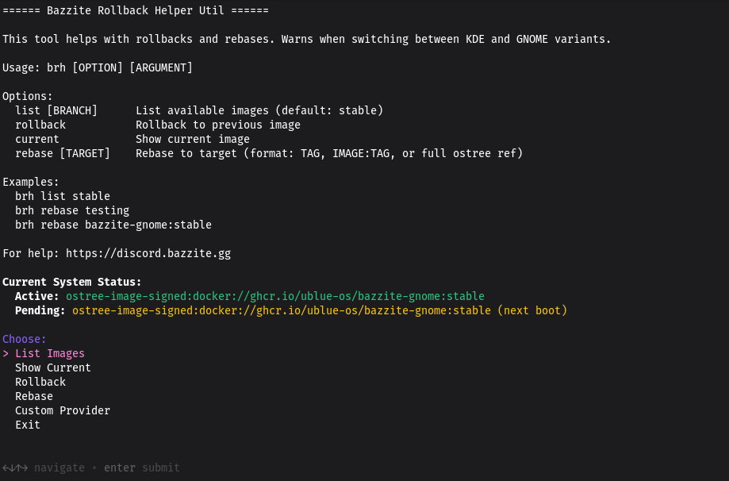

# Bazzite Rollback Helper (`brh`)



!!! note

    [Bazzite Portal](/Installing_and_Managing_Software/Bazzite_Portal.md) показує команди Bazzite Rollback Helper у графічному інтерфейсі.

---

## Призначення

`bazzite-rollback-helper` — це утиліта командного рядка, яка спрощує відкат оновлень системи та зміну **варіанта образу** / **гілки оновлень**. Базова команда `rpm-ostree rebase` вимагає вказувати для перебазування **повне посилання ostree**, а `brh rebase` автоматично доповнить решту за вас.

> Докладні посібники з перебазування можна знайти [тут](/Installing_and_Managing_Software/Updates_Rollbacks_and_Rebasing/rebase_guide.md).

---

## Використання `bazzite-rollback-helper`

Відкрийте термінал хост-системи та **введіть** таку команду, щоб увійти в інтерактивний режим:

```bash
brh
```

Можна також ввести повну назву, якщо вам _дуже_ хочеться друкувати:

```bash
bazzite-rollback-helper
```

---

## Доступні параметри

| Параметр | Дія |
| :-: | :- |
| `list` | Показати образи за останні 90 днів, на які можна перебазуватися |
| `rollback` | Повернутися до попереднього розгортання після наступного перезавантаження |
| `current` | Показати інформацію про поточне розгортання та образ |
| `rebase` | Перейти на іншу збірку, гілку оновлень або інший образ Fedora **на власний ризик** |

!!! example

    `bazzite-rollback-helper list` покаже доступні образи bazzite.

    `bazzite-rollback-helper rebase <image-name:stable>` — щоб перебазуватися на раніший образ, іншу гілку оновлень або інший образ Bazzite (для настільних ПК чи Bazzite-Deck).  Версію можна знайти за допомогою команди `list`.

!!! tip "Щоб повернутися до попереднього розгортання, використовуйте псевдонім `bruh moment`"

---

### Перебазування на старіший образ Bazzite

> Див. [Посібник з перебазування](/Installing_and_Managing_Software/Updates_Rollbacks_and_Rebasing/rebase_guide/#rebasing-to-older-builds)

---

## Відеоінструкція з Bazzite Rollback Helper

https://www.youtube.com/watch?v=XvljabnzgVo

---
