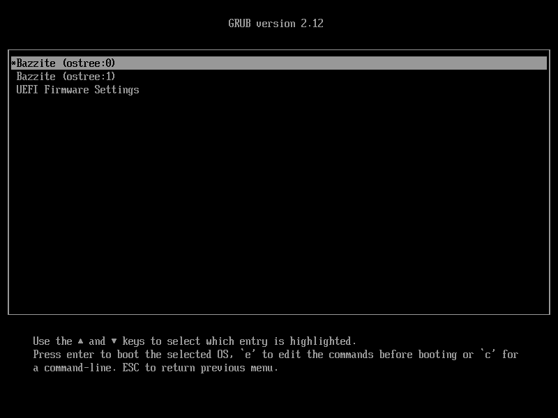

# Rollbacks

## Rolling Back Upgrades

Bazzite provides multiple ways to swap back to a previous system version if there are major issues after updating.

> If you are encountering issues with rollbacks between Bazzite Deck 43 and Bazzite Deck 44, instructions to resolve it are [here](#issue-with-rollbacks-between-bazzite-deck-43-and-44).

=== "Using Bazzite Updater"

    If you have access to a graphical session, you may rollback using the Bazzite Updater.
    
    > The rollback menu can be accessed [here](/Installing_and_Managing_Software/Updates_Rollbacks_and_Rebasing/bazzite_updater/#rollback-updates).
    
    If your devices boots into a black screen, use the [**Before Booting Bazzite (GRUB)**](#__tabbed_1_3) method.

=== "Using the Command Line"

    Use this method if you are in the following situation:

    - If a new Bazzite update cannot initialize a graphical session
    
    If you are stuck in a command line or `tty` and the Desktop Environment(KDE/GNOME) cannot start properly, you may use the following command to set the backup deployment as primary:

    ```bash
    rpm-ostree rollback
    ```

    and then reboot.

    !!! tip "You may also use `bruh moment` as a more memorable alias."

=== "Before Booting Bazzite (GRUB)"

    Use this method if you are in the following situation:

    - If a new Bazzite update cannot be booted successfully

    

    !!! tip "Controls may vary with different handhelds or HTPC setups to navigate the menu and an external physical keyboard may be required to rollback in GRUB."

    If a new Bazzite update (also known as deployment) fails to boot, the GRUB bootloader menu will need to be used to boot the previous(backup) deployment.
    
    Simply select the `ostree:1` backup entry to boot into the previous deployment. 
    
    From there, you will need to use **any of the other methods** to set the backup deployment as primary. Otherwise, the system will keep trying to boot the new (and potentially broken) deployment on the next restart.
    
    !!! info 
    
        Bazzite should automatically show the GRUB bootloader menu if it fails to boot. If it does not show up, you may need to press <kbd>esc</kbd> once and tap <kbd>↓</kbd>.
        
        If you have set the GRUB menu timeout to **Skip Menu**, then you will also need to hold <kbd>Shift</kbd> or <kbd>F8</kbd>.
        
        Rollback does not affect personal files.

---

## Saving a Deployment

Bazzite automatically cleans up the oldest deployment after an update. By default, the system will have 2 deployments always available.

To keep a specific version of Bazzite always available, you can **pin** the deployment to prevent it from being cleaned up. You may follow the instructions shown below:

1. Find the index number of the deployment you'd like to pin with this command:

```bash
rpm-ostree status -v
```

!!! info "The index number will be shifted after every `rpm-ostree` transaction. If you are unsure, check it again with the aforementioned command."

2. Run the following command, replacing `<id>` with the actual index number:

```bash
sudo ostree admin pin <id>
```

!!! example

    The command to pin the current deployment will be:
    ```bash
    sudo ostree admin pin 0
    ```
    The command to pin the previous deployment will be:
    ```bash
    sudo ostree admin pin 1
    ```

---

## Unpinning a Saved Deployment

Unpinning a saved deployment follows similar steps to saving it.

1. Find the index number of the deployment you'd like to unpin with this command:

```bash
rpm-ostree status -v
```

!!! info "The index number will be shifted after every `rpm-ostree` transaction. If you are unsure, check it again with the aforementioned command."

2. Run the following command, replacing `<id>` with the actual index number:

```bash
sudo ostree admin pin -u <id>
```

!!! example

    The command to unpin the current deployment will be:
    ```bash
    sudo ostree admin pin -u 0
    ```
    The command to unpin the previous deployment will be:
    ```bash
    sudo ostree admin pin -u 1
    ```

---

## Application Update Downgrades

Flatpak applications can be easily managed and downgraded in Warehouse.

> Read about the pre-installed Warehouse application [here](/Installing_and_Managing_Software/Flatpak.md#warehouse).

---

## Issue with Rollbacks Between Bazzite Deck 43 and 44

Autologin will be broken when rolling back from Bazzite Deck 44 to Bazzite Deck 43.

To fix this, simply delete any files prefixed with `zz-` under `/etc/sddm.conf.d/`

!!! tip "These typically include the following: `zz-steamos`, `zz-bazzite`, `zz-holo-autologin.conf`, `zz-bazzite-autologin.conf` and `zz-steamos-autologin.conf`"

> Read more about Bazzite Deck 44 [here](https://universal-blue.discourse.group/t/bazzites-biggest-update-deck-44-has-launched-happy-birthday-to-universal-blue/12373). You may report any relevant regressions under [this Discord support thread](https://discord.com/channels/1072614816579063828/1539396706712555712).

---
