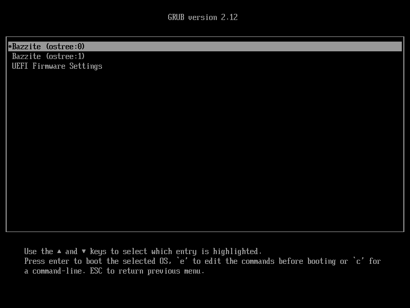

# Відкати

## Відкат оновлень

Bazzite пропонує кілька способів повернутися до попередньої версії системи, якщо після оновлення виникли серйозні проблеми.

> Якщо у вас проблеми з відкатом між Bazzite Deck 43 і Bazzite Deck 44, інструкцію з їх усунення можна знайти [тут](#issue-with-rollbacks-between-bazzite-deck-43-and-44).

=== "За допомогою Bazzite Updater"

    Якщо вам доступний графічний сеанс, можна відкотити оновлення за допомогою Bazzite Updater.
    
    > Меню відкату можна відкрити [тут](./bazzite_updater.md#rollback-updates).
    
    Якщо пристрій завантажується в чорний екран, скористайтеся способом [**Перед завантаженням Bazzite (GRUB)**](#__tabbed_1_3).

=== "Через командний рядок"

    Використовуйте цей спосіб у такій ситуації:

    - нове оновлення Bazzite не може запустити графічний сеанс
    
    Якщо ви застрягли в командному рядку або `tty` і робоче середовище (KDE/GNOME) не запускається, можна зробити резервне розгортання основним такою командою:

    ```bash
    rpm-ostree rollback
    ```

    а потім перезавантажитися.

    !!! tip "Також можна використати псевдонім `bruh moment`, який легше запам'ятати."

=== "Перед завантаженням Bazzite (GRUB)"

    Використовуйте цей спосіб у такій ситуації:

    - нове оновлення Bazzite не вдається завантажити

    

    !!! tip "Керування меню може відрізнятися на різних портативних консолях і HTPC, і для відкату в GRUB може знадобитися зовнішня фізична клавіатура."

    Якщо нове оновлення Bazzite (його ще називають розгортанням) не завантажується, потрібно скористатися меню завантажувача GRUB, щоб завантажити попереднє (резервне) розгортання.
    
    Просто виберіть резервний пункт `ostree:1`, щоб завантажити попереднє розгортання. 
    
    Після цього потрібно скористатися **будь-яким іншим способом**, щоб зробити резервне розгортання основним. Інакше під час наступного перезавантаження система знову намагатиметься завантажити нове (і, можливо, зламане) розгортання.
    
    !!! info 
    
        Bazzite має автоматично показати меню завантажувача GRUB, якщо система не завантажилася. Якщо меню не з'являється, можливо, потрібно один раз натиснути <kbd>esc</kbd>, а потім <kbd>↓</kbd>.
        
        Якщо для тайм-ауту меню GRUB ви вибрали **Skip Menu**, також потрібно утримувати <kbd>Shift</kbd> або <kbd>F8</kbd>.
        
        Відкат не зачіпає особисті файли.

---

## Збереження розгортання

Після оновлення Bazzite автоматично видаляє найстаріше розгортання. За замовчуванням у системі завжди доступні 2 розгортання.

Щоб певна версія Bazzite завжди була доступна, можна **закріпити** (pin) розгортання, і тоді його не буде видалено. Скористайтеся інструкцією нижче:

1. Знайдіть індекс розгортання, яке хочете закріпити, такою командою:

```bash
rpm-ostree status -v
```

!!! info "Індекс змінюється після кожної транзакції `rpm-ostree`. Якщо не впевнені, перевірте його ще раз командою вище."

2. Виконайте таку команду, замінивши `<id>` на справжній індекс:

```bash
sudo ostree admin pin <id>
```

!!! example

    Команда для закріплення поточного розгортання:
    ```bash
    sudo ostree admin pin 0
    ```
    Команда для закріплення попереднього розгортання:
    ```bash
    sudo ostree admin pin 1
    ```

---

## Відкріплення збереженого розгортання

Відкріплення виконується так само, як і закріплення.

1. Знайдіть індекс розгортання, яке хочете відкріпити, такою командою:

```bash
rpm-ostree status -v
```

!!! info "Індекс змінюється після кожної транзакції `rpm-ostree`. Якщо не впевнені, перевірте його ще раз командою вище."

2. Виконайте таку команду, замінивши `<id>` на справжній індекс:

```bash
sudo ostree admin pin -u <id>
```

!!! example

    Команда для відкріплення поточного розгортання:
    ```bash
    sudo ostree admin pin -u 0
    ```
    Команда для відкріплення попереднього розгортання:
    ```bash
    sudo ostree admin pin -u 1
    ```

---

## Повернення до старіших версій застосунків

Flatpak-застосунками зручно керувати й повертати їх до старіших версій у Warehouse.

> Про заздалегідь встановлений застосунок Warehouse читайте [тут](../Flatpak.md#warehouse).

---

## Проблема з відкатом між Bazzite Deck 43 і 44 { #issue-with-rollbacks-between-bazzite-deck-43-and-44 }

Під час відкату з Bazzite Deck 44 на Bazzite Deck 43 перестає працювати автоматичний вхід.

Щоб це виправити, просто видаліть усі файли з префіксом `zz-` у `/etc/sddm.conf.d/`

!!! tip "Зазвичай це такі файли: `zz-steamos`, `zz-bazzite`, `zz-holo-autologin.conf`, `zz-bazzite-autologin.conf` і `zz-steamos-autologin.conf`"

> Докладніше про Bazzite Deck 44 читайте [тут](https://universal-blue.discourse.group/t/bazzites-biggest-update-deck-44-has-launched-happy-birthday-to-universal-blue/12373). Про пов'язані регресії можна повідомити в [цій темі підтримки в Discord](https://discord.com/channels/1072614816579063828/1539396706712555712).

---
