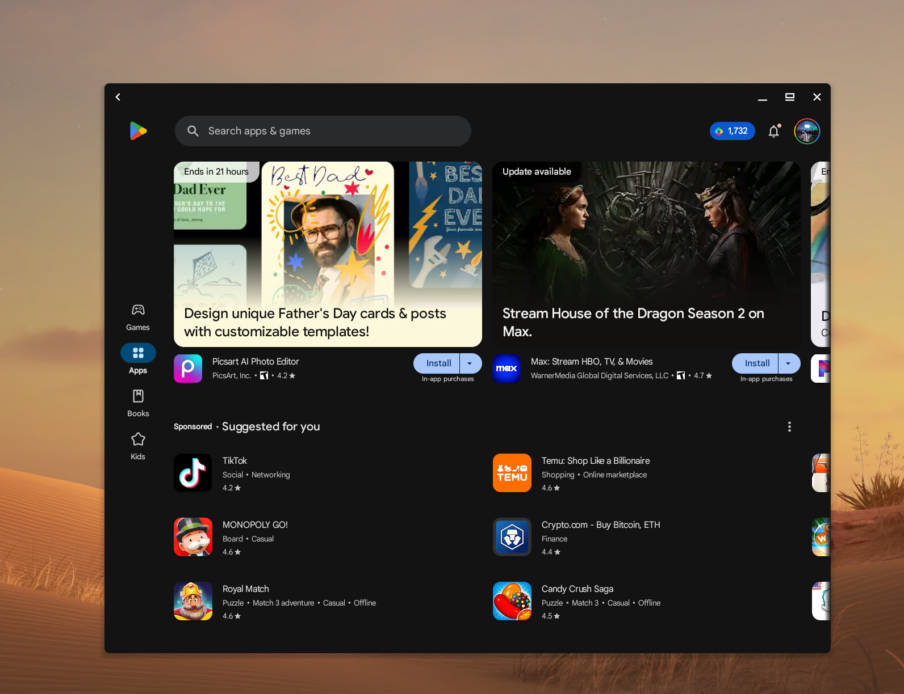
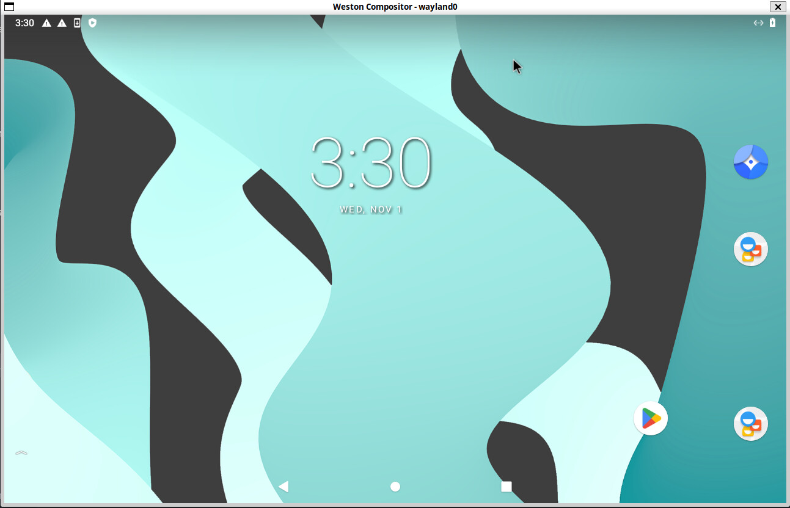
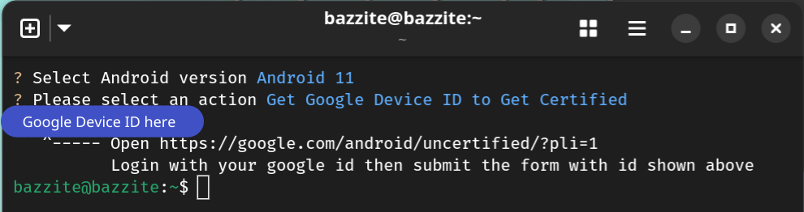
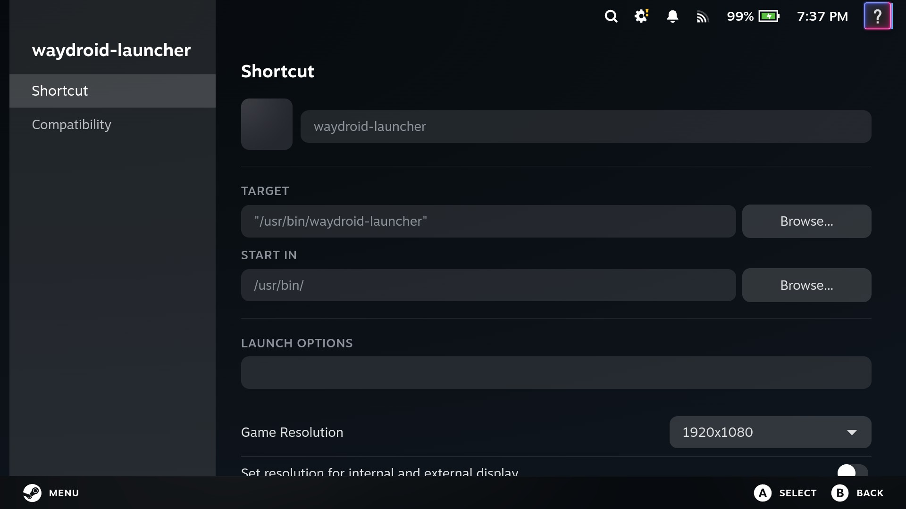
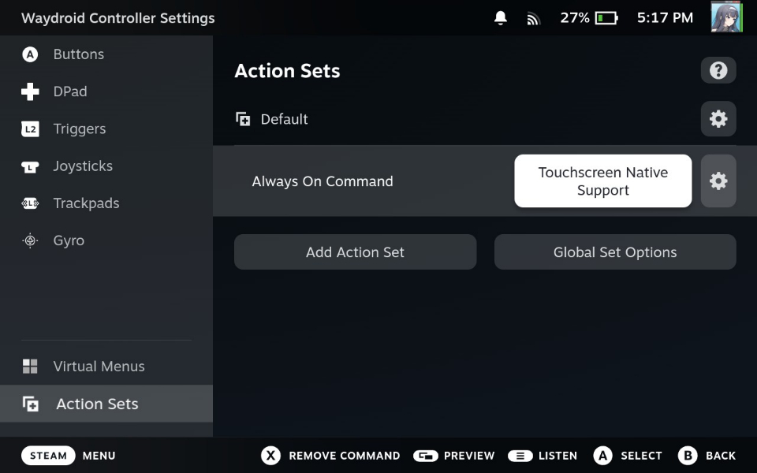
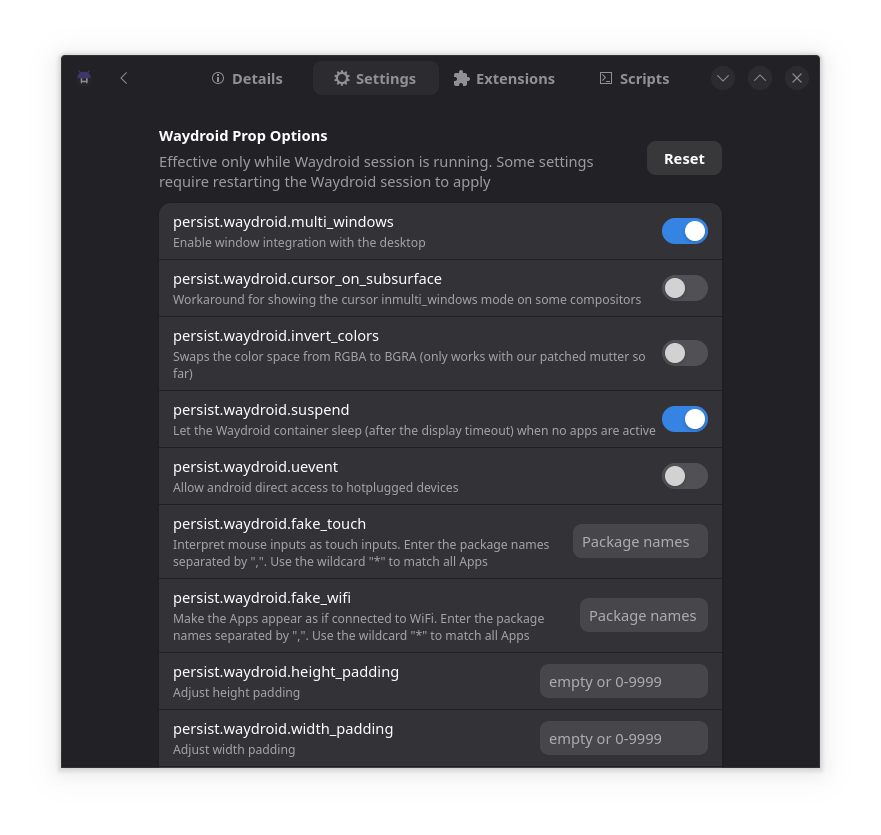

# Налаштування Waydroid

## Що таке Waydroid? { #what-is-waydroid }


    


[Waydroid](https://waydro.id/) — це контейнер Android, який працює в Linux. За його допомогою користувачі Bazzite можуть запускати Android-застосунки.

## Перше налаштування { #first-time-setup }

Відкрийте термінал хост-системи та **введіть цю команду, щоб налаштувати Waydroid**:

```bash
ujust configure-waydroid
```

### Ініціалізація Waydroid { #initialize-waydroid }

Перед першим запуском Waydroid треба ініціалізувати. Для цього виберіть пункт:

```bash
Initialize Waydroid
```

Перевірте, чи все спрацювало, ввівши цю **команду**:

```bash
/usr/bin/waydroid-launcher
```

Вона вперше запустить Waydroid.

### Налаштування Waydroid { #configure-waydroid }

> Налаштуйте свій контейнер Waydroid

#### Крок 1: зупиніть сеанс Waydroid { #part-1-stop-waydroid-session }

Щоб налаштування застосувалися правильно, Waydroid має бути зупинений.

Відкрийте термінал хост-системи та введіть цю **команду**:

```command
waydroid session stop
```

#### Крок 2: налаштування { #part-2-configuration }

Відкрийте термінал хост-системи та введіть цю **команду**:

```
ujust configure-waydroid
```

Пункт `Configure Waydroid` дає змогу встановити додаткові компоненти для Android за допомогою [Waydroid Extras Script](https://github.com/casualsnek/waydroid_script#waydroid-extras-script).

1. Виберіть установлену версію Android. Щоб дізнатися її, запустіть Waydroid, відкрийте застосунок **Налаштування** (Settings) і перейдіть до розділу **Про телефон** (About phone). Версія Android буде 11 або 13.
2. Виберіть, що встановити.

##### Доступні доповнення Waydroid: { #available-waydroid-extras }

- [**GApps**](https://github.com/opengapps/opengapps/wiki/FAQ) (стандартні застосунки Android, зокрема **Google Play Store**) або [microG](https://microg.org/) (вільні альтернативи застосункам Google)

- **Трансляція ARM** (**_libndk_** або **_libhoudini_**)
  - _libhoudini_ загалом має кращу сумісність, ніж _libndk_.
  - Деякі ігри працюють лише з одним із них: _libhoudini_ або _libndk_. В Android 11 _libhoudini_ працюватиме значно повільніше за _libndk_, якщо у вас процесор AMD.
  - **Не встановлюйте обидва одночасно. Якщо потрібно перейти на інший, спершу вилучіть поточний шар трансляції, а потім встановіть новий.**

- [**Magisk**](https://github.com/topjohnwu/Magisk) (набір інструментів для досвідчених користувачів Android)

- [**Підтримка Logitech Smartdock**](https://support.logi.com/hc/en-us/articles/360023201574-What-is-SmartDock) (підтримка обладнання SmartDock)

- [**F-Droid Privileged Extension**](https://f-droid.org/packages/org.fdroid.fdroid.privileged/) (повноцінна підтримка [F-Droid](https://f-droid.org/en/packages/))

- [**`widevine`**](https://widevine.com/) (підтримка DRM для потокового відео)

### Отримання Google Device ID для сертифікації (**GApps**) { #get-google-device-id-to-get-certified-gapps }



1. Запустіть Waydroid
   (**Waydroid має працювати**)

2. Вибравши поточну версію Android, виберіть `Get Google Device ID to Get Certified`, особливо якщо плануєте користуватися Google Play Store (**GApps**).

3. Дотримуйтеся інструкцій, які з'являться в терміналі.

Після перевірки зазвичай минає деякий час, поки пристрій отримає сертифікацію Google Play.

## Додавання до Steam як гри не зі Steam { #add-as-a-non-steam-shortcut }

> Це корисно для [образів Bazzite з ігровим режимом Steam.](../Handheld_and_HTPC_edition/Steam_Gaming_Mode.md)

Щоб Waydroid правильно працював в ігровому режимі Steam, додайте `/usr/bin/waydroid-launcher` у Steam як гру не зі Steam.



### Увімкнення мультисенсорного введення { #enable-multi-touch-support }

Щоб користуватися мультисенсорними жестами у Waydroid в ігровому режимі Steam, увімкніть «Вбудовану підтримку сенсорного екрана» в налаштуваннях контролера Steam:

1. У ярлику Waydroid відкрийте **Налаштування контролера** (Controller Settings).
2. Перейдіть до **Редагувати розкладку** (Edit Layout) > **Набори дій** (Action Sets) > **Стандартний** (Default).
3. Виберіть **Додати команду «Завжди увімкнено»** (Add Always-On command).
4. У розділі **Система** (System) виберіть команду **Вбудована підтримка сенсорного екрана** (Touchscreen Native Support).



<hr>

## Поради та хитрощі для Waydroid { #waydroid-tips-tricks }

Цей розділ присвячено окремим діям і проблемам у Waydroid, що працює в Bazzite.

### Застосунок Waydroid Helper { #waydroid-helper-application }



[waydroid-helper](https://github.com/waydroid-helper/waydroid-helper) — графічний застосунок, який дає змогу детальніше налаштовувати Waydroid і керувати ним.

Щоб встановити його, виконайте цю команду `ujust`:

```bash
ujust configure-waydroid helper
```

Також можна перейти просто до його [випусків](https://github.com/waydroid-helper/waydroid-helper/releases) і встановити останній AppImage за допомогою Gear Lever.

### Вимкнення введення у Waydroid, коли вікно неактивне { #disable-inputs-to-waydroid-when-unfocused }

У Waydroid є [проблема](https://github.com/waydroid/waydroid/issues/135): він отримує введення з контролерів, клавіатур та інших пристроїв введення, навіть коли його вікно неактивне.

Щоб вимкнути це:

!!! note

    Waydroid має працювати!

У терміналі хост-системи **виконайте цю команду**:

```command
waydroid prop set persist.waydroid.uevent false
```

Щоб скасувати цю зміну, виконайте ту саму команду, але з `true` замість `false`.

### Перетворення клацань миші на дотики { #mouse-clicks-to-touch-input }

Деякі застосунки не очікують клацань миші й реагують лише на дотики до сенсорного екрана.

!!! note

    Waydroid має працювати!

Щоб увімкнути це для окремого застосунку, виконайте в терміналі хост-системи цю команду:

```command
waydroid prop set persist.waydroid.fake_touch "PACKAGE_NAME_HERE"
```

!!! note

    Назви пакетів зазвичай мають формат «com.example.appname».
    Назву пакета застосунку можна знайти внизу сторінки **Інформація про додаток** (App info) у застосунку **Налаштування** (Settings).

    Підтримуються й шаблони, тож «com.rovio.*» застосується до всіх ігор Rovio.

    Ось приклад для гри «Fate/Grand Order»:
    `waydroid prop set persist.waydroid.fake_touch "com.aniplex.fategrandorder.en"`

Щоб зміни набули чинності, застосунок у Waydroid треба перезапустити.

!!! warning

    Вказуйте цією командою лише окремі застосунки!
    Якщо застосувати її до всієї системи за допомогою шаблону, курсор миші може поводитися неправильно.

Щоб скасувати ці зміни, виконайте в терміналі хост-системи цю команду:

```command
waydroid prop set persist.waydroid.fake_touch ""
```

### Параметри роздільності й щільності { #resolution-density-options }

Це для користувачів, у яких виникають проблеми з роздільністю чи масштабуванням Waydroid або із запуском Waydroid у вкладеному режимі. Це **необов'язково**.

Відкрийте термінал хост-системи та введіть такі **команди**:

```bash
sudoedit /etc/default/waydroid-launcher
```

```bash
sudoedit /etc/default/steamos-nested-desktop
```

Після змін збережіть текстові файли.

### Виправлення для гібридної графіки у Waydroid { #waydroid-hybrid-graphics-fix }

Це лише для користувачів, у яких кілька відеокарт і в Waydroid з'являються графічні артефакти.

**Введіть у терміналі хост-системи**:

```
ujust configure-waydroid
```

Потім виберіть `Select GPU for Waydroid`: там можна вибрати відеокарту для Waydroid, щоб позбутися графічних артефактів.

### Відеокарти NVIDIA { #nvidia-gpus }

Образи Bazzite для NVIDIA постачаються з `waydroid-nvidia` замість звичайного Waydroid. Він замінює графічний стек, щоб графіку Android обробляла відеокарта NVIDIA, і має три режими драйвера:

| Режим | Як працює | Коли використовувати |
| :--- | :--- | :--- |
| `nvidia-prolapse` (типовий) | Vulkan-драйвер NVK з Mesa працює **всередині** Android і звертається до модуля ядра напряму | майже завжди |
| `glibc-shim` | власний драйвер NVIDIA хост-системи працює всередині Android через бібліотеки сумісності | коли типовий режим працює неправильно |
| `venus` | виклики Vulkan з Android передаються через unix-сокет до рендерера на хост-системі | для старіших встановлень і систем, де інші режими не працюють |

Виберіть режим командою:

```bash
sudo waydroid-nvidia-setup --mode nvidia-prolapse
```

Якщо під час першого налаштування потрібен образ із застосунками Google, додайте `-s GAPPS`:

```bash
sudo waydroid-nvidia-setup --mode nvidia-prolapse -s GAPPS
```

!!! note "Відкриті модулі ядра"

    Цим режимам потрібні **відкриті модулі ядра** NVIDIA. Вони є в образах `bazzite-nvidia-open`; із закритим модулем єдиний робочий варіант — `glibc-shim`. Починаючи з драйвера 615, NVIDIA більше не постачає закритий модуль для Turing і новіших відеокарт.

!!! warning "Запускайте налаштування, коли контейнер зупинено"

    Якщо `waydroid-container` працює, його `vendor.img` уже змонтовано через loop-пристрій, і налаштування завершується помилкою `wrong fs type, bad option, bad superblock on /dev/loop*`. Спершу зупиніть його:

    ```bash
    sudo systemctl stop waydroid-container
    sudo waydroid-nvidia-setup --mode nvidia-prolapse
    ```

!!! warning "Образ vendor прив'язаний до модуля ядра"

    Образ, який встановлює налаштування, прив'язаний до модуля ядра NVIDIA, на якому його запускали. Після оновлення ядра чи драйвера контейнер **не запуститься**, доки налаштування не виконати знову. Ознака в журналі:

    ```
    NVIDIA driver mode nvidia-prolapse: install record ... is invalid
    ```

    Щоб виправити це, знову виконайте `sudo waydroid-nvidia-setup --mode nvidia-prolapse`. Якщо нова версія драйвера не входить у діапазон, який підтримує поточний випуск, дочекайтеся оновлення, а не запускайте налаштування примусово.

!!! tip "Гібридні ноутбуки, де робочий стіл працює на відеокарті NVIDIA"

    У режимі `venus` сервер рендерингу пропонує Android усі пристрої Vulkan хост-системи, а інструментарій інтерфейсу Android завжди бере **перший** із них. Якщо першою йде вбудована відеокарта, жодне вікно не може імпортувати свій буфер і Waydroid нічого не показує. Прив'яжіть сервер рендерингу до NVIDIA:

    ```bash
    mkdir -p ~/.config/systemd/user/wd-venus.service.d
    cat > ~/.config/systemd/user/wd-venus.service.d/20-nvidia-only.conf <<'EOF'
    [Service]
    Environment=VK_ICD_FILENAMES=/usr/share/vulkan/icd.d/nvidia_icd.x86_64.json
    EOF
    systemctl --user daemon-reload
    systemctl --user restart wd-venus
    ```

    Вказуйте точну назву файлу (`nvidia_icd.x86_64.json`): з неправильним шляхом сервер рендерингу залишається без драйвера й постійно перезапускається. Режиму `nvidia-prolapse` це не стосується.

!!! note "Версії Android"

    Офіційні образи Waydroid досі мають Android 13. Новіші версії Android походять зі збірок спільноти й не підтримуються описаним вище налаштуванням.

### Скидання Waydroid { #reset-waydroid }


!!! warning

    Усі ваші дані Waydroid буде втрачено.

Якщо виникли проблеми або вам потрібен чистий контейнер Waydroid, виберіть `Reset Waydroid` після того, як **введете**:

```
ujust configure-waydroid
```
