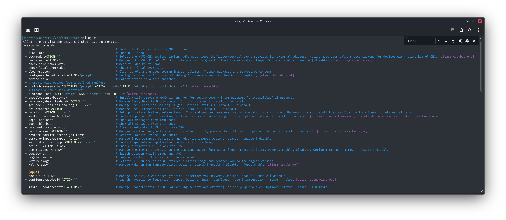
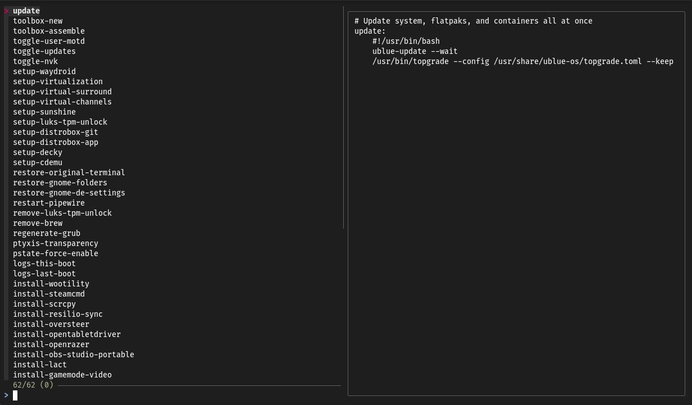

# Команди `ujust`

## Використання { #usage }


!!! note

    Для популярних команд `ujust` можна використовувати застосунок [Bazzite Portal](./Bazzite_Portal.md) як графічний інтерфейс.

Команди `ujust` автоматизують завдання за допомогою скриптів, які можна використовувати для налаштування й обслуговування системи. Також вони можуть встановлювати спеціалізовані програми, для яких супровідники та учасники проєкту підготували скрипти встановлення в Bazzite. Зверніть увагу, що _деякі_ програми, встановлені командами `ujust`, можуть додавати до вашої системи [**накладені пакети**](./rpm-ostree.md), що зазвичай не рекомендовано.


<sub>Ця команда покаже список доступних команд.</sub>

Відкрийте термінал хост-системи та **введіть цю команду**:

```
ujust
```



```
ujust --choose
```

Ця команда покаже текстовий інтерфейс із командами `ujust`, які можна вибирати й запускати стрілками або мишею.

!!! attention

    Команди, яким потрібні значення або прапорці, цим способом не працюють.

### Введення команд вручну { #manually-entering-commands }

**Знайдіть потрібну команду і введіть**:

```
ujust <command>
```

Шукати певні команди можна, **ввівши**:

```
ujust | grep "<search keyword(s)>"
```

- `install-`: встановлює програму. Команд для налаштування чи видалення поки що немає.
    - **Увага**: деякі застосунки, які встановлюються командою `ujust`, можуть накладати пакети на вашу систему.
- `get-`: встановлює «розширення», як-от плагіни Decky. Якщо щось є розширенням, для нього теж можна використовувати `get-`.
- `setup-`: встановлює програму й надає команди для видалення і налаштування після встановлення.
- `configure-`: налаштовує те, що є в образі за замовчуванням.
  - Якщо це спершу треба встановити, команда буде в `setup-`.
- `toggle-`: вмикає або вимикає функцію чи налаштування.
  - Вибір може бути автоматичним або ручним залежно від реалізації.
- `fix-`: виправляє проблему, накладає латку або обходить її.
- `distrobox-`: дієслово лише для Distrobox, яке спрощує роботу з контейнерами.
- `foo`: замініть це назвою команди.
  - Це скорочення, для яких ми вирішили не використовувати дієслово.
    - **Приклади**: `ujust update` і `ujust enroll-secure-boot-key`.

## Перегляд коду кожного скрипту `ujust` { #view-each-ujust-scripts-source-code }

Щоб подивитися, що робить скрипт кожної команди, відкрийте термінал хост-системи та **введіть**:

```
ujust --show <command>
```

Також команди `ujust` можна знайти локально в:
`/usr/share/ublue-os/just`.

!!! note

    У цій теці також є **приховані** команди `ujust`.

## Огляд скриптів `ujust` { #ujust-script-overview }

Тут наведено лише деякі поширені скрипти `ujust` у Bazzite. Їх набагато більше, і всі можна переглянути командою `ujust --choose`, як описано вище.

### Скрипти для обслуговування { #maintenance-scripts }

- `ujust update` — оновлює систему, Flatpak-застосунки й контейнери одночасно.
- `ujust configure-grub` — налаштовує видимість меню завантаження GRUB.
- `ujust fix-reset-steam` — повертає теку Steam у початковий стан, не видаляючи ігри, музику, збереження тощо. Дуже корисно, якщо зі Steam виникають проблеми або в ігровому режимі з'являється порожній екран.
- `ujust fix-proton-hang` — примусово завершує всі процеси, пов'язані з Wine і Proton. Корисно, якщо ігри не запускаються після того, як якась гра закрилася неправильно
- `ujust bios` — перезавантажує пристрій одразу в екран BIOS/UEFI.
- `ujust restart-pipewire` — звук тріщить? Перезапуск PipeWire іноді це виправляє.
- `ujust enroll-secure-boot-key` — реєструє ключ підпису драйвера Nvidia і модулів ядра (KMOD) для Secure Boot. Він потрібен, якщо ви хочете користуватися Bazzite з увімкненим Secure Boot.
- `ujust clean-system` — видаляє старі невикористовувані образи й томи podman, пакети Flatpak і вміст rpm-ostree.

### Скрипти для налаштування й увімкнення функцій { #configurationenabling-scripts }

- `ujust configure-waydroid` — помічник для налаштування Waydroid. Докладніше в [посібнику з налаштування Waydroid](./Waydroid_Setup_Guide.md).
- `ujust setup-virtualization` — встановлює й налаштовує віртуалізацію і VFIO.
- `ujust setup-sunshine` — вмикає або вимикає сервер трансляції ігор Sunshine.
- `ujust setup-luks-tpm-unlock` — вмикає автоматичне розблокування LUKS через TPM.
- `ujust setup-decky` — встановлює й налаштовує Decky Loader.
- `ujust setup-boot-windows-steam` — додає в Steam скрипт для завантаження Windows, що корисно при подвійному завантаженні.
- `ujust enable-tailscale` — вмикає підтримку Tailscale.
- `ujust enable-supergfxctl` — вмикає Supergfxctl, перемикач відеокарт для гібридних ноутбуків.
- `ujust bazzite-cli` — модифікація Bazzite CLI з покращеннями командного рядка в стилі Bluefin. Докладніше в розділі [Інструменти командного рядка Bazzite](../Advanced/bazzite-cli.md).

### Скрипти для вирішення проблем { #troubleshooting-scripts }

- `ujust logs-last-boot` — показує всі повідомлення з попереднього завантаження.
- `ujust logs-this-boot` — показує всі повідомлення з поточного завантаження.
- `ujust device-info` — збирає корисну інформацію про пристрій і завантажує її на pastebin. Дуже корисно, коли ви звертаєтеся по допомогу.

## Сайт проєкту { #project-website }

https://just.systems/man/en/
